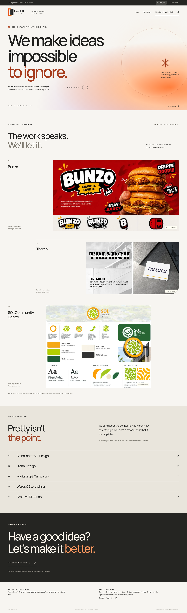
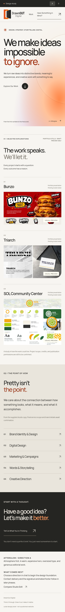
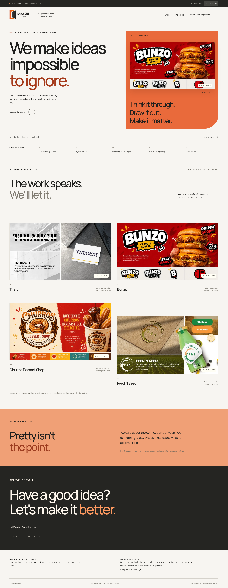
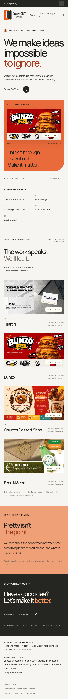

[Services cinematic hero and dark About refinements — galleries and recordings](services-hero/README.md)

[About brand story — approved sketch, responsive pages and real-time recordings](about/README.md)

[Curated portfolio rhythm — Home and Work recordings](portfolio-rhythm/README.md)

[Contact page — desktop, tablet and mobile review](contact/README.md)

[Approved opening project-square gallery and recordings](signature-squares/README.md)

[Earlier opening correction gallery and recordings — PR #4](signature-opening/README.md)

[Historical signature experience gallery before the opening correction](signature/README.md)

[Approved Phase 4 cinematic motion gallery and recordings](phase-4/README.md)

[Approved Phase 3 Work and case-study gallery](phase-3/README.md)

# Phase 0 visual review gallery

The current homepage storytelling work is in the [Phase 2 Afterglow gallery](./phase-2/README.md) on its dedicated review branch. This page preserves Phase 0.

For the completed Phase 1 foundation, open the [Afterglow Phase 1 review gallery](./phase-1/README.md). This page preserves the original Phase 0 alternatives.

These are the existing, full-resolution concept screenshots from the recovered DrawnOut Digital workspace. Open an image to inspect the entire page at its original size. The relative image paths below work directly in GitHub; no cloud workspace access or running development server is needed.

All four original PNG files are preserved without resizing or regeneration. Portfolio artwork is included for design review; the project records remain private drafts and are excluded from the production site build.

## Concept A — Afterglow

Warm atmospheric gradients, expressive typography, and editorial portfolio presentation. Concept A was selected as the working direction in the earlier review.

### Desktop — 1440px

[Open the full-resolution desktop screenshot](./concept-a-1440.png)

### Mobile — 390px

[Open the full-resolution mobile screenshot](./concept-a-390.png)

## Concept B — Studio Edit

Split hero, compact capability index, and paired portfolio presentation. Preserved as the original alternative for comparison.

### Desktop — 1440px

[Open the full-resolution desktop screenshot](./concept-b-1440.png)

### Mobile — 390px

[Open the full-resolution mobile screenshot](./concept-b-390.png)

## Implementation and verification

- [Phase 0 implementation handoff](../docs/PHASE_0_HANDOFF.md)
- [Original Phase 0 validation](../docs/VALIDATION.md)
- [Post-push publishing validation](../docs/PUBLISHING_VALIDATION.md)
- [Publishing recovery and current verification](../docs/PUBLISHING_RECOVERY.md)
- [Repository setup and current implementation](../README.md)

This checkpoint preserves the existing implementation, including the Phase 1 foundation already present from the earlier authorized session. The publication recovery introduces no new design implementation. Phase 0 screenshots remain the review artifacts above; the original historical handoff and validation documents are preserved.
