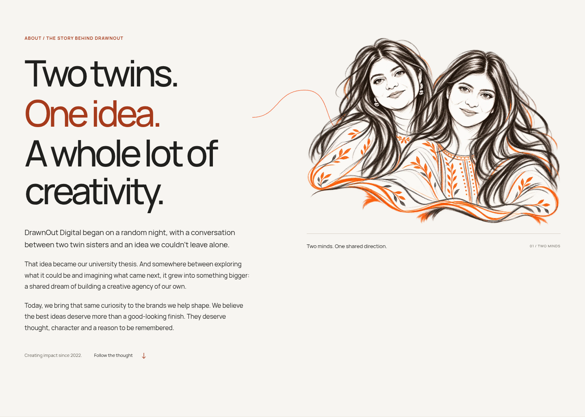
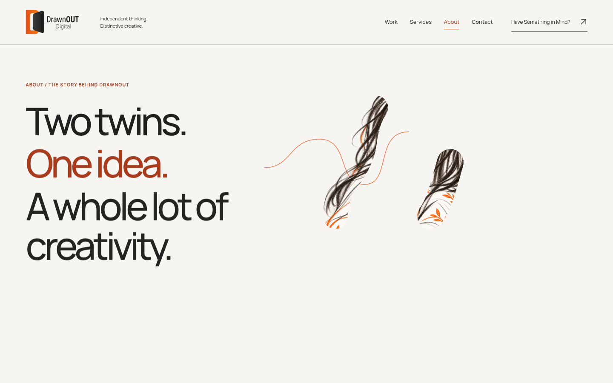
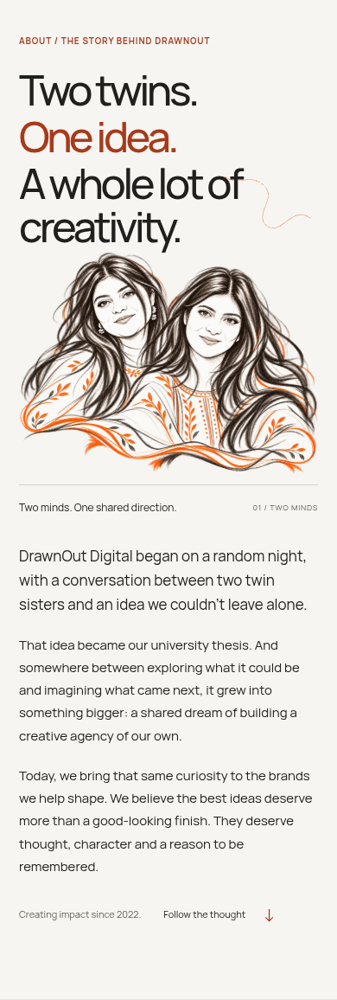
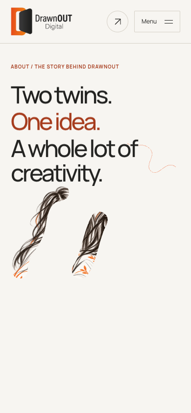
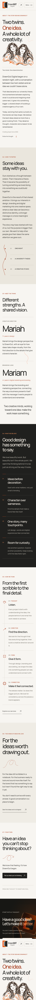
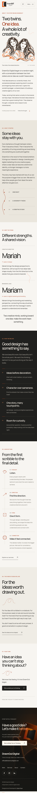
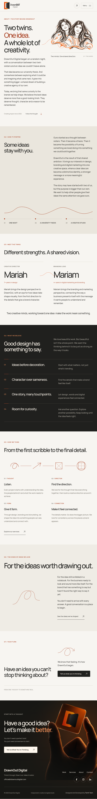
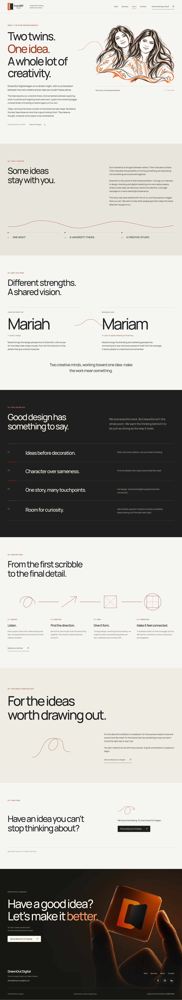
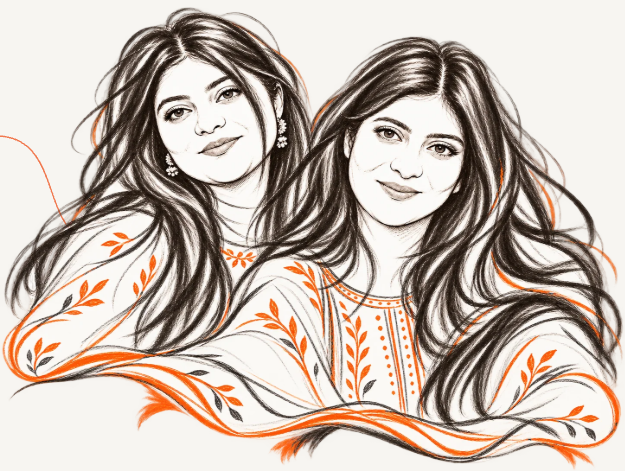

# About — actual production-browser evidence

Native Chromium screenshots and real-time recordings from the local production build. The portrait is the owner-approved derived raster sketch, revealed with broad SVG masks. No original personal photograph or rejected review candidate is included.

[Observed validation](../../docs/next-milestone/ABOUT_PAGE_VALIDATION.md) · [Capture facts, dimensions and hashes](capture-evidence.json) · [Browser test report](browser-tests.json)

## Desktop and mobile hero

### 1440px

[Play real-time hero reveal MP4](about-1440-hero-reveal.mp4) · [Play origin/process forward-reverse and footer MP4](about-1440-origin-process-footer.mp4)

### 390px

[Play real-time hero reveal MP4](about-390-hero-reveal.mp4) · [Play origin/process forward-reverse and footer MP4](about-390-origin-process-footer.mp4)

## Complete responsive pages

### 320px — reduced-motion layout

### 390px — reduced-motion layout

### 768px — reduced-motion layout

### 1440px — reduced-motion layout

## Native no-JavaScript fallback

## Approved portrait on the actual cream background

[Full-resolution transparent approved sketch](../../src/assets/about/founders-sketch-approved.png) · [Editable SVG reveal masks](../../design-assets/about/portrait-reveal-masks.svg) · [Approval and provenance manifest](../../design-assets/about/portrait-manifest.json)

[Full source resolution cream presentation](founders-cream-native-1445.png) — approved derived PNG rendered at 1445×1088 on the same Afterglow paper colour in a standalone browser canvas. The image above is cropped directly from the actual About hero.

## Review limits

Recordings preserve real playback speed and native scrolling. Chromium uses software rendering in this environment; these are visual and interaction observations, not physical-device performance measurements. Founder identity positions are not asserted. The private reference comparison and illustration approval occurred in the conversation and are not reproduced here. Philosophy and approach copy still require final studio editorial approval. Preview indexing remains disabled. No merge, deployment or separate Netlify repository publication was performed.
