# Contact — The First Thought

A short original orange-line study accompanies the approved Contact introduction, then settles. The form and contact methods remain usable throughout. Contact uses the existing page-level loader opt-out so a cold visit reveals this experience immediately; the homepage intro and shared layout sources remain unchanged.

**Form status: unconfigured. No live enquiry or inbox delivery is verified.** Form-state evidence below uses intercepted test fixtures. Owner visual approval, actual Formspree setup, verified recipient and approved privacy policy remain required.

## Actual animation recordings

- [Desktop, 1440px — 8.84 seconds](contact-1440-animation.mp4).
- [Mobile, 390px — 8.36 seconds](contact-390-animation.mp4).
- [Capture provenance, source hashes, real phase clocks and hit tests](contact-capture.json).

These are production Chromium recordings with normal page arrival, native scrolling and typing. The line runs for 4.8 active seconds and stops once; it does not indicate form submission. No timeline seeking, compositing, colour grading or CSS rewrite is used. Mobile means viewport/touch emulation, not physical-device validation.

| Natural phase                   | Desktop                                                              | Mobile                                                             |
| ------------------------------- | -------------------------------------------------------------------- | ------------------------------------------------------------------ |
| 01 — The thought                | 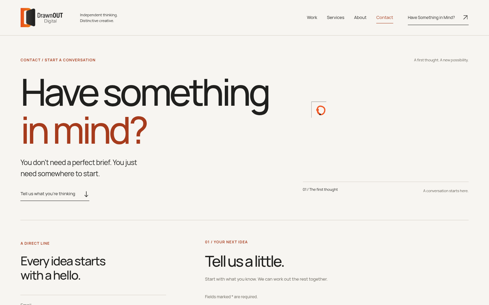                | 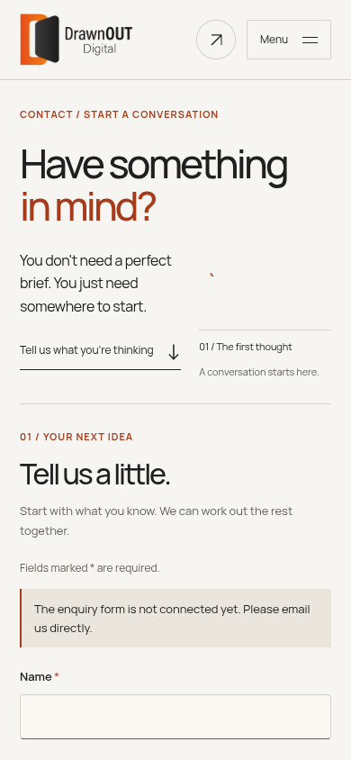                |
| 02 — Finding a connection       | 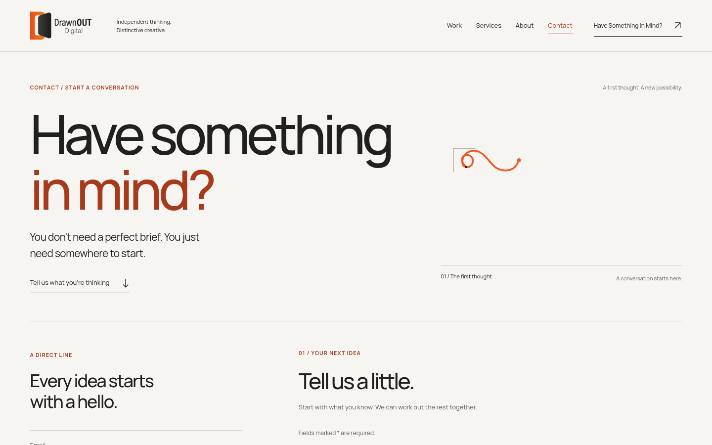  | 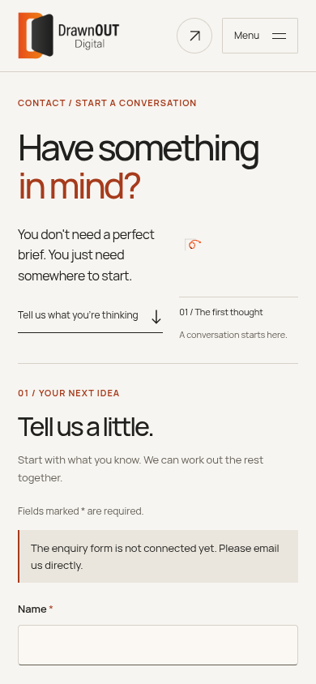  |
| 03 — Beginning the conversation | 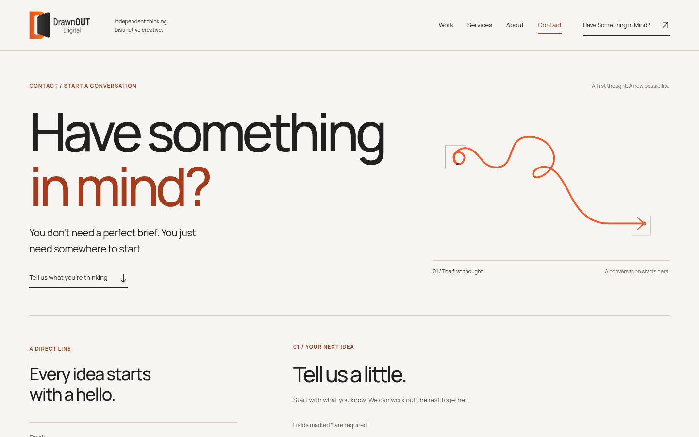 |  |

## Before and after

Both layout views use the real reduced-motion fallback at identical viewport sizes so the whole page can be inspected. Before captures come from immutable parent `106d63ca5d50f4f84a715c407073f6d7c8fc7424`. All original full-resolution PNGs are retained.

### Mobile introduction, 390px

| Before                                                              | After                                                             |
| ------------------------------------------------------------------- | ----------------------------------------------------------------- |
| 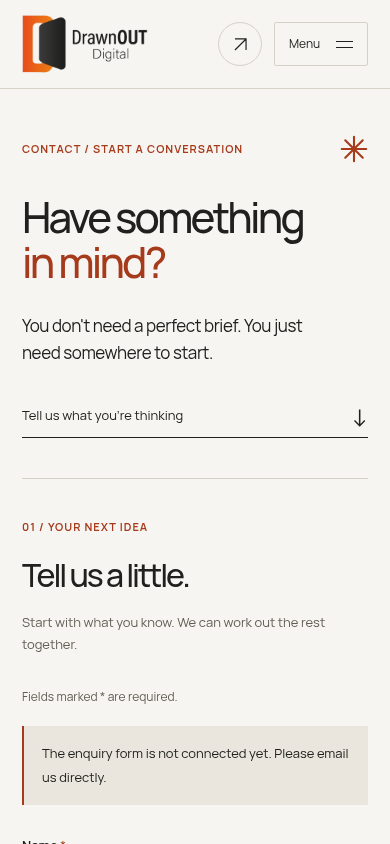 | 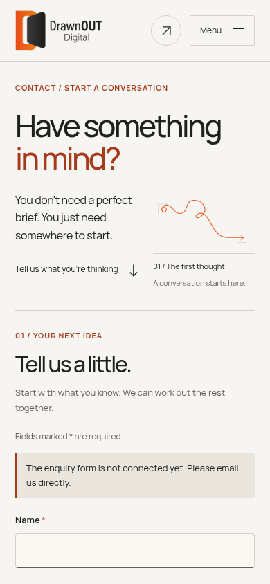 |

### Desktop introduction, 1440px

| Before                                                                | After                                                               |
| --------------------------------------------------------------------- | ------------------------------------------------------------------- |
| 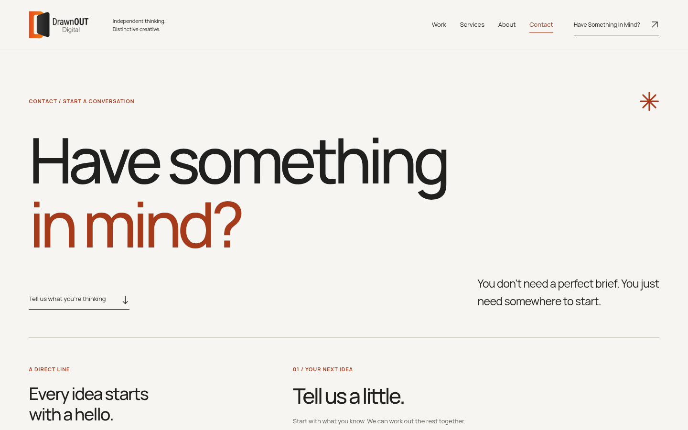 |  |

### Complete Contact pages

| Width  | Original full page                | Completed full page             | Completed introduction                       |
| ------ | --------------------------------- | ------------------------------- | -------------------------------------------- |
| 320px  | [Before](contact-before-320.png)  | [After](contact-after-320.png)  | [Introduction](contact-after-320-intro.png)  |
| 390px  | [Before](contact-before-390.png)  | [After](contact-after-390.png)  | [Introduction](contact-after-390-intro.png)  |
| 768px  | [Before](contact-before-768.png)  | [After](contact-after-768.png)  | [Introduction](contact-after-768-intro.png)  |
| 1024px | [Before](contact-before-1024.png) | [After](contact-after-1024.png) | [Introduction](contact-after-1024-intro.png) |
| 1440px | [Before](contact-before-1440.png) | [After](contact-after-1440.png) | [Introduction](contact-after-1440-intro.png) |
| 1920px | [Before](contact-before-1920.png) | [After](contact-after-1920.png) | [Introduction](contact-after-1920-intro.png) |

| Complete desktop                                                          | Complete mobile                                                         |
| ------------------------------------------------------------------------- | ----------------------------------------------------------------------- |
| 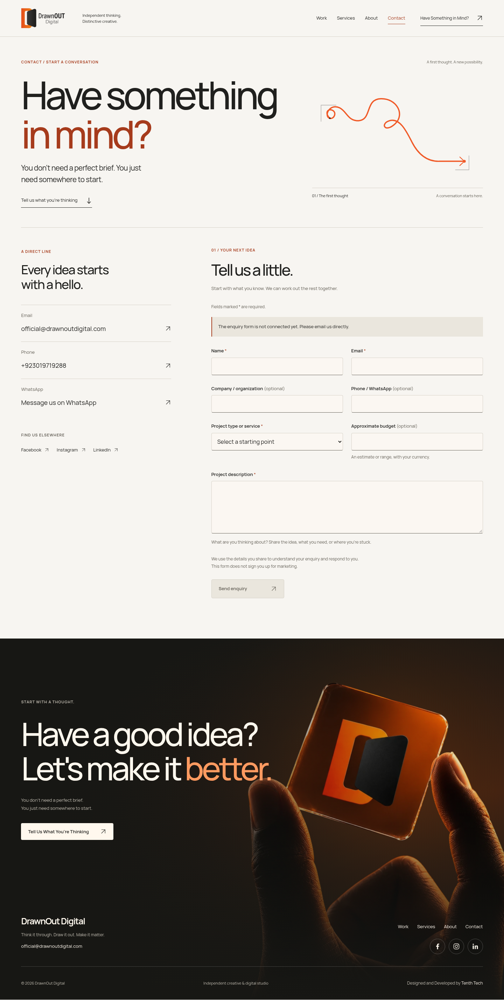 |  |

The compact mobile drawing sits beside the supporting copy. Measured final Name-field position at 390px is 771.14px from the page top; the previous screenshot places it around 865px. The native enquiry anchor remains available without waiting for motion. At 1920px, a corrected type cap keeps the intended two-line headline. [Measured final layouts](layout-measurements.json) / [original capture hashes](baseline-capture.json).

## Static and no-JavaScript behavior

The complete-page views above demonstrate the actual reduced-motion final composition at all six widths. Save Data and failed motion-module loading also retain the static drawing and usable form.

| Mobile without JavaScript                                                           | Desktop without JavaScript                                                            |
| ----------------------------------------------------------------------------------- | ------------------------------------------------------------------------------------- |
|  | 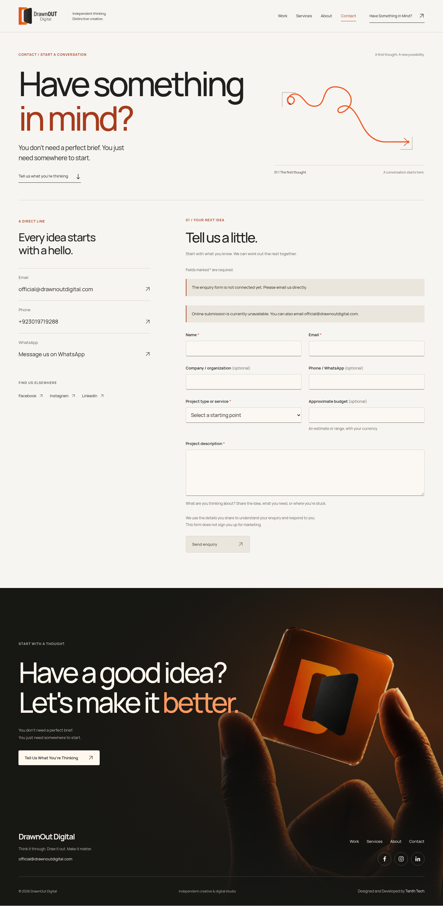 |

## Form interface evidence — intercepted fixtures

These screenshots exercise the interface with synthetic values and intercepted responses. They do not establish a real endpoint, provider account, recipient verification or email delivery. The ordinary production build remains unconfigured with a disabled submit button and working direct-email alternative.

| Fixture state                                              | Mobile                                                                                                                         | Desktop                                                                                                                          |
| ---------------------------------------------------------- | ------------------------------------------------------------------------------------------------------------------------------ | -------------------------------------------------------------------------------------------------------------------------------- |
| Required-field errors and linked summary                   | 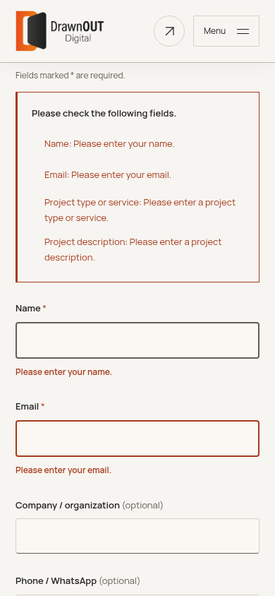                | 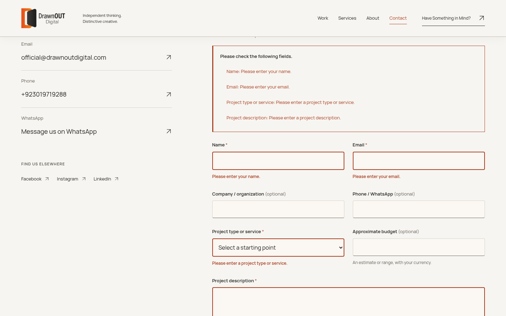                |
| Loading and duplicate prevention                           | 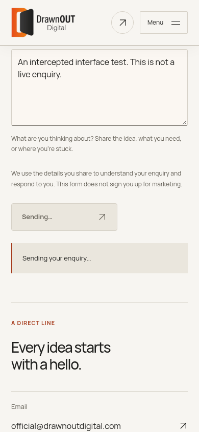                           | 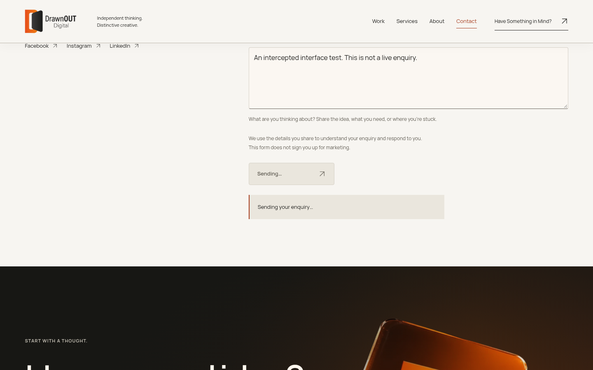                           |
| Simulated provider acknowledgement and subtle confirmation | 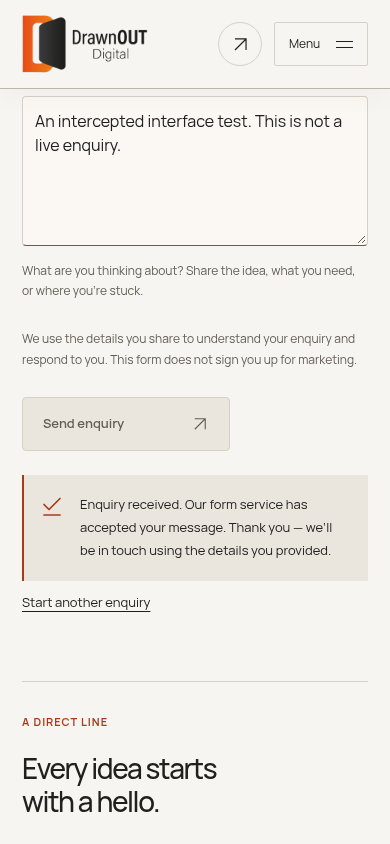 | 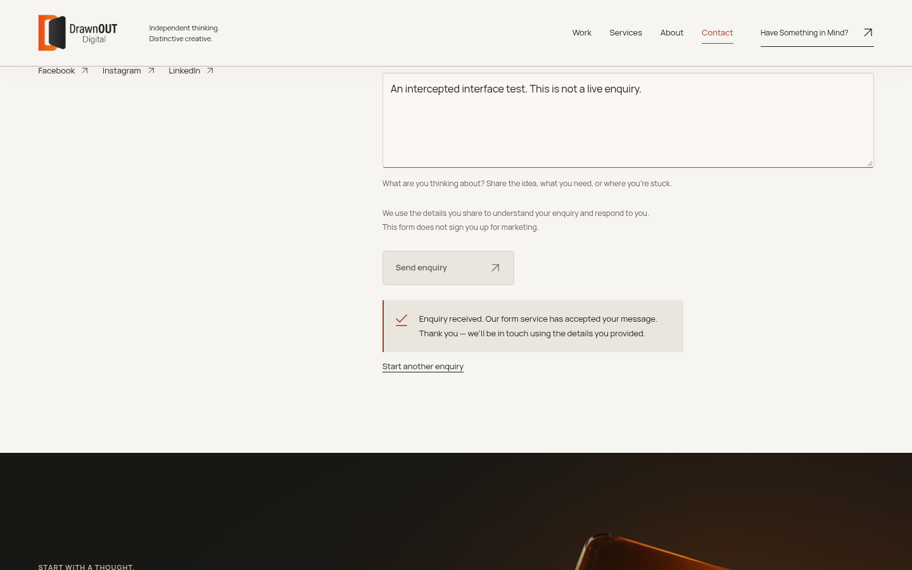 |
| Simulated provider rejection; values retained              | 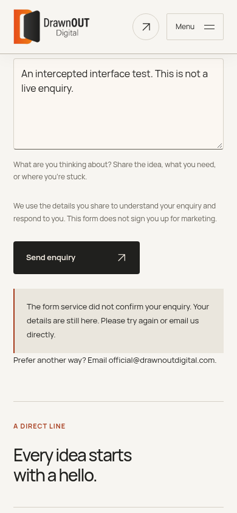              | 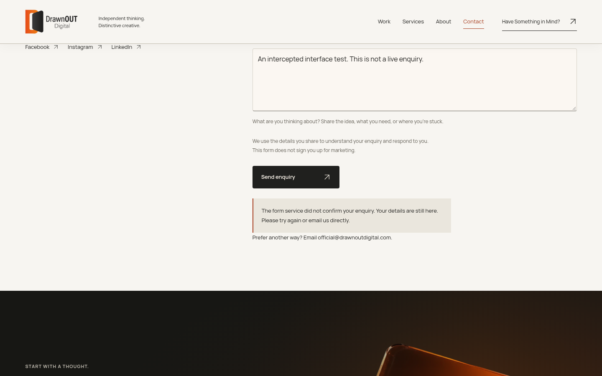              |

The confirmation mark appears only after the existing successful HTTP and explicit JSON acknowledgement gate. Its text describes provider acceptance. Inbox delivery and Reply-To require real owner-controlled verification. Failed, ambiguous and unconfigured states cannot show that mark.

## Source, validation and owner actions

- [Implementation and narrative source](../../docs/contact-signature/IMPLEMENTATION.md).
- [Reproducible SVG](../../src/components/contact/FirstThought.astro), [controller](../../src/scripts/contact-first-thought.ts) and [phase/pause policy](../../src/lib/contact-thought-policy.ts).
- [Owner Formspree activation checklist and missing approvals](../../docs/contact-signature/FORMSPREE_ACTIVATION.md).
- [Final validation / baseline comparison](../../docs/contact-signature/VALIDATION.md), [focused Contact browser results](browser-tests.json), [core and preservation results](core-validation.json).
- [Exact baseline failures recorded before implementation](../../docs/contact-signature/BASELINE.md).

Final review status: **42/42 Contact browser checks pass.** The full unchanged browser suite records **233/244 passing, 11 failing**; raw results, exact baseline comparisons and an unresolved About early-keyboard startup differential are documented in the [validation report](../../docs/contact-signature/VALIDATION.md). The unchanged historical preservation scope audit also retains its explicit failure for newly authorized Contact edits; the current Contact audit freezes 426 protected files. [Machine summary](final-validation.json) / [real native journeys](contact-navigation-smoke.json).

The initial CSS-visibility-only checks missed the existing loader covering the new artwork; real recordings exposed it. Contact now opts out using the shared layout’s existing prop, stronger hit-testing checks pass, and all displayed recordings were recaptured. Rejected recordings stay outside this gallery. The four real desktop/mobile Home/Contact/Work journeys pass; missing Contact loader-only metadata remains an intentional, documented legacy assertion mismatch.

The production-quality 3D hand/footer remains a separate milestone. No merge, live form activation, deployment or Netlify mirror push is part of this review.
