# Contact — visual review

The new Contact page uses the approved Afterglow design and official contact details. **The owner has not configured Formspree yet:** these production screenshots show the honest unconfigured state and working email alternative. No submission or live email delivery is claimed.

[Validation results](../../docs/CONTACT_VALIDATION.md) · [Integration and owner setup](../../docs/CONTACT_HANDOFF.md) · [Capture measurements](capture-evidence.json) · [Browser regression results](browser-verification.json)

Screenshots are unedited Chromium captures of the static production build. Full-page and detail views use the website’s reduced-motion preference; the separately labelled motion views show completed reveals after native scrolling.

## Desktop — 1440px

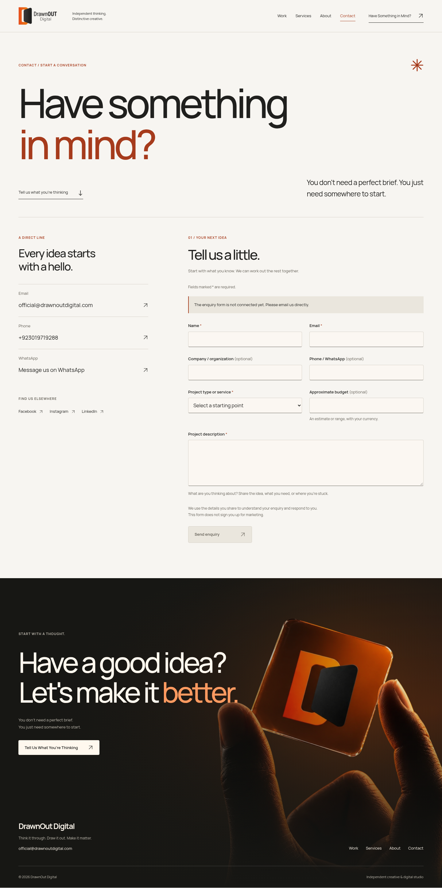

Desktop component views

### Editorial introduction

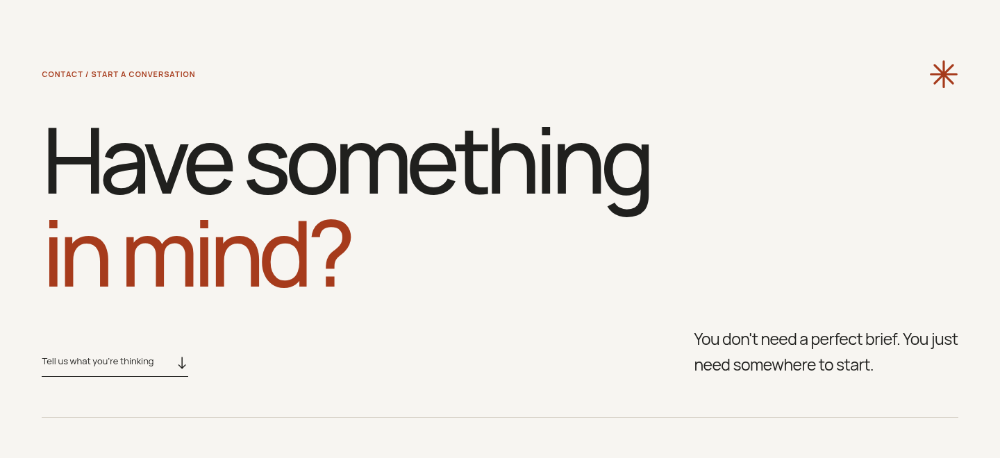

### Enquiry form and email fallback

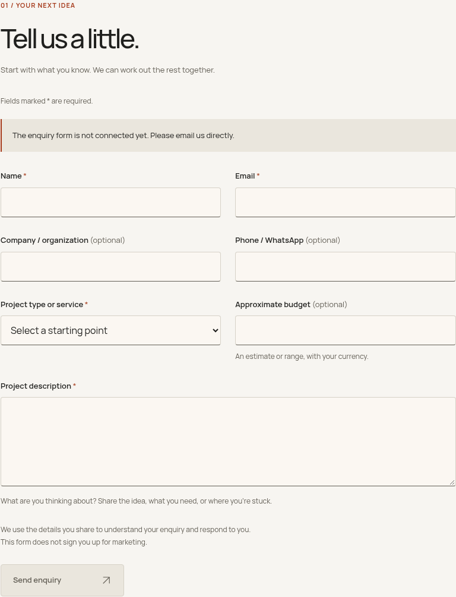

### Direct contact and social links

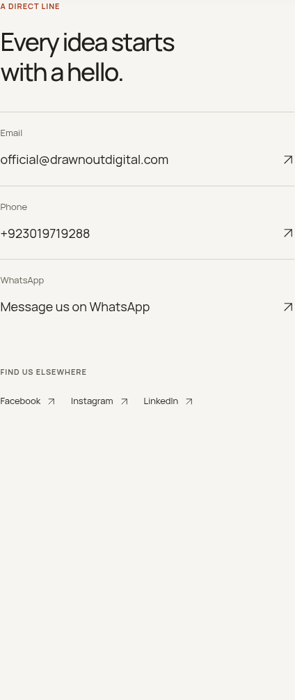

### Preserved signature footer

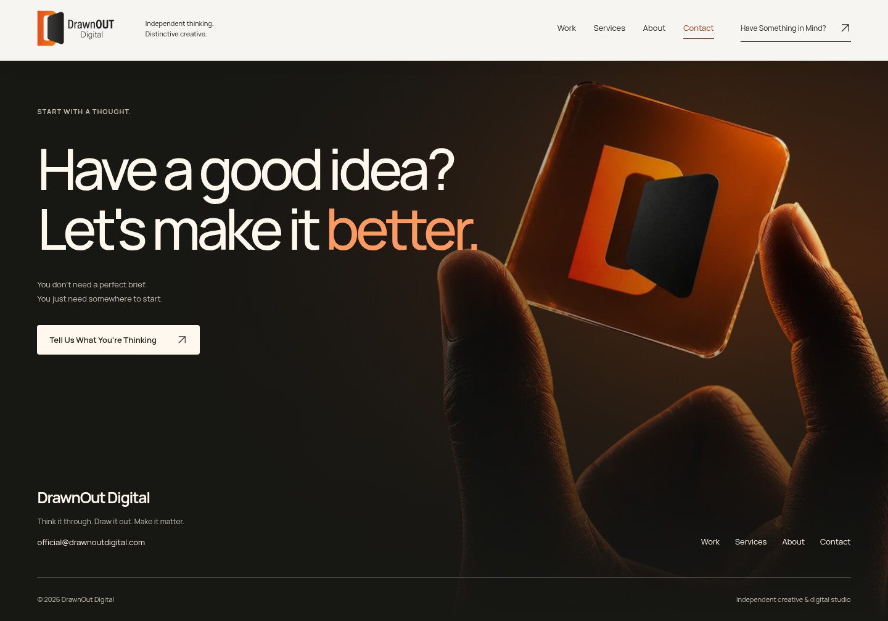

### Introduction after normal-motion reveal

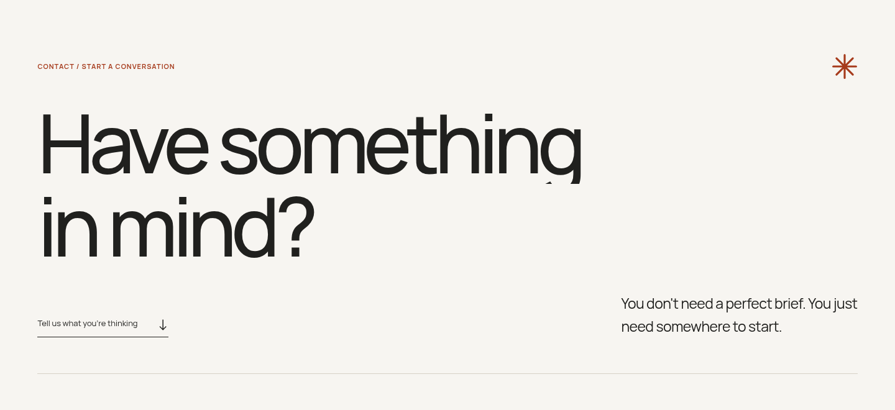

### Footer after native scrolling, normal motion

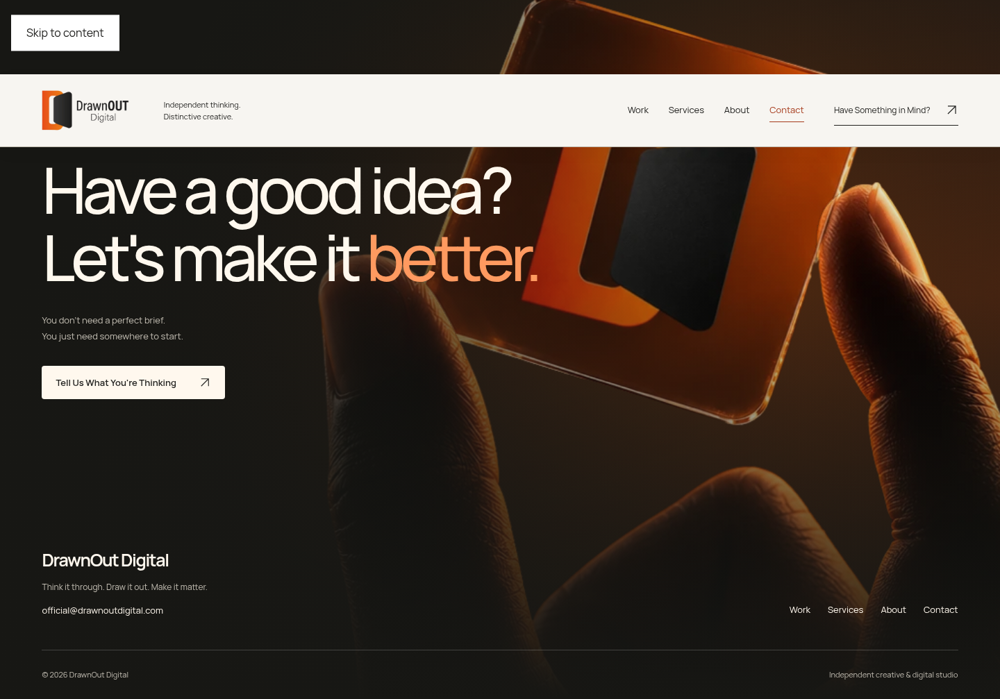

## Tablet — 768px

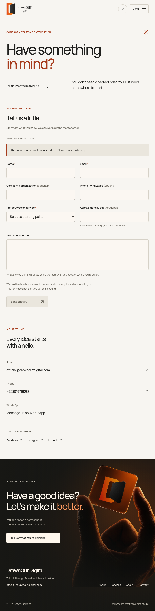

Tablet component views

### Editorial introduction

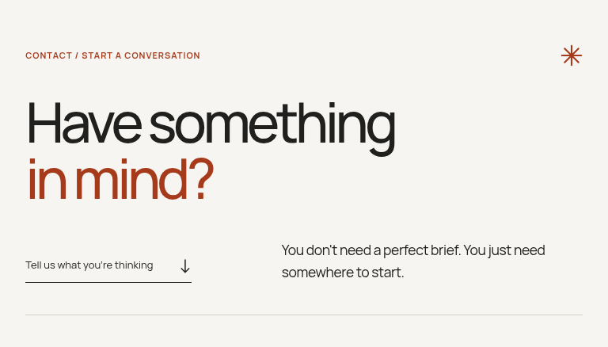

### Enquiry form and email fallback

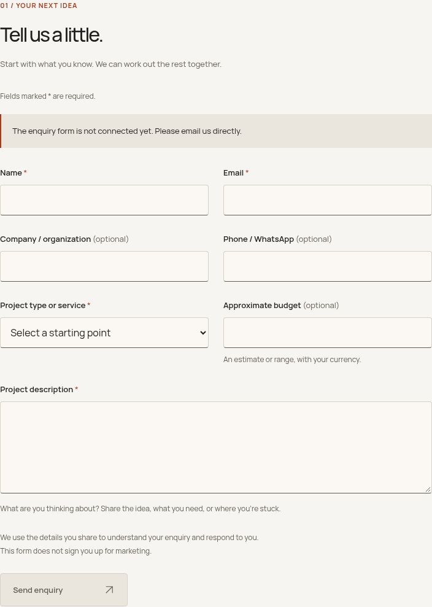

### Direct contact and social links

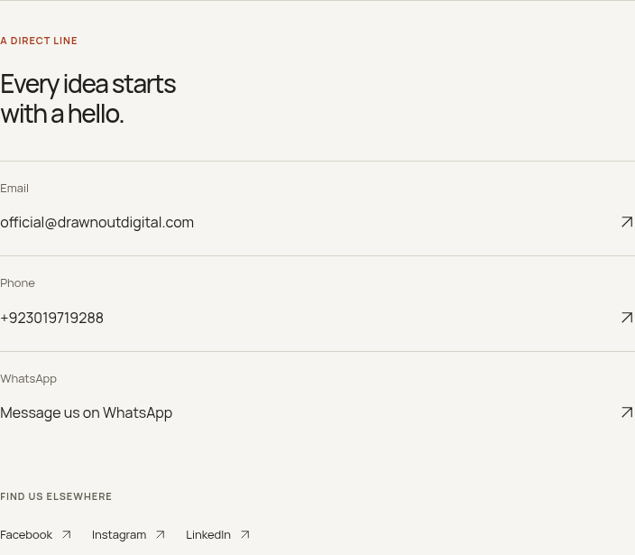

### Preserved signature footer

### Introduction after normal-motion reveal

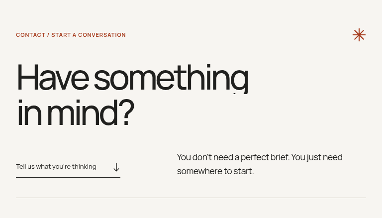

### Footer after native scrolling, normal motion

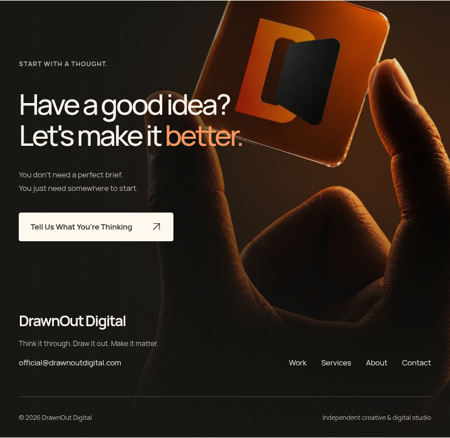

## Mobile — 390px

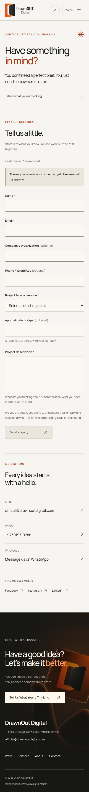

Mobile component views

### Editorial introduction

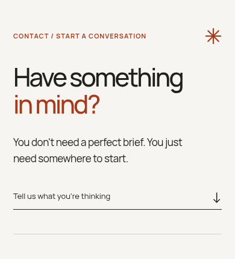

### Enquiry form and email fallback

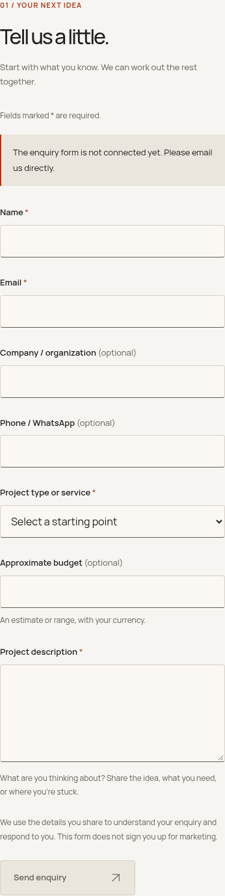

### Direct contact and social links

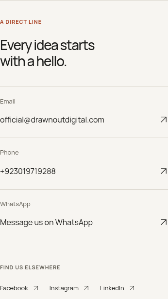

### Preserved signature footer

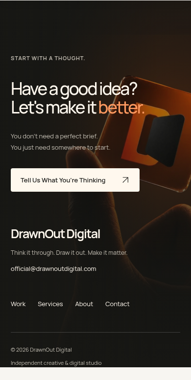

### Introduction after normal-motion reveal

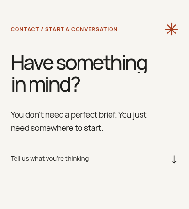

### Footer after native scrolling, normal motion

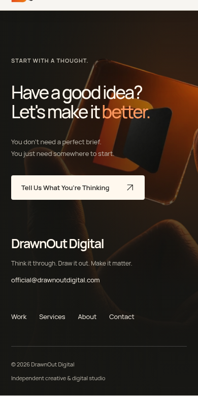

## Submission states

The configured success, failure, timeout and duplicate-submission paths are exercised using intercepted browser test responses. These tests make no external Formspree requests and cannot establish inbox delivery. A real owner-created endpoint, verified recipient, tested delivery and approved DrawnOut privacy policy are required before public form launch.
