# Loader and right-side Afterglow correction

Real headed Chromium recordings from the local production build, captured on 28 October 2026. No animation timelines were sought or sped up. This is visual-review evidence, not approval or a claim about the separately hosted Netlify build.

[Validation report](../../docs/next-milestone/STAGE_A_VALIDATION.md) · [Source diagnosis](../../docs/next-milestone/STAGE_A_STATUS.md) · [Measured browser evidence](evidence.json)

## Desktop 1440px

[Watch full recording (41.12s)](desktop-loader-gradient.mp4)

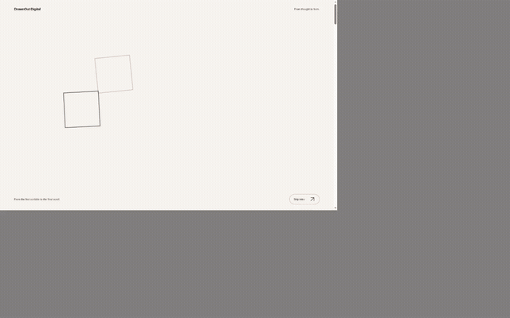

The full recording shows a fresh arrival, eight continuous seconds of autonomous gradient motion, two refreshes, ordinary Contact/Work navigation and each Home/logo return.

| Arrival       | Completes from navigation | Observed visible interval |
| ------------- | ------------------------- | ------------------------- |
| direct        | 4556.6ms                  | 3733ms                    |
| refresh-1     | 4386.6ms                  | 3916ms                    |
| refresh-2     | 4862.3ms                  | 3900ms                    |
| /contact-home | 4303.1ms                  | 3833ms                    |
| /work-home    | 4303.2ms                  | 3850ms                    |

### Gradient at 0 / 2 / 5 / 8 seconds

| 0s                             | 2s                             |
| ------------------------------ | ------------------------------ |
| 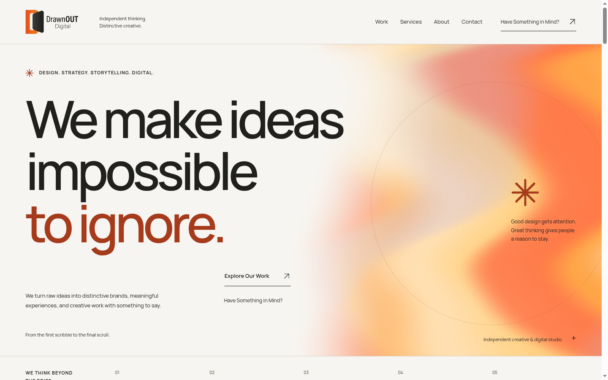 | 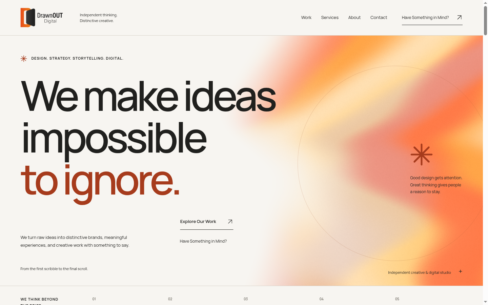 |

| 5s                             | 8s                             |
| ------------------------------ | ------------------------------ |
| 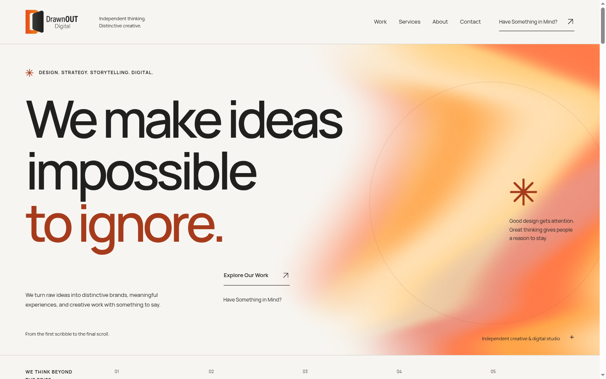 | 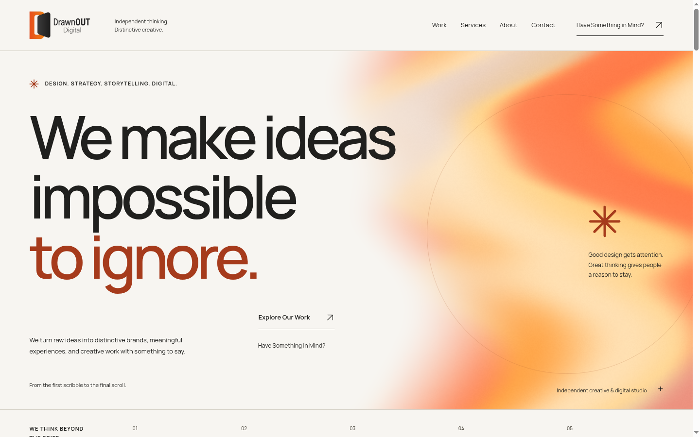 |

Raw shader frames: [0s](gradient-1440-0s-canvas.png), [2s](gradient-1440-2s-canvas.png), [5s](gradient-1440-5s-canvas.png), [8s](gradient-1440-8s-canvas.png).

## Mobile 390px

[Watch full recording (36.48s)](mobile-loader-gradient.mp4)

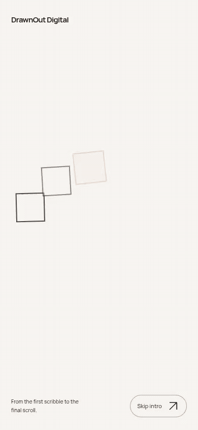

The full recording shows a fresh arrival, eight continuous seconds of autonomous gradient motion, two refreshes, ordinary Contact/Work navigation and each Home/logo return.

| Arrival       | Completes from navigation | Observed visible interval |
| ------------- | ------------------------- | ------------------------- |
| direct        | 4502.0ms                  | 3700ms                    |
| refresh-1     | 4378.4ms                  | 3583ms                    |
| refresh-2     | 4553.3ms                  | 3650ms                    |
| /contact-home | 4289.7ms                  | 3817ms                    |
| /work-home    | 4301.9ms                  | 3866ms                    |

### Gradient at 0 / 2 / 5 / 8 seconds

| 0s                            | 2s                            |
| ----------------------------- | ----------------------------- |
| 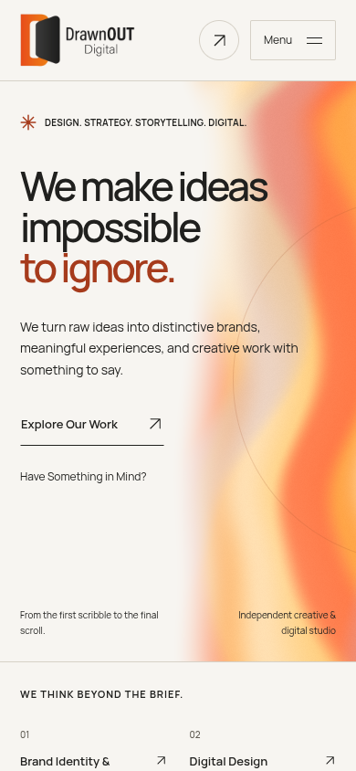 | 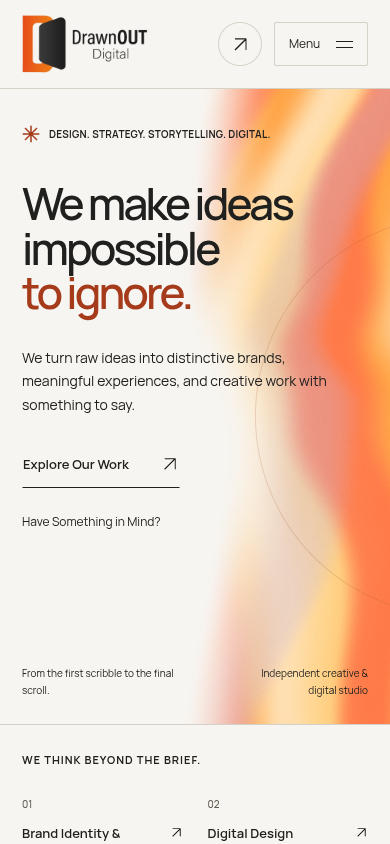 |

| 5s                            | 8s                            |
| ----------------------------- | ----------------------------- |
| 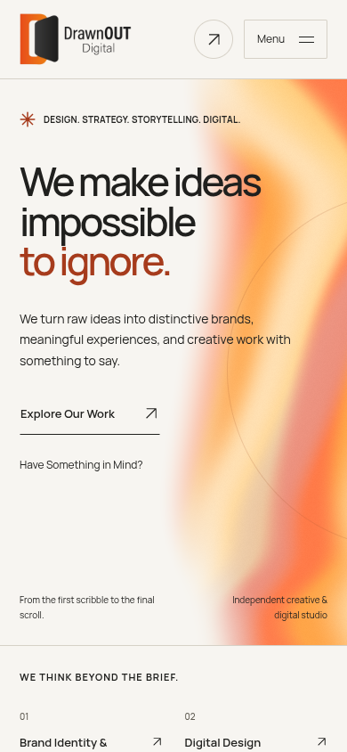 | 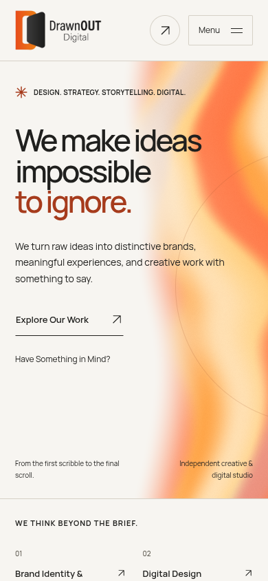 |

Raw shader frames: [0s](gradient-390-0s-canvas.png), [2s](gradient-390-2s-canvas.png), [5s](gradient-390-5s-canvas.png), [8s](gradient-390-8s-canvas.png).

## Accessible and late-start behavior — 1440px

[Watch fallback, Skip and reduced-motion recording](fallbacks-1440.mp4)

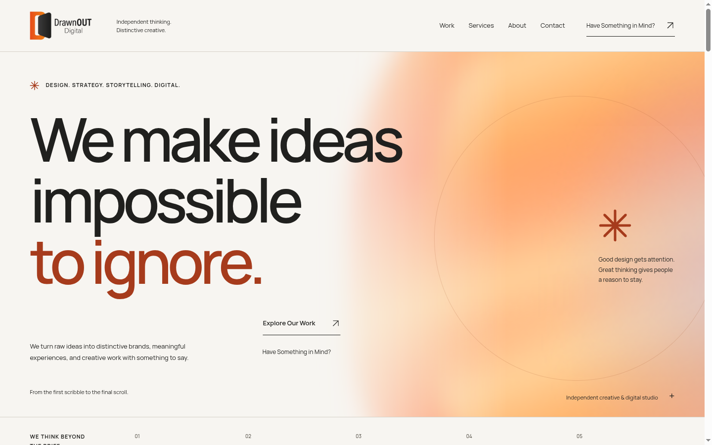

## Accessible and late-start behavior — 390px

[Watch fallback, Skip and reduced-motion recording](fallbacks-390.mp4)

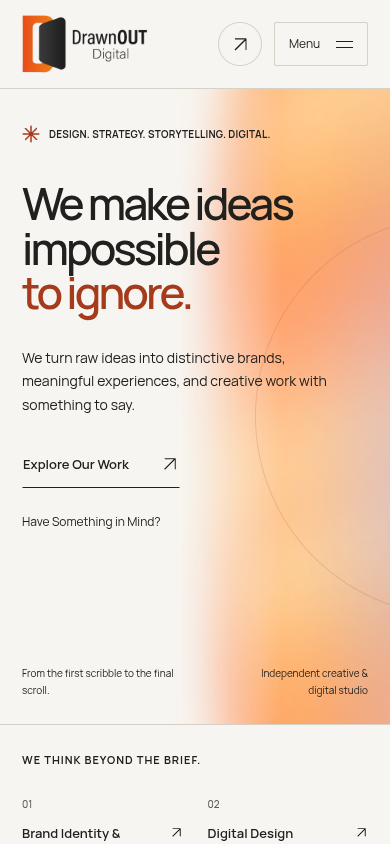

## Review limits

- Cold/warm cache behavior is demonstrated on a local production server. Delayed HTML is an explicit 1300ms latency scenario, not a certification across every mobile network.
- Software WebGL exercises the actual shader; hardware GPU performance and browser/device review remain necessary.
- The supplied hand/plaque is a separated 2D motion prototype, not a rigged photorealistic hand.
- Hosted Netlify SHA and behavior remain unverified because this environment cannot access that host or its separate mirror repository. Nothing was deployed or pushed to that repository.
- Contact retains its unconfigured Formspree fallback. No live email delivery is claimed.
