# Loading milestone — checkpoint review

This is the saved-work checkpoint for issue #6, stacked on `feature/contact-page` (PR #5). The implementation is preserved for review; final acceptance validation is incomplete.

These existing production captures were recorded on 2026-10-28 before the last mobile refresh/zero-scroll and background-animation pause corrections. They are genuine browser evidence, not a final capture of every checkpoint change. No screenshots or recordings were regenerated for this checkpoint.

- [Existing desktop recording — 47.08 seconds](desktop-loading-experience.mp4)
- Final mobile recording: **not completed**.
- [Capture measurements and video timeline](loading-evidence.json)
- [Measured browser results](checkpoint-validation.json)
- [Validation status and remaining checks](../../docs/LOADING_MILESTONE_VALIDATION.md)
- [Implementation handoff](../../docs/LOADING_MILESTONE_HANDOFF.md)

## Existing desktop preview

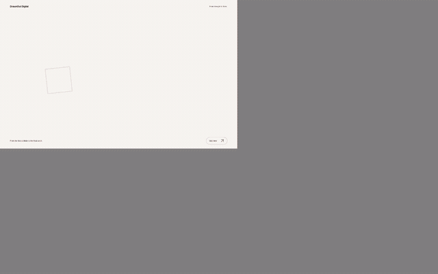

## Opening — desktop 1440px

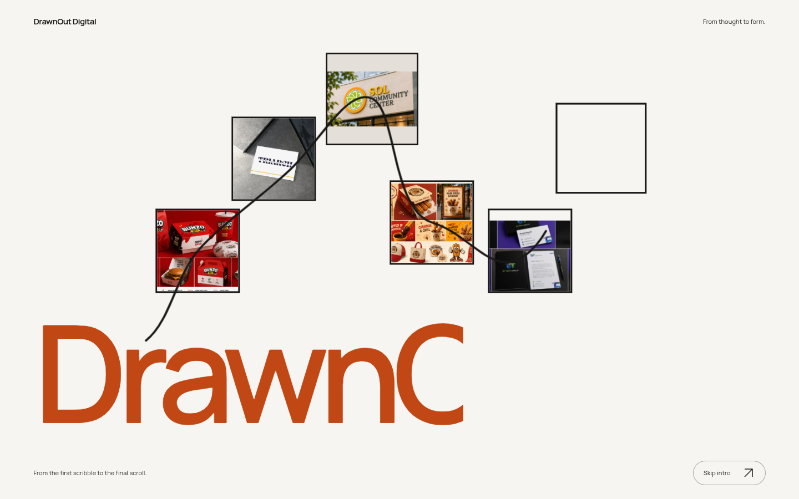

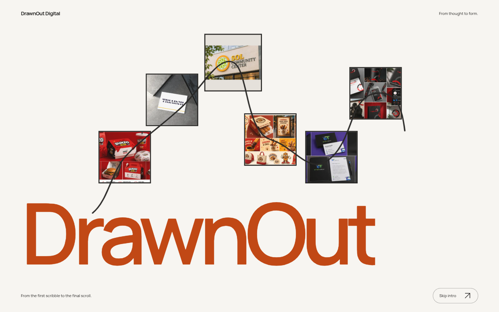

## Opening — mobile 390px

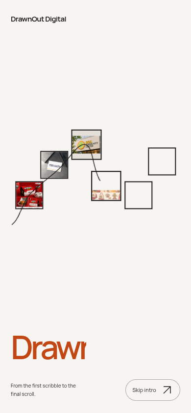

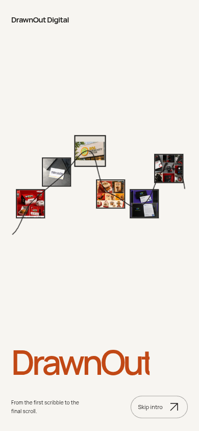

## Living hero — 1440px

The 0/2/5-second views show autonomous movement after renderer readiness.

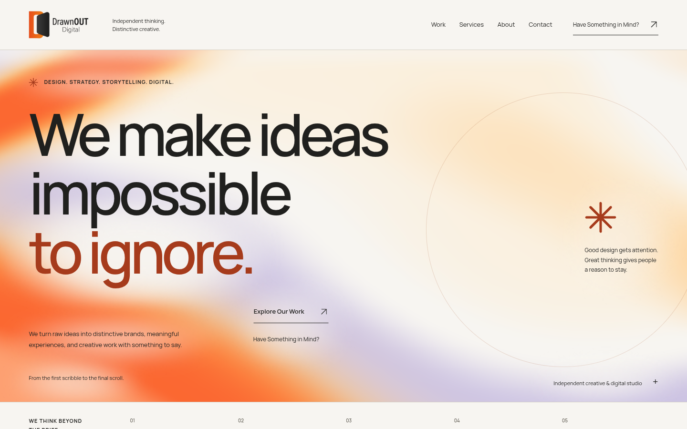

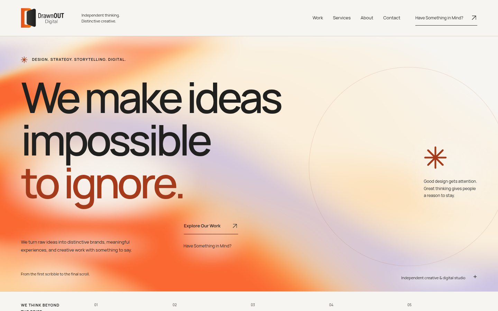

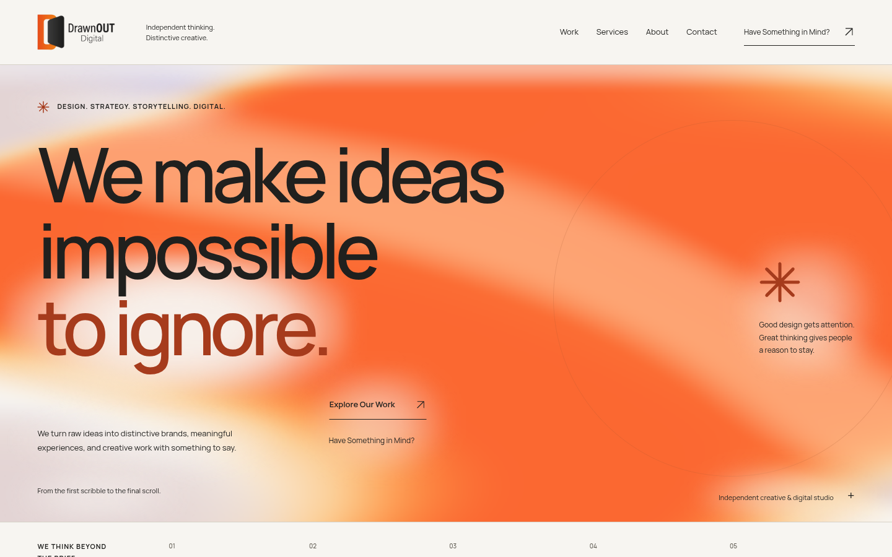

Raw production WebGL canvas: [0s](gradient-1440-0s-canvas.png), [2s](gradient-1440-2s-canvas.png), [5s](gradient-1440-5s-canvas.png).

## Living hero — 768px

The 0/2/5-second views show autonomous movement after renderer readiness.

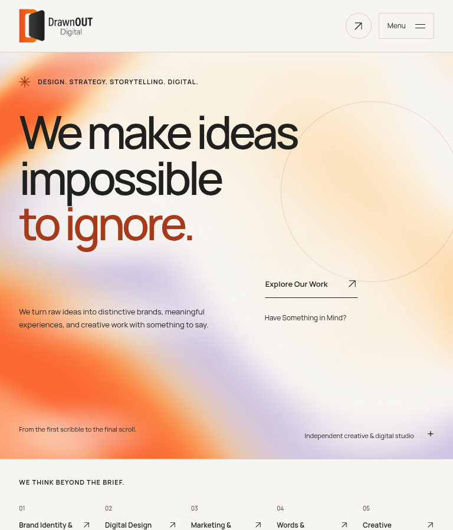

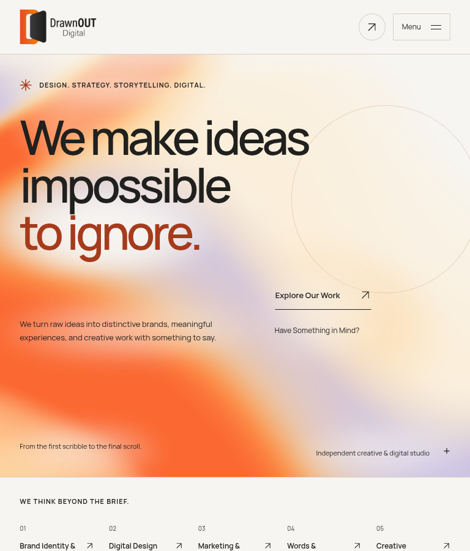

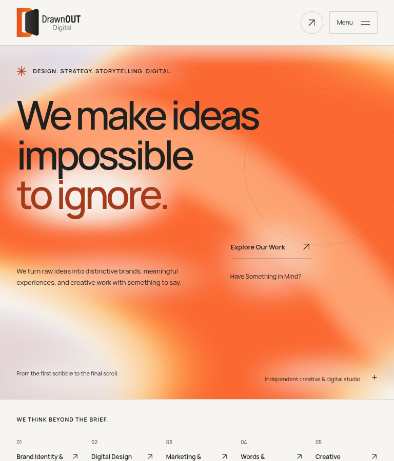

Raw production WebGL canvas: [0s](gradient-768-0s-canvas.png), [2s](gradient-768-2s-canvas.png), [5s](gradient-768-5s-canvas.png).

## Living hero — 390px

The 0/2/5-second views show autonomous movement after renderer readiness.

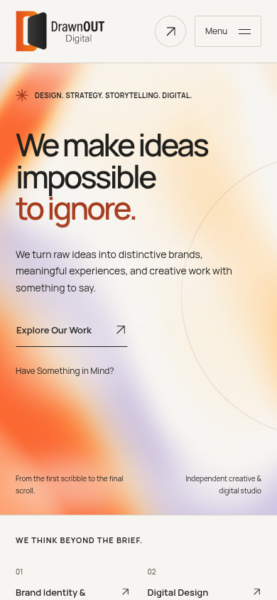

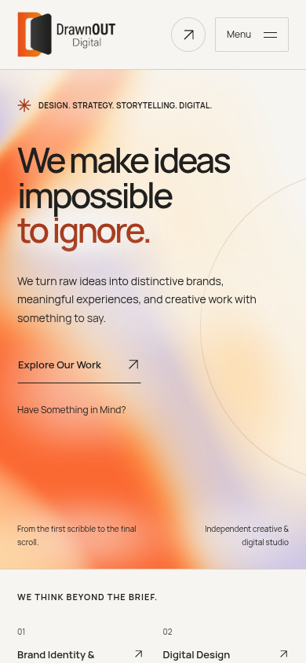

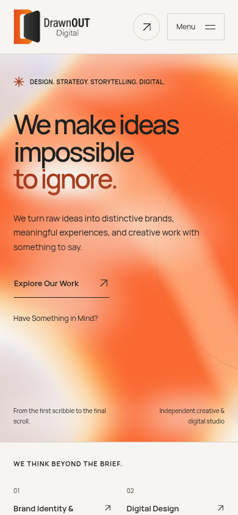

Raw production WebGL canvas: [0s](gradient-390-0s-canvas.png), [2s](gradient-390-2s-canvas.png), [5s](gradient-390-5s-canvas.png).

## Living hero — 320px

The 0/2/5-second views show autonomous movement after renderer readiness.

Raw production WebGL canvas: [0s](gradient-320-0s-canvas.png), [2s](gradient-320-2s-canvas.png), [5s](gradient-320-5s-canvas.png).

## Accessible CSS fallback

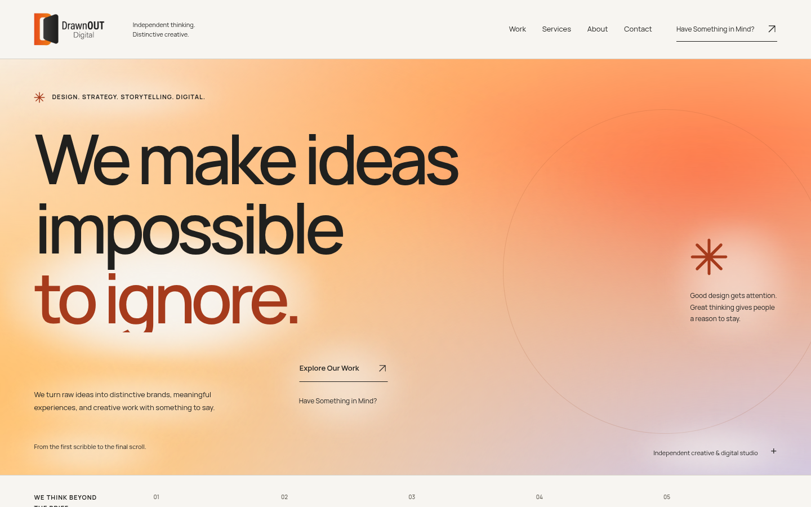

## Signature footer — 1440px

### Arrival

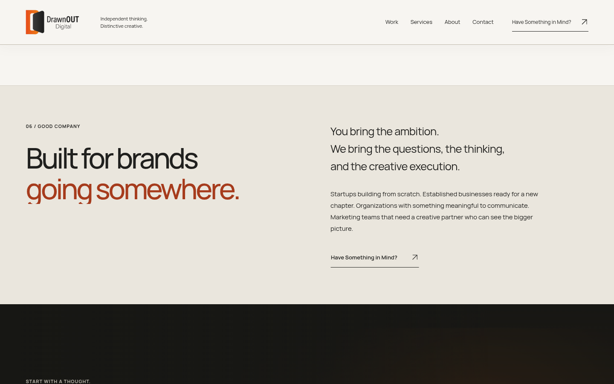

### Held pose

### Expansion

### Reverse scroll

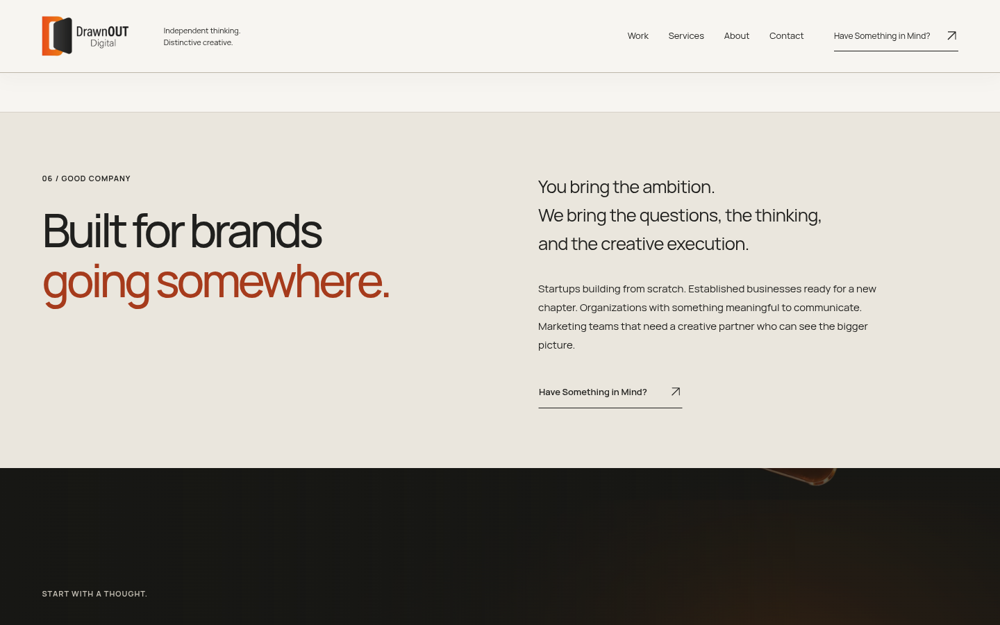

### Social links and Tenth Tech credit

### Static footer component view

## Signature footer — 768px

### Arrival

### Held pose

### Expansion

### Reverse scroll

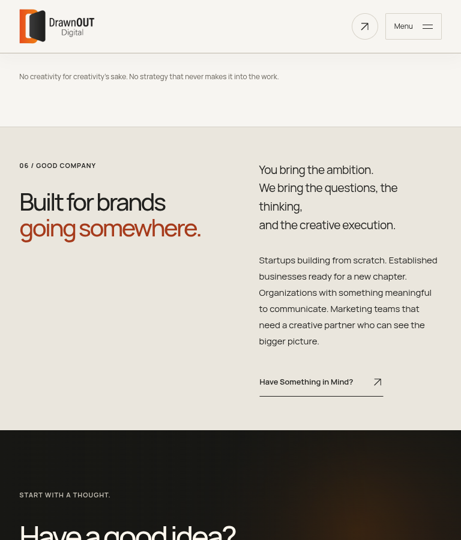

### Social links and Tenth Tech credit

### Static footer component view

## Signature footer — 390px

### Arrival

### Held pose

### Expansion

### Reverse scroll

### Social links and Tenth Tech credit

### Static footer component view

## Evidence limits

The hand and illuminated plaque remain the documented separated-image motion prototype, not a completed photorealistic rigged 3D model. Software WebGL exercises the production shader but does not establish physical-device GPU performance. Existing static footer component captures can include the sticky header; the corrected capture script is saved but has not been rerun. Formspree remains safely unconfigured pending the owner’s endpoint and verified live delivery.
