# Three completed portfolio animations — creative review

Triarch, By Tech Group and U Wanna Smoothie replace their original loops. Bunzo, SOL Community Center and Churros stay byte-identical to PR #20. No website layouts, enquiry puzzle or publication controls change. These exports are ready for **creative review**, not a claim of owner approval.

**Validation note:** core, media and focused portfolio checks pass. Wider startup/animation checks have unresolved failures; see the [actual validation results](../../docs/motion-completion/VALIDATION.md) and the original-baseline comparison. This remains a creative-review draft.

## Actual desktop and mobile browser playback

These are production-build Chromium recordings using native scrolling, real Work/case links, naturally playing videos and keyboard pause controls. Each project remains visible for more than one full 7.5-second cycle. Mobile is touch/viewport emulation, not a physical phone.

- [Desktop recording, 1440px](completion-1440-browser.mp4).
- [Mobile recording, 390px](completion-390-browser.mp4).
- [Capture source/commit, hashes and actual media-clock samples](completion-capture.json).

The recordings show the website in use. The following GIFs and storyboards are decoded export previews, not browser recordings. GIFs reduce resolution/frame rate for GitHub; use the six full MP4s to judge motion and colour. Original loops run 5.75s; new loops run 7.5s, without retiming the comparisons.

## Triarch

Measured letter fragments, alignment rules and the actual architectural card/device artwork.

| Landscape — original                                             | Landscape — completed                                            |
| ---------------------------------------------------------------- | ---------------------------------------------------------------- |
| 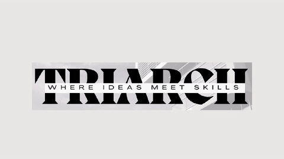 |  |

| Portrait — original                                            | Portrait — completed                                           |
| -------------------------------------------------------------- | -------------------------------------------------------------- |
| 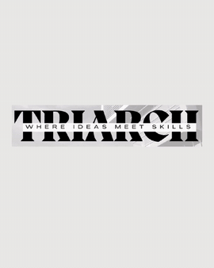 |  |

### Full exports and provenance

- [Landscape MP4](../../design-assets/portfolio-motion/quality/triarch-landscape.mp4), [matching poster](../../design-assets/portfolio-motion/quality/triarch-landscape-poster.webp).
- [Portrait MP4](../../design-assets/portfolio-motion/quality/triarch-portrait.mp4), [matching poster](../../design-assets/portfolio-motion/quality/triarch-portrait-poster.webp).
- Original immutable [landscape MP4](https://github.com/tenthtech/drawnout-digital/blob/e9a4b74fc1ebfb2d082c78a218883c9252a8ee3b/design-assets/portfolio-motion/triarch-landscape.mp4) / [portrait MP4](https://github.com/tenthtech/drawnout-digital/blob/e9a4b74fc1ebfb2d082c78a218883c9252a8ee3b/design-assets/portfolio-motion/triarch-portrait.mp4).
- [Native extracted layers](../../design-assets/portfolio-motion/quality/layers/triarch/), [source/export manifest](../../design-assets/portfolio-motion/quality/triarch-manifest.json).

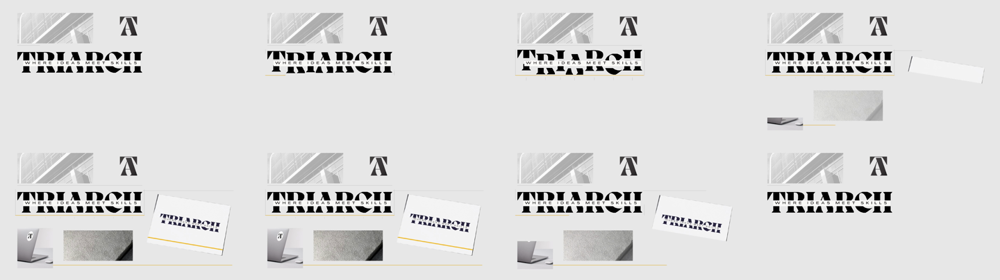

[Original storyboard](triarch-before-storyboard.png). Replacement frames: 0, 1, 2, 3, 4, 5, 6 and 7.458s, read left to right then next row.

| Desktop, actual browser                                                          | Mobile, actual browser                                                         |
| -------------------------------------------------------------------------------- | ------------------------------------------------------------------------------ |
| 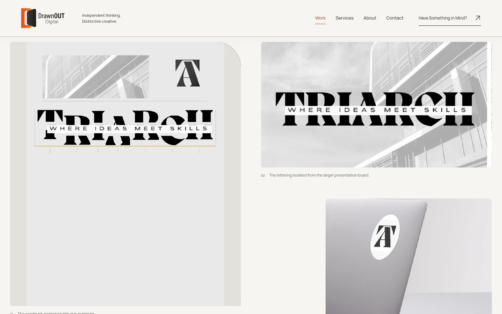 | 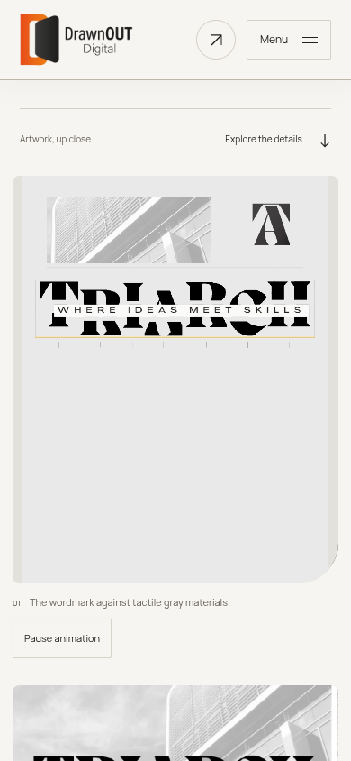 |

Source-rendered stills (not browser captures):

| Format    | Settled                             | Anticipation                             | Deconstructed                                | Assembly                               | Applications                            | Return                               |
| --------- | ----------------------------------- | ---------------------------------------- | -------------------------------------------- | -------------------------------------- | --------------------------------------- | ------------------------------------ |
| landscape | [0s](triarch-landscape-settled.png) | [1s](triarch-landscape-anticipation.png) | [2.15s](triarch-landscape-deconstructed.png) | [3.3s](triarch-landscape-assembly.png) | [4.75s](triarch-landscape-resolved.png) | [6.6s](triarch-landscape-return.png) |
| portrait  | [0s](triarch-portrait-settled.png)  | [1s](triarch-portrait-anticipation.png)  | [2.15s](triarch-portrait-deconstructed.png)  | [3.3s](triarch-portrait-assembly.png)  | [4.75s](triarch-portrait-resolved.png)  | [6.6s](triarch-portrait-return.png)  |

## By Tech Group

Five real mark surfaces connect independently, followed by the original lettering, cards and mug.

| Landscape — original                                                         | Landscape — completed                                                        |
| ---------------------------------------------------------------------------- | ---------------------------------------------------------------------------- |
|  |  |

| Portrait — original                                                        | Portrait — completed                                                       |
| -------------------------------------------------------------------------- | -------------------------------------------------------------------------- |
|  |  |

### Full exports and provenance

- [Landscape MP4](../../design-assets/portfolio-motion/quality/by-tech-group-landscape.mp4), [matching poster](../../design-assets/portfolio-motion/quality/by-tech-group-landscape-poster.webp).
- [Portrait MP4](../../design-assets/portfolio-motion/quality/by-tech-group-portrait.mp4), [matching poster](../../design-assets/portfolio-motion/quality/by-tech-group-portrait-poster.webp).
- Original immutable [landscape MP4](https://github.com/tenthtech/drawnout-digital/blob/e9a4b74fc1ebfb2d082c78a218883c9252a8ee3b/design-assets/portfolio-motion/by-tech-group-landscape.mp4) / [portrait MP4](https://github.com/tenthtech/drawnout-digital/blob/e9a4b74fc1ebfb2d082c78a218883c9252a8ee3b/design-assets/portfolio-motion/by-tech-group-portrait.mp4).
- [Native extracted layers](../../design-assets/portfolio-motion/quality/layers/by-tech-group/), [source/export manifest](../../design-assets/portfolio-motion/quality/by-tech-group-manifest.json).

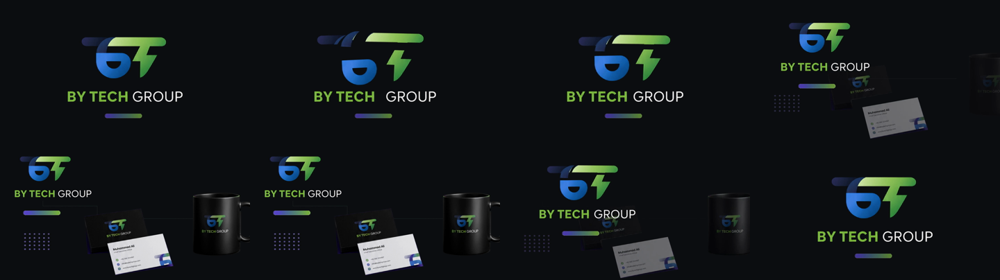

[Original storyboard](by-tech-group-before-storyboard.png). Replacement frames: 0, 1, 2, 3, 4, 5, 6 and 7.458s, read left to right then next row.

| Desktop, actual browser                                                                      | Mobile, actual browser                                                                     |
| -------------------------------------------------------------------------------------------- | ------------------------------------------------------------------------------------------ |
| 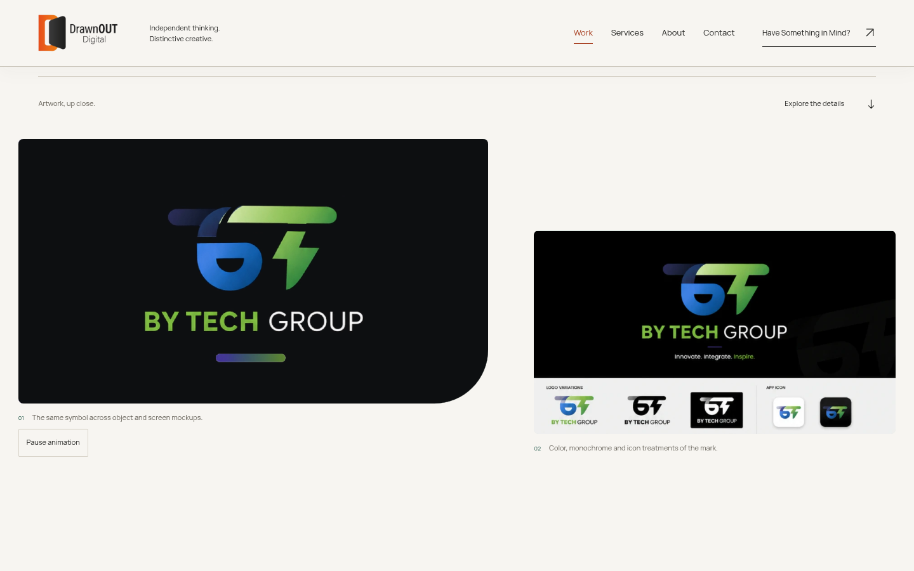 | 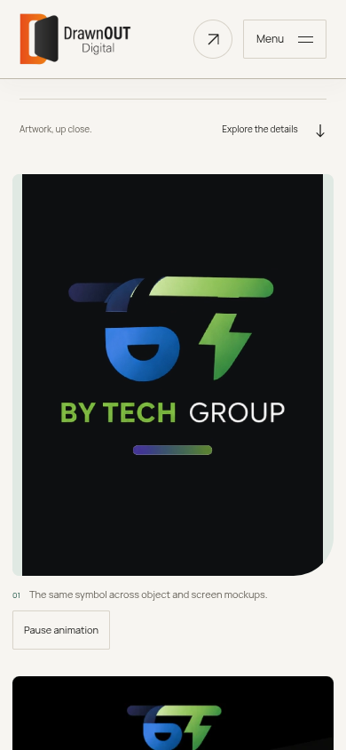 |

Source-rendered stills (not browser captures):

| Format    | Settled                                   | Anticipation                                   | Deconstructed                                      | Assembly                                     | Applications                                  | Return                                     |
| --------- | ----------------------------------------- | ---------------------------------------------- | -------------------------------------------------- | -------------------------------------------- | --------------------------------------------- | ------------------------------------------ |
| landscape | [0s](by-tech-group-landscape-settled.png) | [1s](by-tech-group-landscape-anticipation.png) | [2.15s](by-tech-group-landscape-deconstructed.png) | [3.3s](by-tech-group-landscape-assembly.png) | [4.75s](by-tech-group-landscape-resolved.png) | [6.6s](by-tech-group-landscape-return.png) |
| portrait  | [0s](by-tech-group-portrait-settled.png)  | [1s](by-tech-group-portrait-anticipation.png)  | [2.15s](by-tech-group-portrait-deconstructed.png)  | [3.3s](by-tech-group-portrait-assembly.png)  | [4.75s](by-tech-group-portrait-resolved.png)  | [6.6s](by-tech-group-portrait-return.png)  |

## U Wanna Smoothie

The original cup, citrus, leaves, ring and lettering assemble before the real menu and drink enter.

| Landscape — original                                                               | Landscape — completed                                                              |
| ---------------------------------------------------------------------------------- | ---------------------------------------------------------------------------------- |
|  |  |

| Portrait — original                                                              | Portrait — completed                                                             |
| -------------------------------------------------------------------------------- | -------------------------------------------------------------------------------- |
|  |  |

### Full exports and provenance

- [Landscape MP4](../../design-assets/portfolio-motion/quality/u-wanna-smoothie-landscape.mp4), [matching poster](../../design-assets/portfolio-motion/quality/u-wanna-smoothie-landscape-poster.webp).
- [Portrait MP4](../../design-assets/portfolio-motion/quality/u-wanna-smoothie-portrait.mp4), [matching poster](../../design-assets/portfolio-motion/quality/u-wanna-smoothie-portrait-poster.webp).
- Original immutable [landscape MP4](https://github.com/tenthtech/drawnout-digital/blob/e9a4b74fc1ebfb2d082c78a218883c9252a8ee3b/design-assets/portfolio-motion/u-wanna-smoothie-landscape.mp4) / [portrait MP4](https://github.com/tenthtech/drawnout-digital/blob/e9a4b74fc1ebfb2d082c78a218883c9252a8ee3b/design-assets/portfolio-motion/u-wanna-smoothie-portrait.mp4).
- [Native extracted layers](../../design-assets/portfolio-motion/quality/layers/u-wanna-smoothie/), [source/export manifest](../../design-assets/portfolio-motion/quality/u-wanna-smoothie-manifest.json).

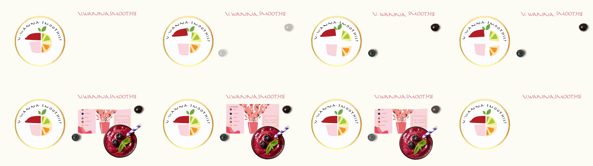

[Original storyboard](u-wanna-smoothie-before-storyboard.png). Replacement frames: 0, 1, 2, 3, 4, 5, 6 and 7.458s, read left to right then next row.

| Desktop, actual browser                                                                            | Mobile, actual browser                                                                           |
| -------------------------------------------------------------------------------------------------- | ------------------------------------------------------------------------------------------------ |
| 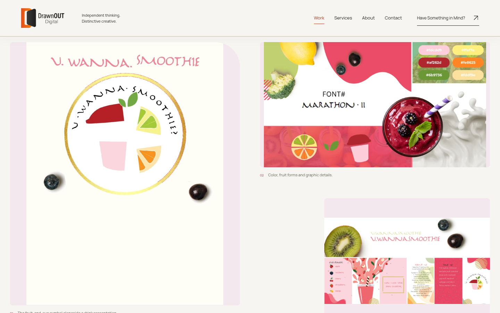 | 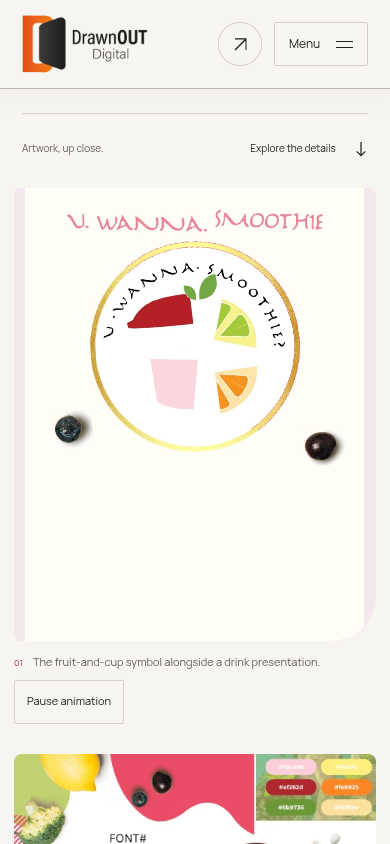 |

Source-rendered stills (not browser captures):

| Format    | Settled                                      | Anticipation                                      | Deconstructed                                         | Assembly                                        | Applications                                     | Return                                        |
| --------- | -------------------------------------------- | ------------------------------------------------- | ----------------------------------------------------- | ----------------------------------------------- | ------------------------------------------------ | --------------------------------------------- |
| landscape | [0s](u-wanna-smoothie-landscape-settled.png) | [1s](u-wanna-smoothie-landscape-anticipation.png) | [2.15s](u-wanna-smoothie-landscape-deconstructed.png) | [3.3s](u-wanna-smoothie-landscape-assembly.png) | [4.75s](u-wanna-smoothie-landscape-resolved.png) | [6.6s](u-wanna-smoothie-landscape-return.png) |
| portrait  | [0s](u-wanna-smoothie-portrait-settled.png)  | [1s](u-wanna-smoothie-portrait-anticipation.png)  | [2.15s](u-wanna-smoothie-portrait-deconstructed.png)  | [3.3s](u-wanna-smoothie-portrait-assembly.png)  | [4.75s](u-wanna-smoothie-portrait-resolved.png)  | [6.6s](u-wanna-smoothie-portrait-return.png)  |

## Source boundaries and validation

- [Art direction, independently animated elements and missing editable masters](../../docs/motion-completion/ART_DIRECTION_AND_SOURCES.md). Native raster detail is preserved; larger canvases do not create additional detail. Hidden Triarch letter contours, By Tech underlaps/cropped mug handle, and independent Smoothie toppings require approved editable masters.
- [Reproducible composition sources](../../scripts/portfolio/quality/) and [promotion workflow](../../scripts/portfolio/promote-completion.mjs).
- [Validation report](../../docs/motion-completion/VALIDATION.md), [core checks](core-validation.json), [media/source preservation](media-validation.json), [focused browser checks](browser-tests.json), [browser colour proof](browser-export-color-audit.json) and [before/after hashes](comparison-manifest.json).
- [Enquiry puzzle recommendation](../../docs/motion-completion/ENQUIRY_RECOMMENDATION.md): shared component with small editorial adjustments only after separate approval; no rollout here.
- [Prior three-animation review gallery](../motion-quality/README.md) remains historical evidence, unchanged.

Physical Safari/iOS/Android testing and creative approval remain owner review items. Production-quality 3D signature hand/footer and live enquiry delivery are separate milestones. No merge or deployment is part of this delivery.
