# DrawnOut motion, imagery and signature enquiry

**First-three creative review.** [Draft PR #20](https://github.com/tenthtech/drawnout-digital/pull/20) is stacked on unmerged premium case-study PR #19. Bunzo, SOL and Churros are submitted for visual approval. Triarch, By Tech Group and U Wanna Smoothie's existing six exports remain byte-for-byte unchanged. No merge or deployment has been performed.

The GIFs below are complete 7.5-second review copies of the real MP4s. Use the full-resolution MP4 links to judge final detail. All new exports are silent H.264 High/yuv420p,180 frames at 24 fps, CRF 19 with faststart; landscape 1440 × 810 and portrait 810 × 1080. Canvas dimensions do not imply vector-quality source artwork.

[Validation](../../docs/motion-quality/VALIDATION.md) · [Exact source limits and remaining 3D requirements](../../docs/motion-quality/LIMITATIONS.md) · [Reference technique study](../../docs/motion-quality/REFERENCE_STUDY.md)

| Project              | Landscape                                                                                        | Portrait                                                                                        | Composition source                                             |
| -------------------- | ------------------------------------------------------------------------------------------------ | ----------------------------------------------------------------------------------------------- | -------------------------------------------------------------- |
| Bunzo                | [700,510 bytes](../../design-assets/portfolio-motion/quality/bunzo-landscape.mp4)                | [656,480 bytes](../../design-assets/portfolio-motion/quality/bunzo-portrait.mp4)                | [Editable source](../../scripts/portfolio/quality/bunzo.mjs)   |
| SOL Community Center | [943,778 bytes](../../design-assets/portfolio-motion/quality/sol-community-center-landscape.mp4) | [792,030 bytes](../../design-assets/portfolio-motion/quality/sol-community-center-portrait.mp4) | [Editable source](../../scripts/portfolio/quality/sol.mjs)     |
| Churros              | [668,984 bytes](../../design-assets/portfolio-motion/quality/churros-landscape.mp4)              | [667,759 bytes](../../design-assets/portfolio-motion/quality/churros-portrait.mp4)              | [Editable source](../../scripts/portfolio/quality/churros.mjs) |

## Bunzo

Five actual white letterfaces lift with overlapping timing from the shared source silhouette; the real printed cup and carton separate and settle. Supplied splash, heart and bolt accents move independently. Complete independent outlined glyphs need the original editable master.

### Landscape

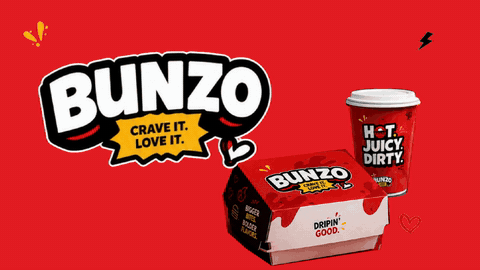

### Portrait

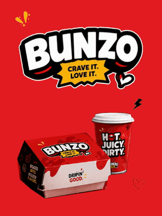

[Landscape MP4](../../design-assets/portfolio-motion/quality/bunzo-landscape.mp4) · [Portrait MP4](../../design-assets/portfolio-motion/quality/bunzo-portrait.mp4) · [Landscape poster](../../design-assets/portfolio-motion/quality/bunzo-landscape-poster.webp) · [Portrait poster](../../design-assets/portfolio-motion/quality/bunzo-portrait-poster.webp) · [Source crops, mattes and hashes](../../design-assets/portfolio-motion/quality/bunzo-manifest.json)

### Actual encoded storyboard

Left to right, top then bottom: decoded frames at 0, 1, 2, 3, 4, 5, 6 and 7.458 seconds.

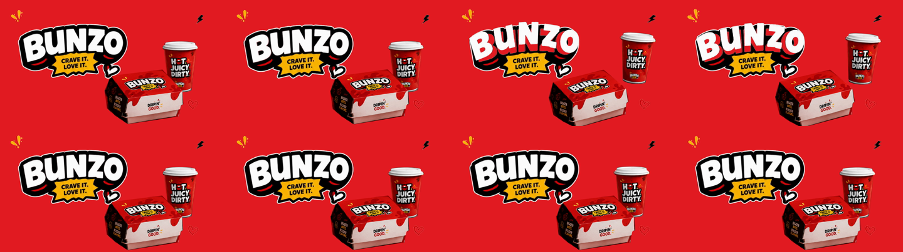

Full-resolution source keyframes:

- landscape: [settled](bunzo-landscape-settled.png) · [anticipation](bunzo-landscape-anticipation.png) · [deconstructed](bunzo-landscape-deconstructed.png) · [assembly](bunzo-landscape-assembly.png) · [resolved](bunzo-landscape-resolved.png) · [return](bunzo-landscape-return.png)
- portrait: [settled](bunzo-portrait-settled.png) · [anticipation](bunzo-portrait-anticipation.png) · [deconstructed](bunzo-portrait-deconstructed.png) · [assembly](bunzo-portrait-assembly.png) · [resolved](bunzo-portrait-resolved.png) · [return](bunzo-portrait-return.png)

## SOL Community Center

The actual gold annulus, green core and lettering motivate a circular transition into real signage, notice, card and notebook artwork. The clean isolated emblem is only186 × 186px, so it is deliberately small; no replacement symbol is drawn.

### Landscape

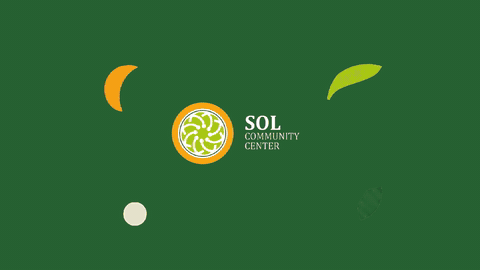

### Portrait

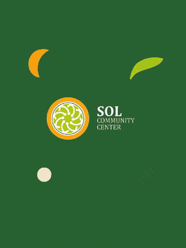

[Landscape MP4](../../design-assets/portfolio-motion/quality/sol-community-center-landscape.mp4) · [Portrait MP4](../../design-assets/portfolio-motion/quality/sol-community-center-portrait.mp4) · [Landscape poster](../../design-assets/portfolio-motion/quality/sol-community-center-landscape-poster.webp) · [Portrait poster](../../design-assets/portfolio-motion/quality/sol-community-center-portrait-poster.webp) · [Source crops, mattes and hashes](../../design-assets/portfolio-motion/quality/sol-community-center-manifest.json)

### Actual encoded storyboard

Left to right, top then bottom: decoded frames at 0, 1, 2, 3, 4, 5, 6 and 7.458 seconds.

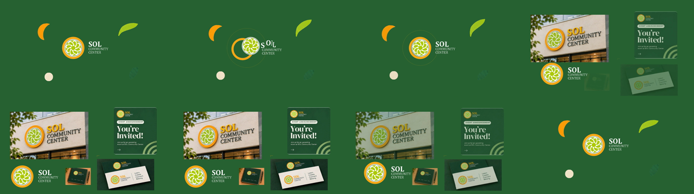

Full-resolution source keyframes:

- landscape: [settled](sol-community-center-landscape-settled.png) · [anticipation](sol-community-center-landscape-anticipation.png) · [deconstructed](sol-community-center-landscape-deconstructed.png) · [assembly](sol-community-center-landscape-assembly.png) · [resolved](sol-community-center-landscape-resolved.png) · [return](sol-community-center-landscape-return.png)
- portrait: [settled](sol-community-center-portrait-settled.png) · [anticipation](sol-community-center-portrait-anticipation.png) · [deconstructed](sol-community-center-portrait-deconstructed.png) · [assembly](sol-community-center-portrait-assembly.png) · [resolved](sol-community-center-portrait-resolved.png) · [return](sol-community-center-portrait-return.png)

## Churros

The authentic crest, intact wordmark, connected pastry/chocolate, side ornaments and ribbon unfold and reassemble beside real packaging cutouts. Overlapping lettering and illustration remain faithful connected layers instead of invented hidden artwork.

### Landscape

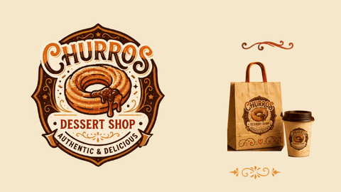

### Portrait

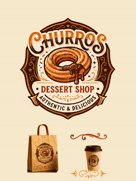

[Landscape MP4](../../design-assets/portfolio-motion/quality/churros-landscape.mp4) · [Portrait MP4](../../design-assets/portfolio-motion/quality/churros-portrait.mp4) · [Landscape poster](../../design-assets/portfolio-motion/quality/churros-landscape-poster.webp) · [Portrait poster](../../design-assets/portfolio-motion/quality/churros-portrait-poster.webp) · [Source crops, mattes and hashes](../../design-assets/portfolio-motion/quality/churros-manifest.json)

### Actual encoded storyboard

Left to right, top then bottom: decoded frames at 0, 1, 2, 3, 4, 5, 6 and 7.458 seconds.

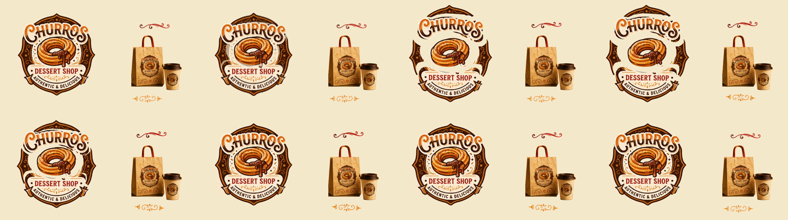

Full-resolution source keyframes:

- landscape: [settled](churros-landscape-settled.png) · [anticipation](churros-landscape-anticipation.png) · [deconstructed](churros-landscape-deconstructed.png) · [assembly](churros-landscape-assembly.png) · [resolved](churros-landscape-resolved.png) · [return](churros-landscape-return.png)
- portrait: [settled](churros-portrait-settled.png) · [anticipation](churros-portrait-anticipation.png) · [deconstructed](churros-portrait-deconstructed.png) · [assembly](churros-portrait-assembly.png) · [resolved](churros-portrait-resolved.png) · [return](churros-portrait-return.png)

## Working browser journeys

Actual production Chromium captures follow real Work/case links, play each pilot, use pause/play controls and native backscroll. Mobile uses touch/viewport emulation; physical-device testing remains outstanding.

- [Desktop 1440px recording](pilots-1440-browser.mp4)
- [Mobile 390px recording](pilots-390-browser.mp4)
- [Capture method, source/media hashes and playback measurements](pilots-capture.json)

## Bring us the pieces — Brand Identity only

A 7.8-second editorial assembly connects five idea fragments to the authentic DrawnOut emblem. The permanent Contact link stays outside the animated artwork. Other service enquiry sections are unchanged pending creative approval.

- [Desktop 1440px actual browser recording](enquiry-1440-browser.mp4)
- [Mobile 390px actual browser recording](enquiry-390-browser.mp4)
- [Runtime/capture evidence](enquiry-capture.json) · [Implementation and fallback behavior](../../docs/motion-quality/ENQUIRY.md)

### Desktop, resolved composition

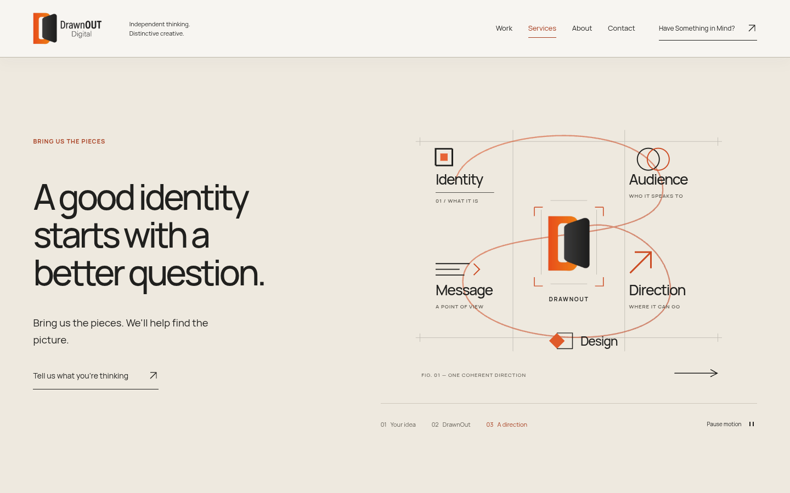

[Your idea](enquiry-1440-idea.png) · [Connecting](enquiry-1440-connecting.png) · [Paused](enquiry-1440-paused.png) · [No JavaScript](enquiry-1440-no-javascript-settled.png)

### Mobile, complete static fallback

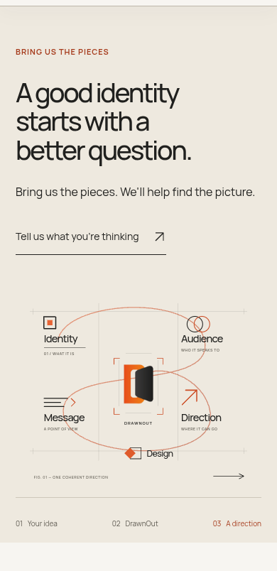

[Your idea](enquiry-390-idea.png) · [Connecting](enquiry-390-connecting.png) · [Direction](enquiry-390-direction.png) · [Paused](enquiry-390-paused.png) · [No JavaScript](enquiry-390-no-javascript-settled.png)

## Image quality — same-scale comparisons

All 37 derivatives were compared against their exact original crop. Full boards retain their genuine native resolution; small details are capped to avoid oversized display. These comparisons use the same source-pixel rectangle and scale. No sharpening or invented detail.

[Complete inventory and resolution limits](../../docs/motion-quality/IMAGE_QUALITY.md) · [All 37 measured source comparisons](image-comparison-metrics.json) · [Actual browser-selected resource/DPR audit](browser-image-audit.json) · [Read-only Netlify-served asset audit](netlify-observation.json)

### Bunzo packaging

Before:


After:


### SOL applications

Before:


After:


### Triarch card

Before:

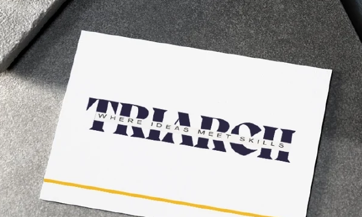

After:


### FK smaller card detail

Before:


After:


## Authentic DrawnOut favicon

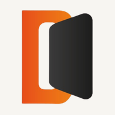

[Source crop and extraction process](../../docs/motion-quality/FAVICON.md) · [Actual Chromium favicon selection](browser-favicon-audit.json). The SVG is explicitly image-backed.

## Reproduce and validate

From the repository root, with the locked npm dependencies and FFmpeg/FFprobe installed:

```sh
node scripts/portfolio/quality/render.mjs
node scripts/portfolio/quality/create-previews.mjs
node scripts/portfolio/promote-quality.mjs
node --test tests/portfolio-motion-exports.test.mjs tests/motion-quality-exports.test.mjs
node scripts/portfolio/refresh-images.mjs
node scripts/portfolio/measure-images.mjs
node scripts/brand/build-favicons.mjs
```

Reproducible JavaScript compositions, extracted RGBA layers and provenance manifests are committed. Large generated still SVGs duplicate embedded image data and remain local ignored outputs. Supplied reference-brand clips and storyboards remain private outside the checkout.

The existing hand/plaque remains a **layered raster prototype**. No completed realistic 3D hand/emblem or physical iOS/Android validation is claimed. Creative approval of these three animations and this enquiry composition is the next gate.
