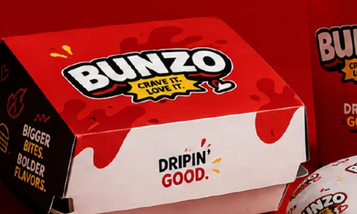
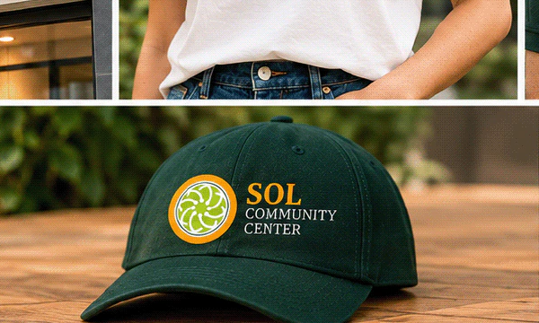
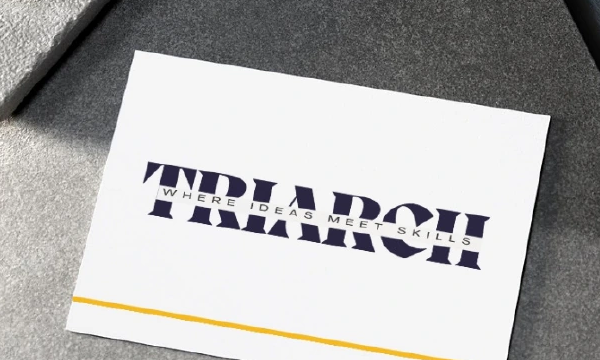
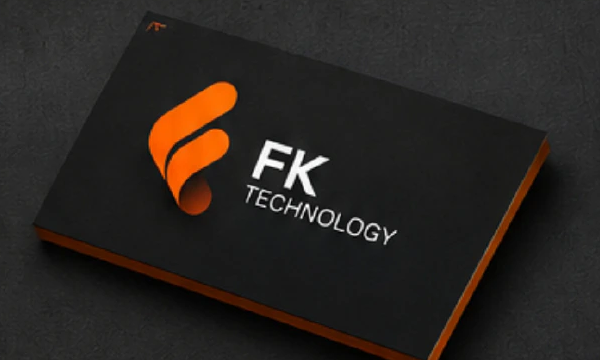

# Motion, imagery and signature enquiry review

Draft stacked PR: [#20](https://github.com/tenthtech/drawnout-digital/pull/20), based on unmerged premium case-study PR #19. This gallery is being assembled alongside the first three motion compositions. No creative approval is inferred from automated validation.

## Image quality: identical source-scale crops

The old derivatives are brought to the same native reference scale, then both versions use exactly the same source rectangle. No sharpening or invented detail. See the [complete audit](../../docs/motion-quality/IMAGE_QUALITY.md).

### Bunzo packaging — before

### Bunzo packaging — native-resolution derivative

### SOL applications — before

### SOL applications — native-resolution derivative

### Triarch card — before

### Triarch card — improved compression fidelity, same native size

### FK small card detail — before

### FK small card detail — improved compression fidelity, same native size

## DrawnOut favicon

[Extraction and source provenance](../../docs/motion-quality/FAVICON.md). The SVG is explicitly image-backed, not a newly drawn vector logo.
