# Owner corrections — About and homepage opening

Real production Chromium screenshots and native real-time recordings. Videos are full, silent H.264 transcodes at the original speed. Home recordings include an actual refresh and the continuing ambient gradient. No application timeline was sought or paused.

**3D asset dependency remains open:** the About 3D emblem beat is withheld because no approved editable emblem geometry or 3D source was supplied. These previews do not represent the final requested 3D sequence. The existing homepage hand/plaque is the approved separated-raster prototype. [Asset audit and exact requirements](../../docs/owner-corrections/ASSET_STATUS.md).

[Capture facts, timings and file hashes](capture-evidence.json)

Captured from source commit `064c10bbad252869e0e98da499f3b3d5aa314fb0`. All 34 PNGs and four recordings completed with **zero page errors and zero failed requests**.

| Observation                                         | 390px  | 1440px |
| --------------------------------------------------- | ------ | ------ |
| About natural completion, from navigation           | 3.847s | 3.703s |
| Homepage natural completion, first load             | 4.318s | 4.371s |
| Homepage natural completion, real refresh           | 4.284s | 4.317s |
| About recording duration                            | 9.12s  | 9.16s  |
| Homepage + refresh recording duration               | 17.32s | 17.92s |
| New WebGL draws observed from 6.5–8.5s, after intro | 60     | 60     |

All measured homepage arrivals completed automatically within five seconds. The recordings include stationary-cursor gradient movement after the introduction. Actual browser facts are recorded in the manifest; these are local Chromium software-rendering observations, not physical-device or Safari certification.

[Inspect the supplied assets and the missing 3D dependency](asset-review/README.md).

## 1440px About arrival

[Real About arrival recording](about-1440-arrival.mp4)

### Portrait arrives first

### Localized atmosphere develops

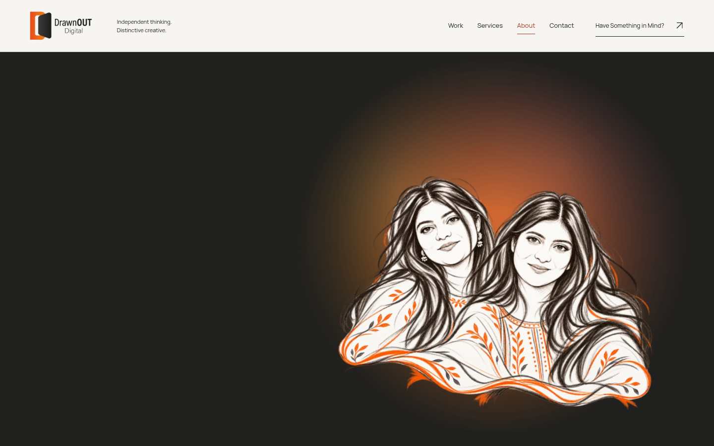

### Headline and copy reveal

### Complete settled hero

## 1440px homepage opening

[Real opening, living gradient and browser refresh recording](home-1440-opening-refresh.mp4)

### Progressive artwork reveal

### Six enlarged approved artworks

### Preserved hand/plaque choreography

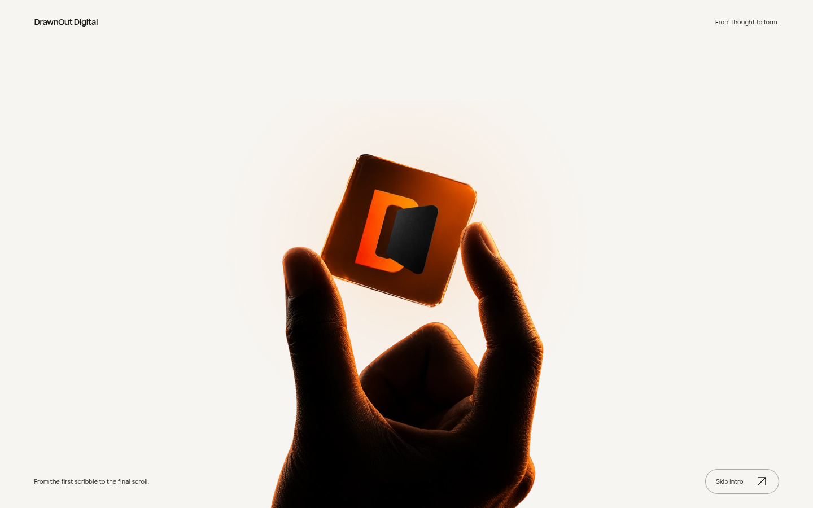

### Automatic Afterglow transition

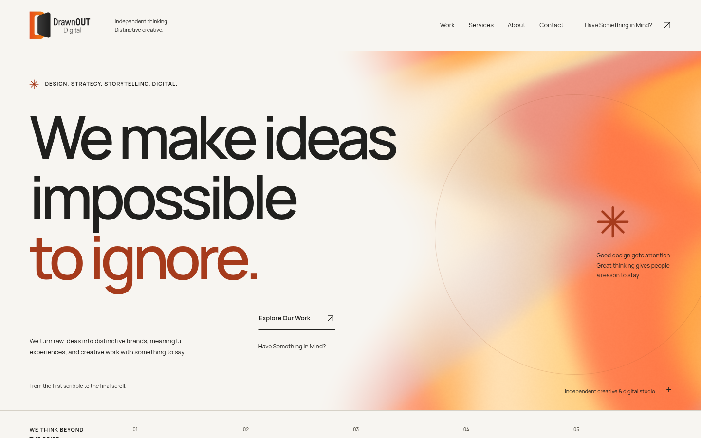

### Living gradient with stationary cursor

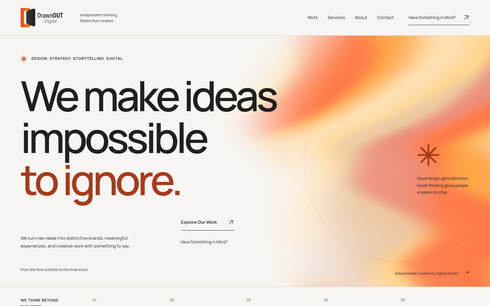

## 390px About arrival

[Real About arrival recording](about-390-arrival.mp4)

### Portrait arrives first

### Localized atmosphere develops

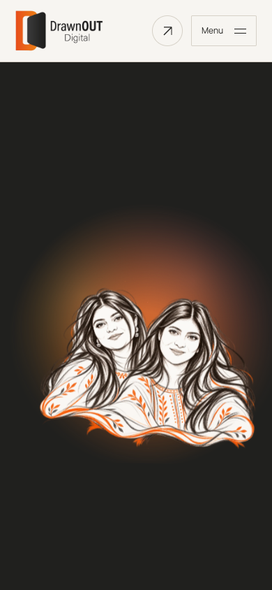

### Headline and copy reveal

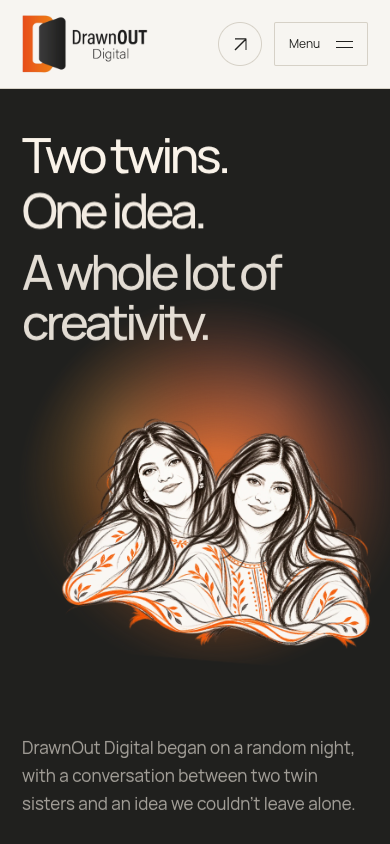

### Complete settled hero

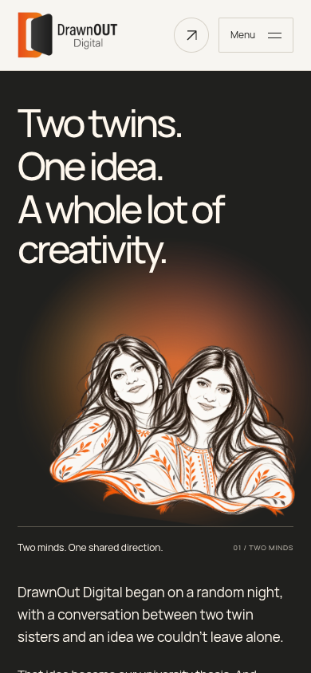

## 390px homepage opening

[Real opening, living gradient and browser refresh recording](home-390-opening-refresh.mp4)

### Progressive artwork reveal

### Six enlarged approved artworks

### Preserved hand/plaque choreography

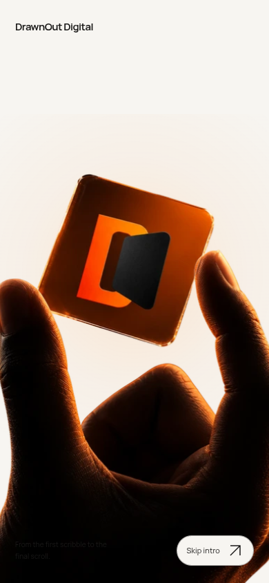

### Automatic Afterglow transition

### Living gradient with stationary cursor

## Responsive and fallback evidence

The following views are captured with real reduced-motion preferences or JavaScript disabled. No CSS was injected to imitate a fallback.

### 320px

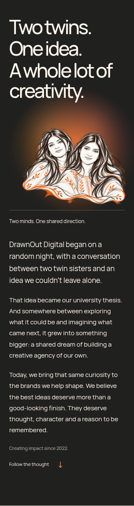

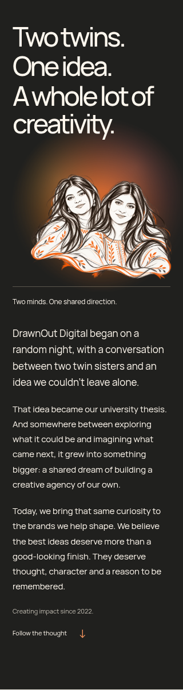

### 390px

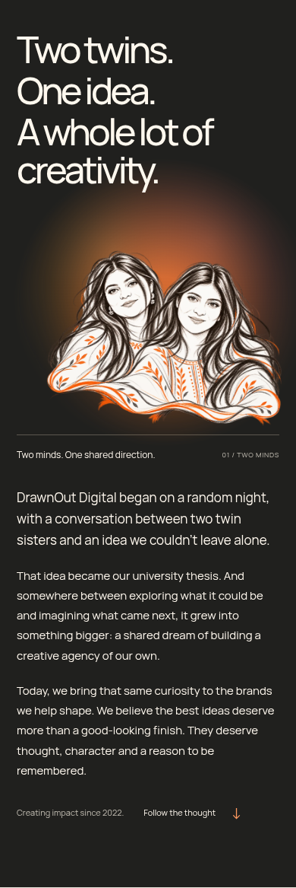

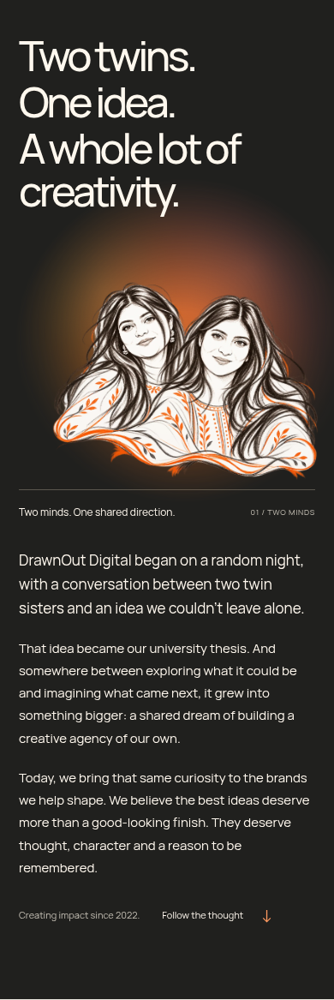

### 768px

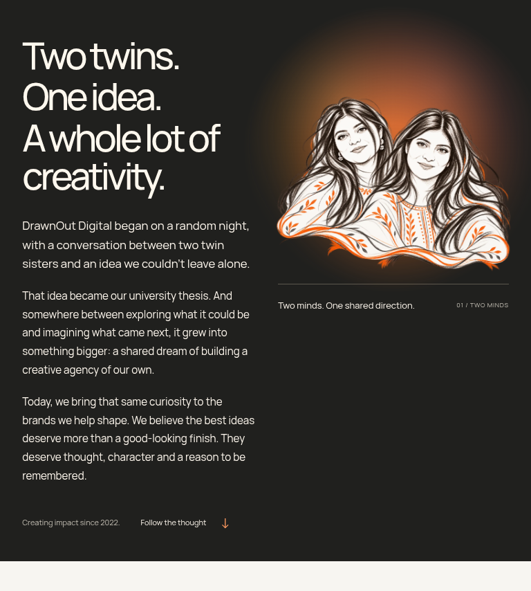

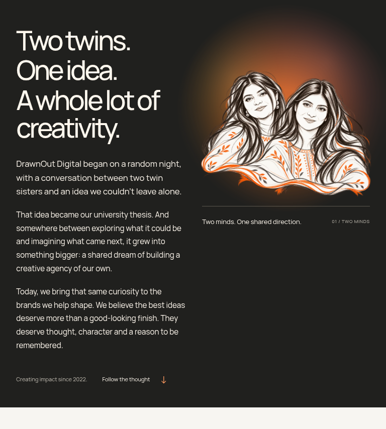

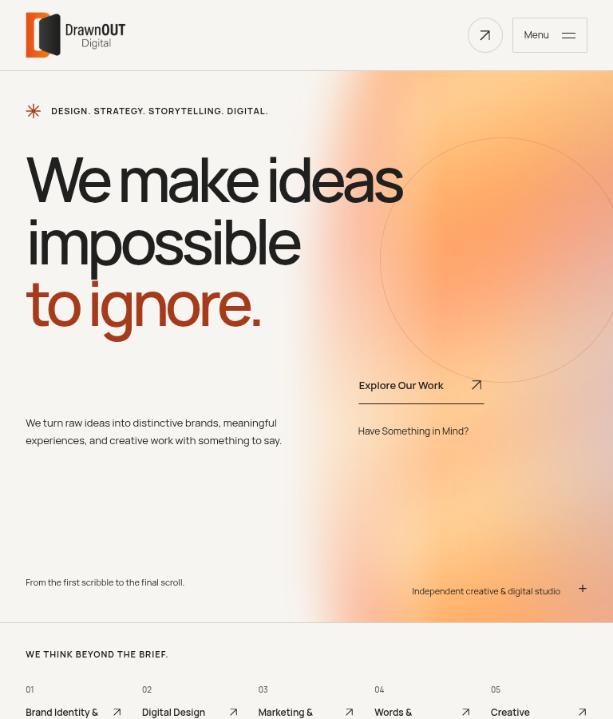

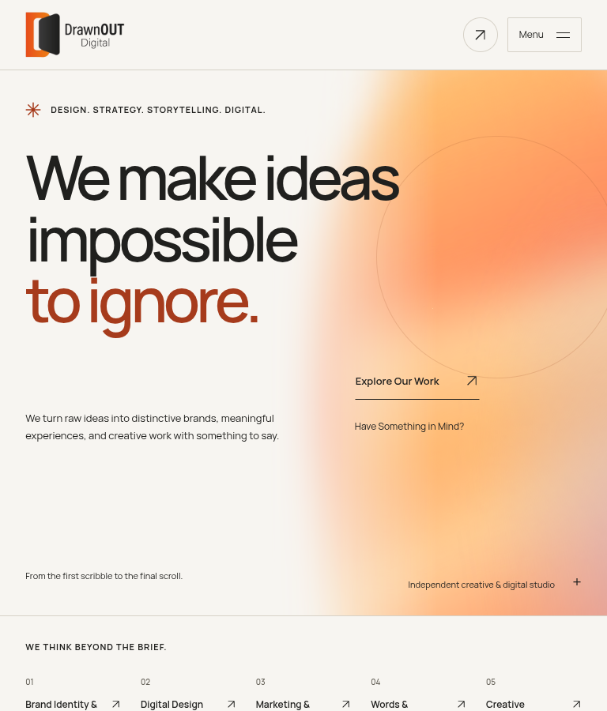

### 1440px

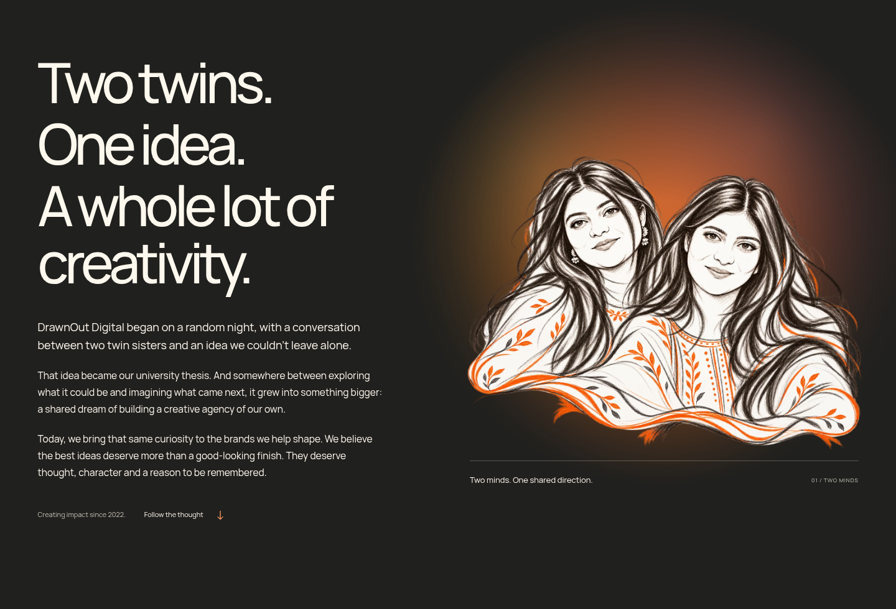

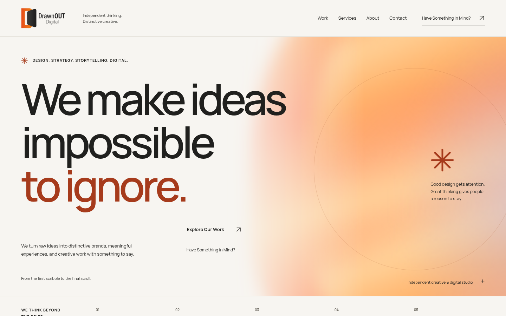

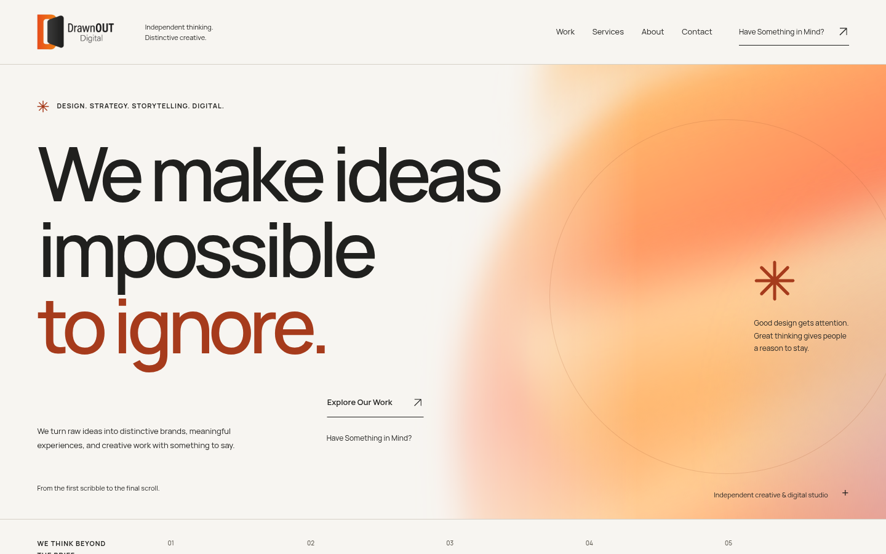
