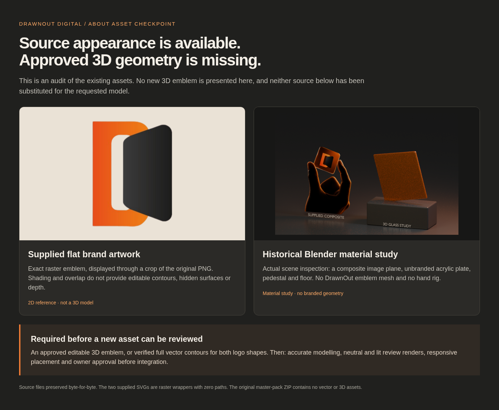
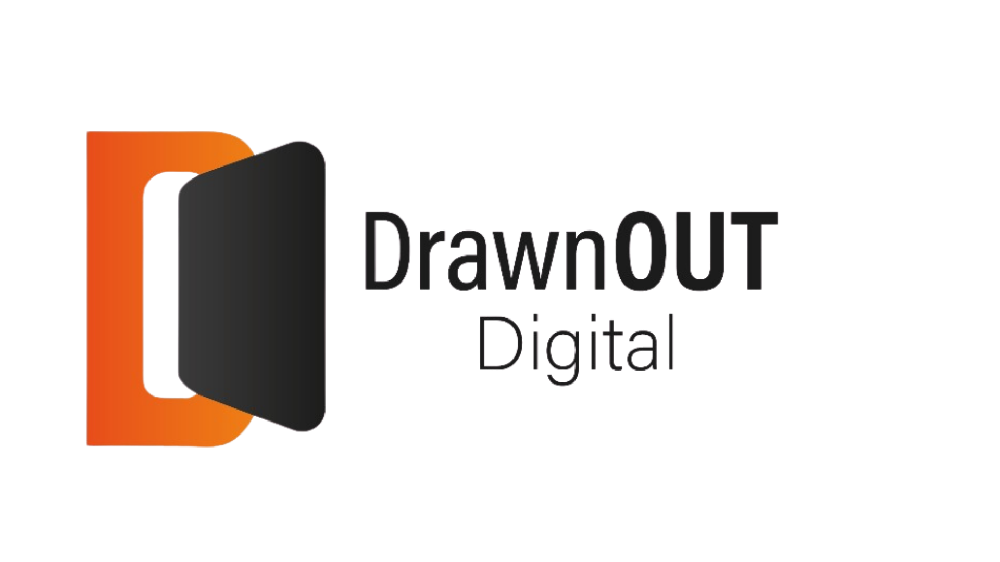
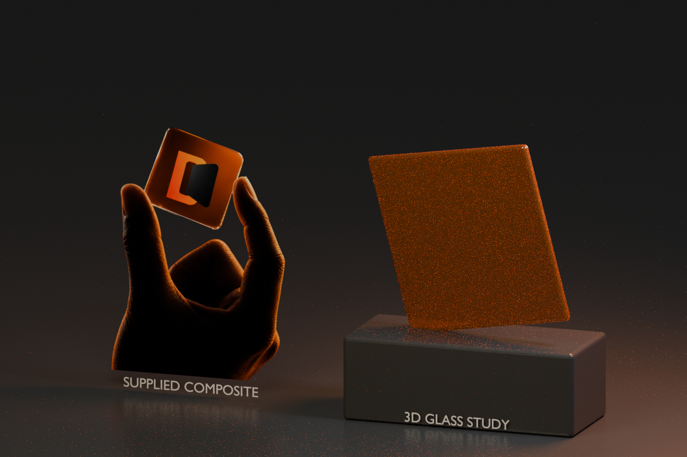

# About emblem — truthful source review

**No approved editable 3D emblem or verified vector geometry was found.** This
preview documents the actual inputs. It does not present the flat logo, existing
material-study plate or raster hand/plaque as a newly completed 3D emblem.

## Supplied brand artwork — flat raster

1920 × 1080 PNG. The original master-pack copy has identical bytes. The existing
`BrandEmblem.astro` simply crops its emblem region; it does not create 3D geometry.

## Existing Blender study — plate materials, no emblem model

The left object is a textured image plane. The right object is an unbranded
acrylic plate. Actual file inspection found no emblem mesh, emblem curves, hand
mesh or armature. This image remains historical evidence, not the new asset
approval proposal.

## What is needed

An approved editable 3D emblem, or approved full vector contours for both logo
shapes, is required before accurate modelling and an asset approval preview can
be completed. The obscured geometry and intended depth cannot be verified from
these raster sources alone.

Read the [dependency and approval checkpoint](../../../docs/owner-corrections/ASSET_STATUS.md),
[source inventory](source-inventory.json) and
[actual Blender object inventory](blender-inventory.json).
