# Phase 1 — Afterglow visual review

This gallery presents the completed Phase 1 design foundation using the approved **Concept A — Afterglow** direction. All 19 existing screenshots are preserved at their original resolution, without resizing or regeneration. Click an image to inspect its full-size PNG directly on GitHub.

The source, configuration, automated tests, and Phase 1 handoff/validation already matched repository `main` before this evidence-delivery change. No design changes or Phase 2 implementation are included.

## Full-page views

These views show the header, atmospheric hero, capability index, selected-work layout, and static footer together.

### Mobile — 390px

[Open the full-page mobile PNG](./afterglow-390.png)

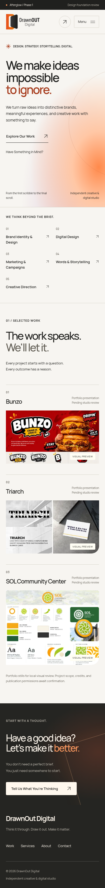

### Tablet — 768px

[Open the full-page tablet PNG](./afterglow-768.png)

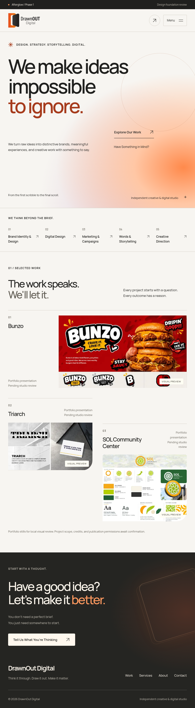

### Desktop — 1440px

[Open the full-page desktop PNG](./afterglow-1440.png)

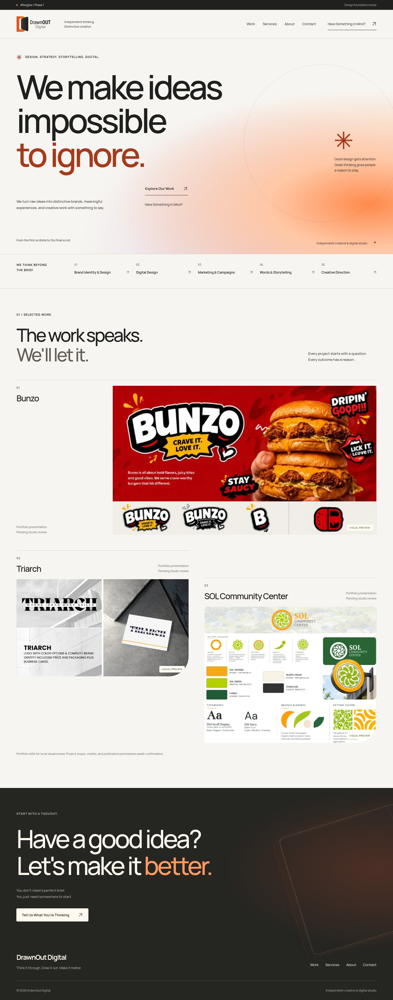

## Mobile navigation — open state

The mobile menu is shown at 390px. Its functional checks cover keyboard focus containment, Escape/backdrop closing, restored focus, and releasing scroll lock on desktop resize. Without JavaScript, the normal navigation links remain visible.

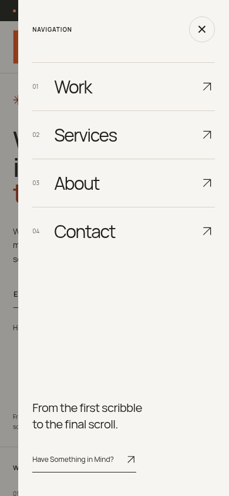

## Header foundation

The authentic supplied logo remains on a light surface. Desktop uses the canonical Work / Services / About / Contact structure; tablet and mobile use the menu control and enquiry link.

| Mobile — 390px                                                          | Tablet — 768px                                                          | Desktop — 1440px                                                                |
| ----------------------------------------------------------------------- | ----------------------------------------------------------------------- | ------------------------------------------------------------------------------- |
| 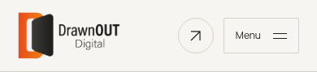 | 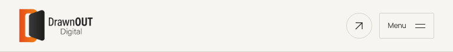 | 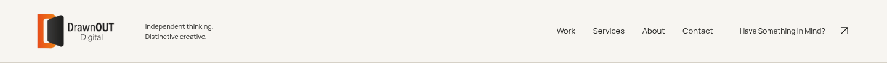 |

## Atmospheric hero and typography

The hero retains Afterglow's warm orange-led atmosphere, original DrawnOut headline, and visible live HTML text. These are static visual foundations for later motion work.

| Mobile — 390px                                                               | Tablet — 768px                                                               | Desktop — 1440px                                                                |
| ---------------------------------------------------------------------------- | ---------------------------------------------------------------------------- | ------------------------------------------------------------------------------- |
| 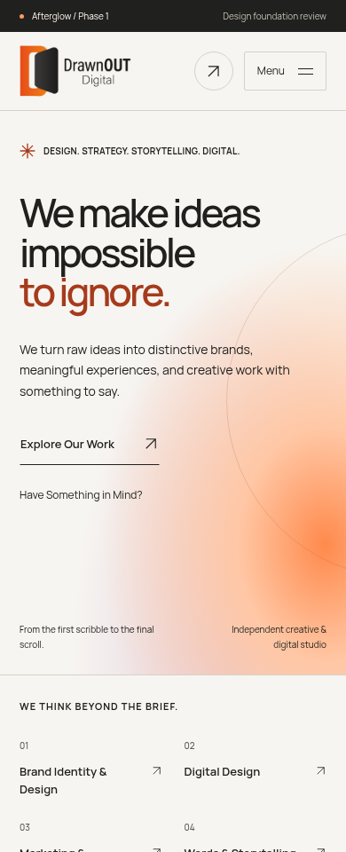 | 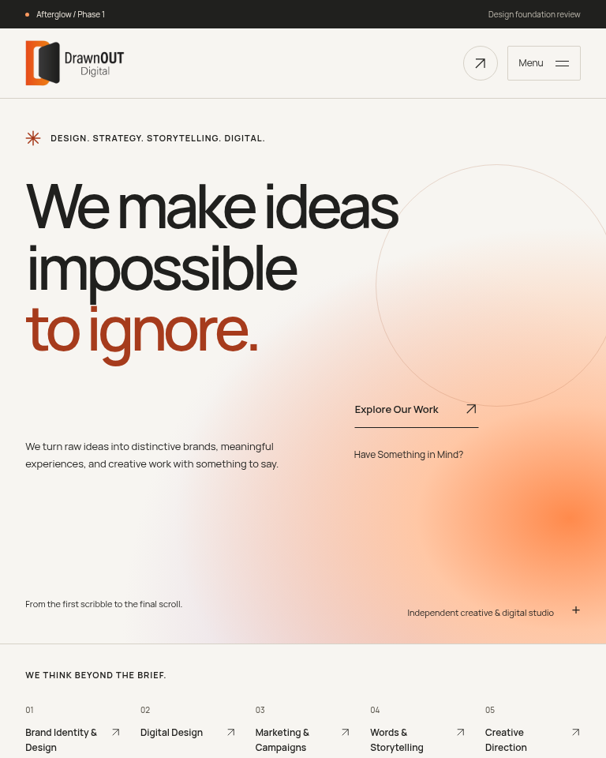 | 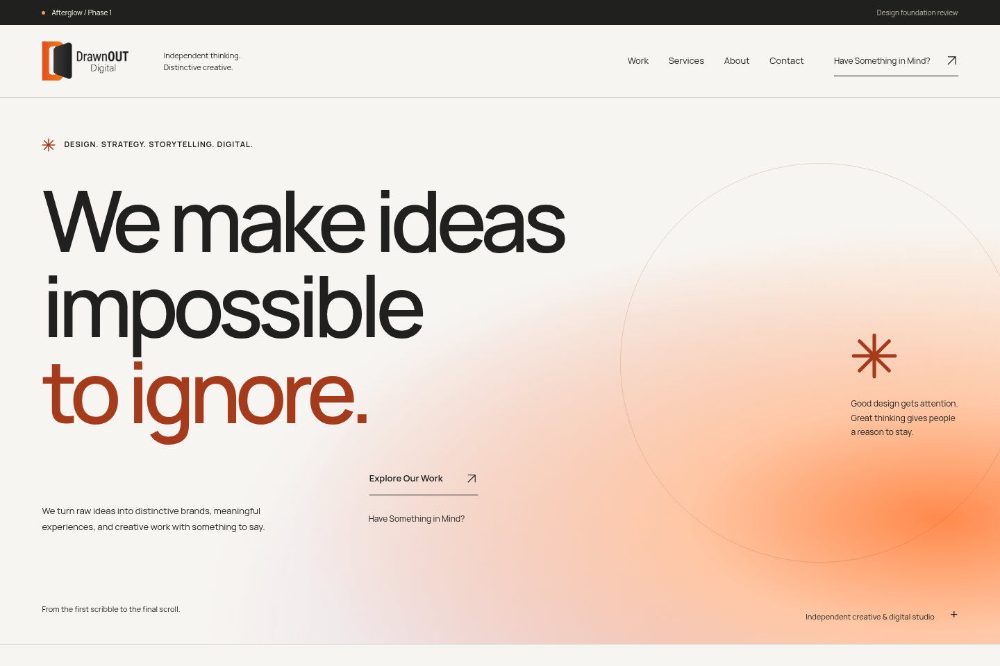 |

## Capability presentation

The five-pillar capability index incorporates the clarity of Concept B while preserving Afterglow's direction. Its links lead to the matching service foundation anchors.

| Mobile — 390px                                                                           | Tablet — 768px                                                                           | Desktop — 1440px                                                                            |
| ---------------------------------------------------------------------------------------- | ---------------------------------------------------------------------------------------- | ------------------------------------------------------------------------------------------- |
| 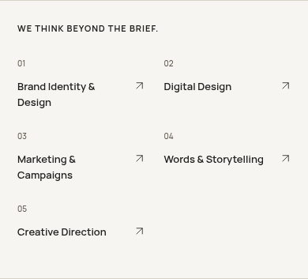 | 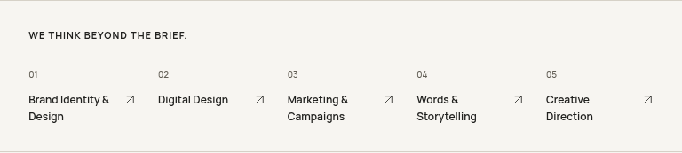 | 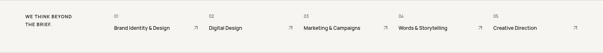 |

## Selected work — editorial portfolio foundation

The large lead project is followed by one paired row on larger screens, with a single-column mobile treatment. Supplied stills remain explicitly marked as review placeholders; project entries are drafts, and no unapproved case routes or portfolio images enter the production build.

| Mobile — 390px                                                              | Tablet — 768px                                                              | Desktop — 1440px                                                               |
| --------------------------------------------------------------------------- | --------------------------------------------------------------------------- | ------------------------------------------------------------------------------ |
| 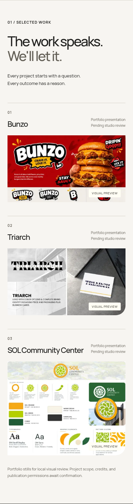 | 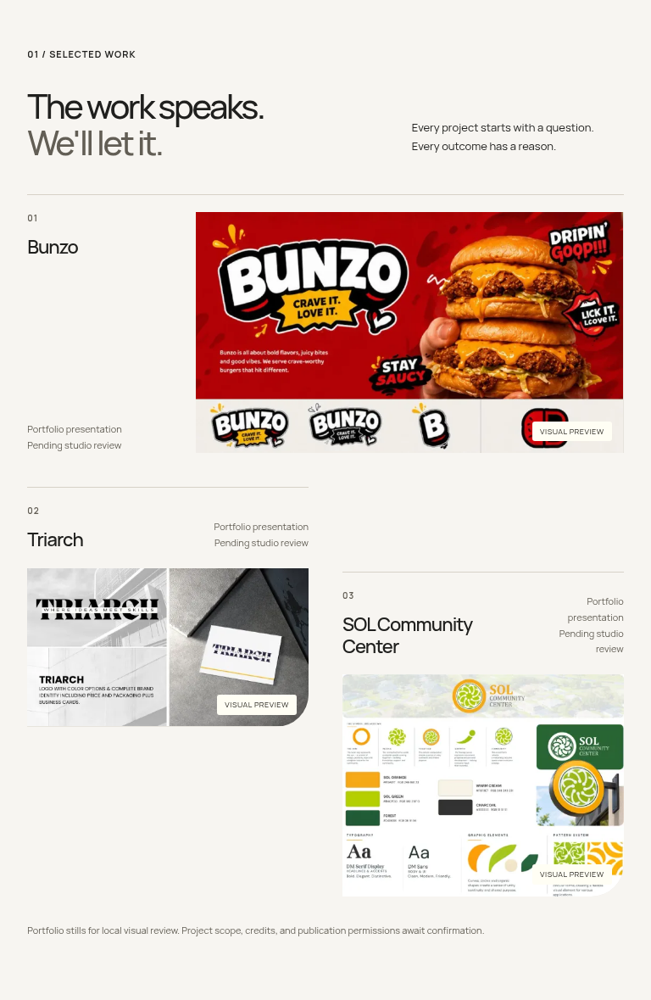 | 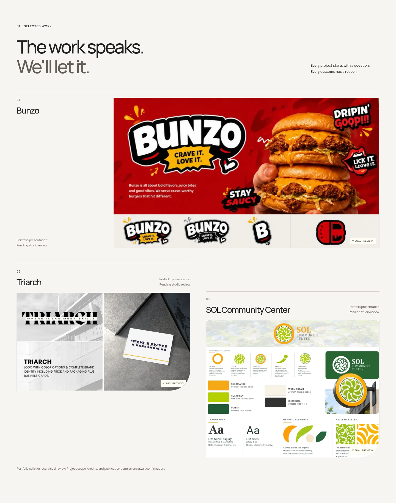 |

## Static footer foundation

The live enquiry CTA, navigation, and independent decorative artwork layer establish the footer structure. The cinematic hand-and-logo animation is not implemented in Phase 1.

| Mobile — 390px                                                               | Tablet — 768px                                                               | Desktop — 1440px                                                                |
| ---------------------------------------------------------------------------- | ---------------------------------------------------------------------------- | ------------------------------------------------------------------------------- |
| 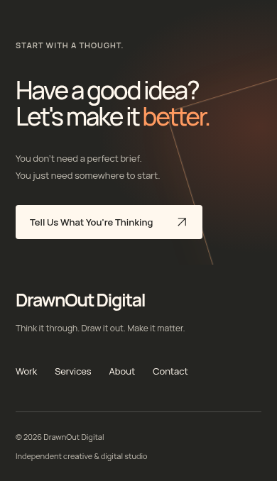 | 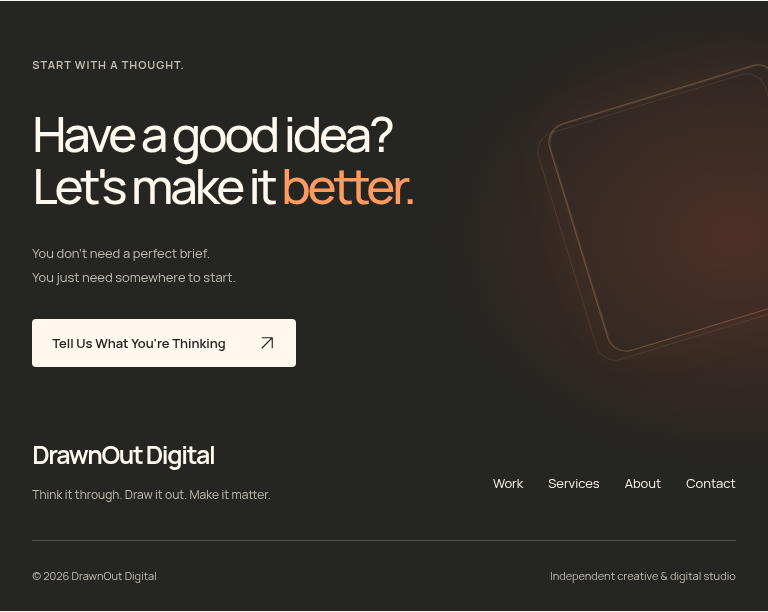 | 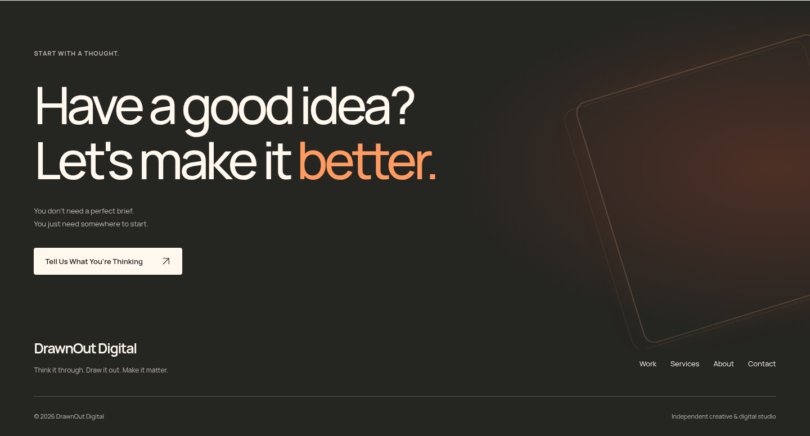 |

## Implementation, validation, and approval

Delivery revalidation passed: build, TypeScript (39 files, zero errors/warnings/hints), ESLint, formatting, and all 45 automated tests (13 content/contrast, 30 browser, and two production-output checks). Fresh browser captures were written to a temporary directory; the 19 original images in this gallery remain byte-for-byte unchanged.

- [Phase 1 implementation handoff](../../docs/PHASE_1_HANDOFF.md)
- [Phase 1 validation results](../../docs/PHASE_1_VALIDATION.md)
- [Repository setup and current implementation](../../README.md)
- [Original Phase 0 alternatives](../README.md)

The gallery includes three full-page views, one open-menu view, and 15 component screenshots. Component-only captures temporarily hide sticky navigation so it does not obscure the cropped evidence; full-page and header captures retain the real navigation.

**Awaiting Phase 1 visual approval. Phase 2 has not begun.**
