# Phase 3 — Afterglow Work and case-study review

An editorial Work index and reusable case-study system, extending the approved Afterglow visual identity. The Phase 2 homepage remains preserved. This gallery includes **24 original-resolution PNGs**: desktop, tablet, and mobile Work views; a filtered index at each size; and full-page, opening, and gallery views of Bunzo and Triarch.

These are authorized **local/development-only previews** of supplied portfolio artwork. All **11 project records remain private drafts**. Commissioning status, scope, services, credits, outcomes, and publication permission are unconfirmed; artwork categories describe what is visible rather than establishing agency deliverables. Production builds exclude unapproved artwork, project metadata, and case-study routes. This GitHub review gallery does not deploy a public website.

## Full-page quick links

| Experience              | Desktop — 1440px                                | Tablet — 768px                                | Mobile — 390px                                |
| ----------------------- | ----------------------------------------------- | --------------------------------------------- | --------------------------------------------- |
| Work index              | [Open desktop Work](./work-1440.png)            | [Open tablet Work](./work-768.png)            | [Open mobile Work](./work-390.png)            |
| Bunzo project preview   | [Open desktop Bunzo](./case-bunzo-1440.png)     | [Open tablet Bunzo](./case-bunzo-768.png)     | [Open mobile Bunzo](./case-bunzo-390.png)     |
| Triarch project preview | [Open desktop Triarch](./case-triarch-1440.png) | [Open tablet Triarch](./case-triarch-768.png) | [Open mobile Triarch](./case-triarch-390.png) |

Click any image to inspect its full-resolution file on GitHub. Expand the full-page views below to compare the complete compositions.

## Work — editorial portfolio index

Large imagery alternates with asymmetric pairings, portrait studies, and offset presentations. Project names and descriptive categories remain close to their artwork. The index and case links are generated from canonical content records.

Desktop Work index — 1440px full page

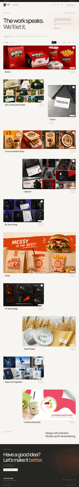

Tablet Work index — 768px full page

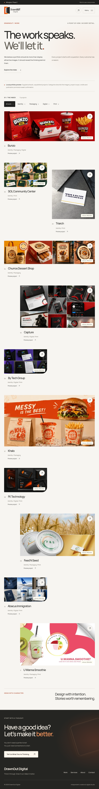

Mobile Work index — 390px full page

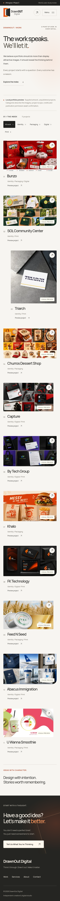

### Responsive filtering — Packaging selection

Category controls and counts derive from the actual records. The selected state, result announcement, URL history, keyboard support, and all-projects no-JavaScript fallback are covered by the automated checks. These viewport captures show the Packaging filter selected.

| Desktop — 1440px                                                                 | Tablet — 768px                                                                | Mobile — 390px                                                                |
| -------------------------------------------------------------------------------- | ----------------------------------------------------------------------------- | ----------------------------------------------------------------------------- |
| 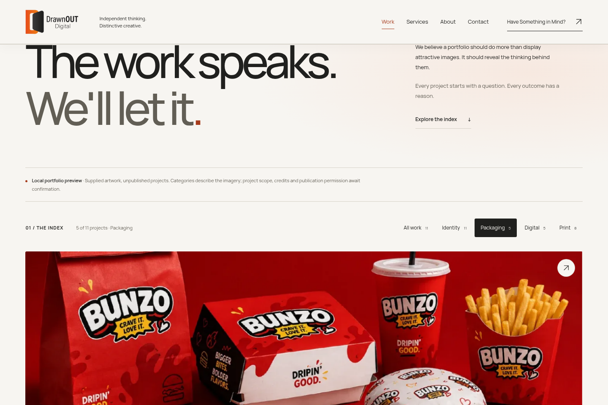 | 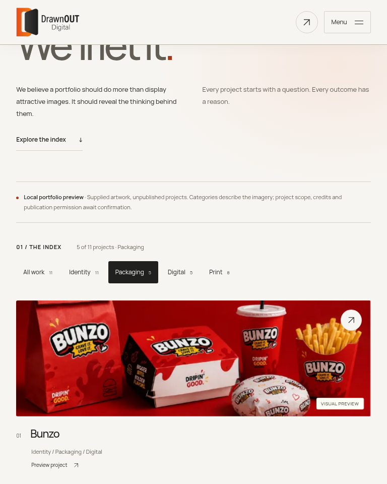 | 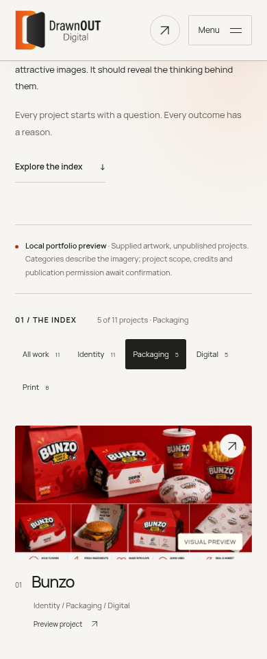 |

## Bunzo — packaging-led project presentation

The shared template presents the supplied red packaging artwork through large scenes and complementary detail compositions. The overview and captions describe visible source material; unverified challenges, services, credits, and outcomes remain absent.

Desktop Bunzo preview — 1440px full page

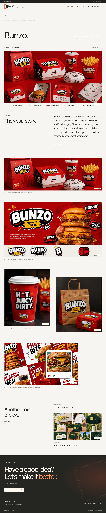

Tablet Bunzo preview — 768px full page

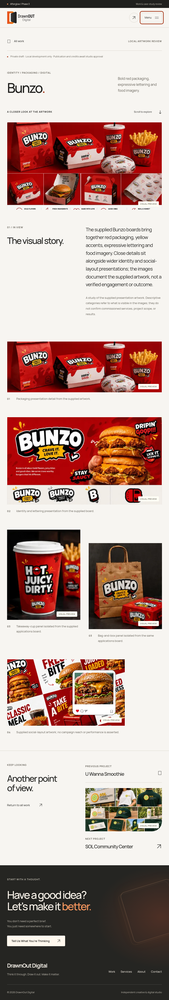

Mobile Bunzo preview — 390px full page

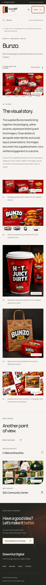

### Bunzo opening — title, introduction, and hero artwork

| Desktop — 1440px                                                                                   | Tablet — 768px                                                                                  | Mobile — 390px                                                                                  |
| -------------------------------------------------------------------------------------------------- | ----------------------------------------------------------------------------------------------- | ----------------------------------------------------------------------------------------------- |
| 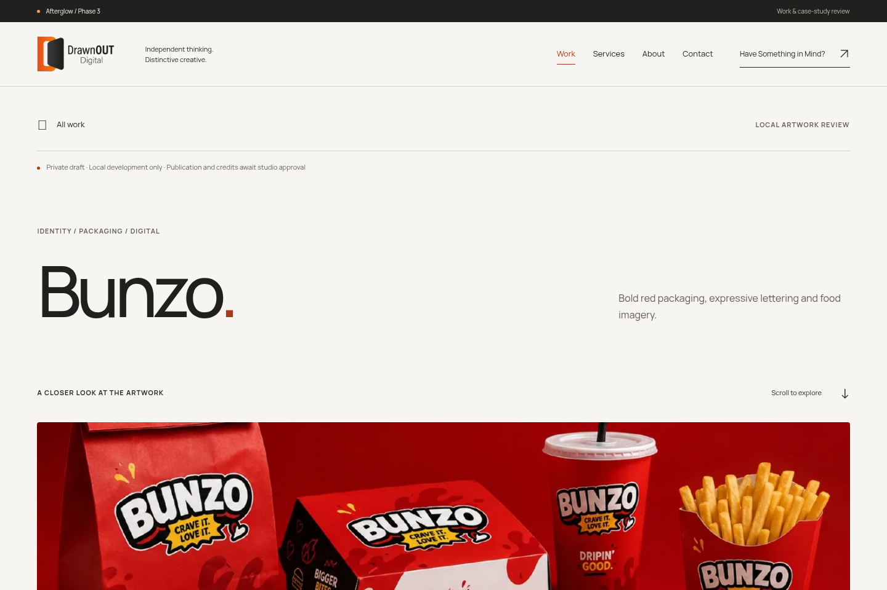 | 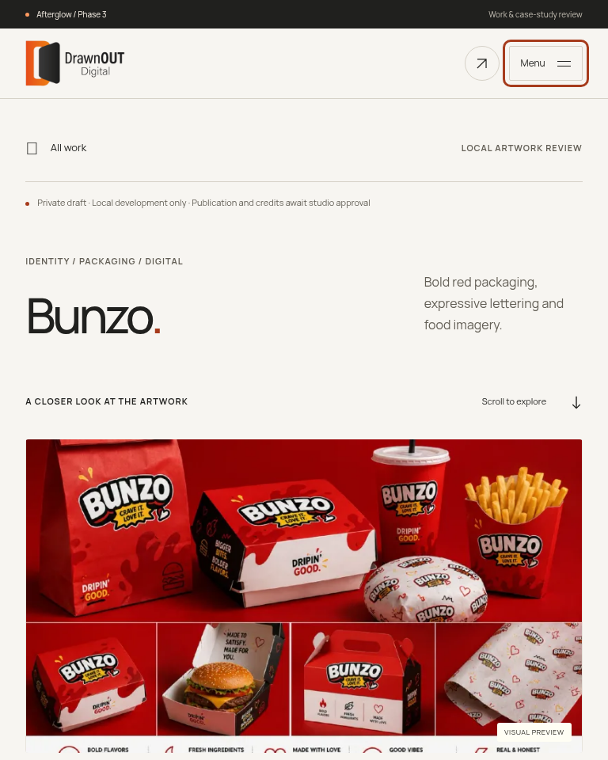 | 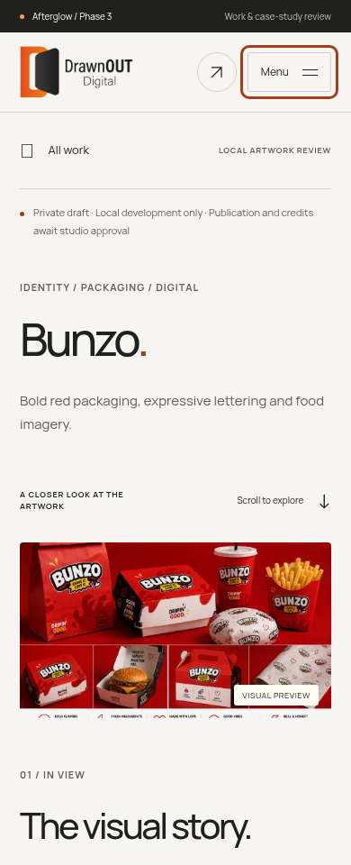 |

### Bunzo image sequence — full artwork and detail compositions

| Desktop — 1440px                                                                                  | Tablet — 768px                                                                                 | Mobile — 390px                                                                                 |
| ------------------------------------------------------------------------------------------------- | ---------------------------------------------------------------------------------------------- | ---------------------------------------------------------------------------------------------- |
| 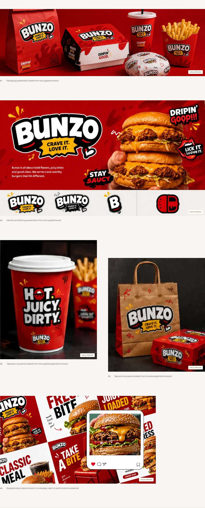 | 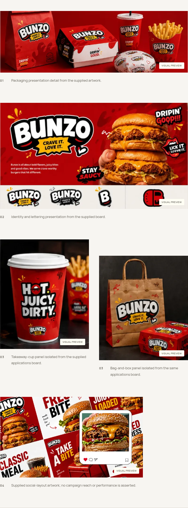 | 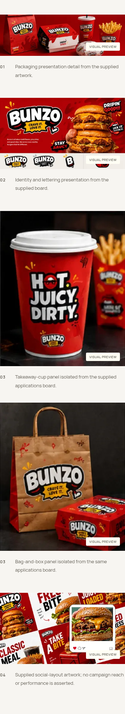 |

## Triarch — identity and print presentation

The same maintainable template accommodates Triarch's restrained monochrome identity and portrait imagery. Responsive compositions, readable captions, project navigation, and the shared enquiry footer support a different visual rhythm without duplicating a project page.

Desktop Triarch preview — 1440px full page

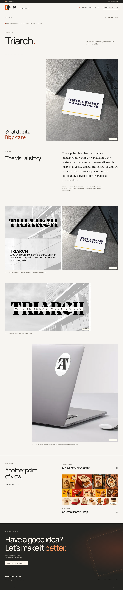

Tablet Triarch preview — 768px full page

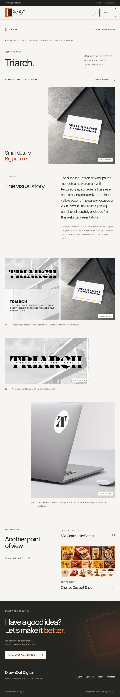

Mobile Triarch preview — 390px full page

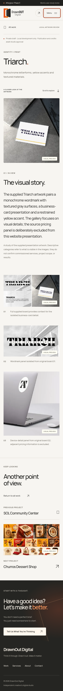

### Triarch opening — title, introduction, and hero artwork

| Desktop — 1440px                                                                                       | Tablet — 768px                                                                                      | Mobile — 390px                                                                                      |
| ------------------------------------------------------------------------------------------------------ | --------------------------------------------------------------------------------------------------- | --------------------------------------------------------------------------------------------------- |
| 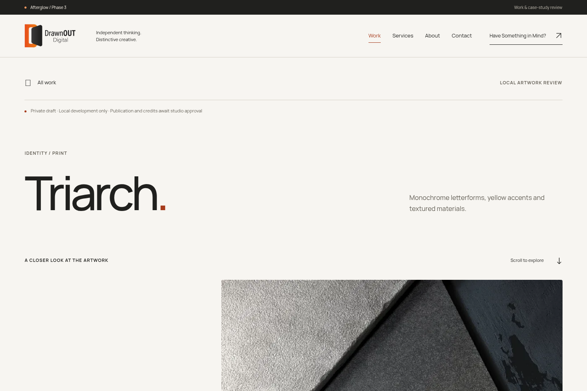 | 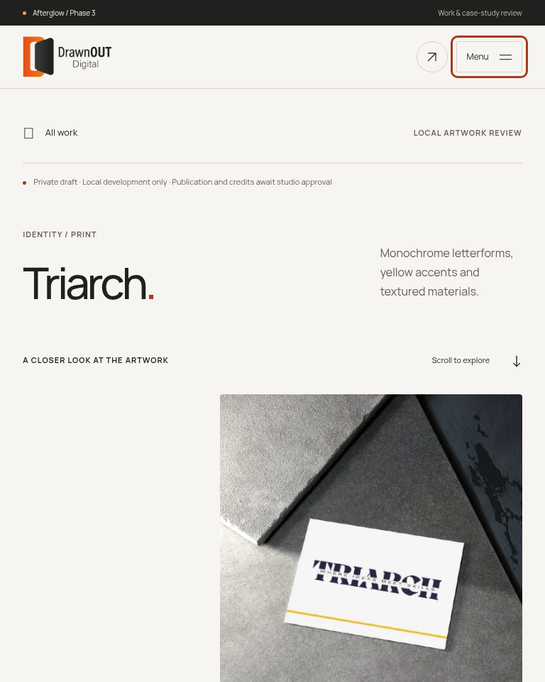 | 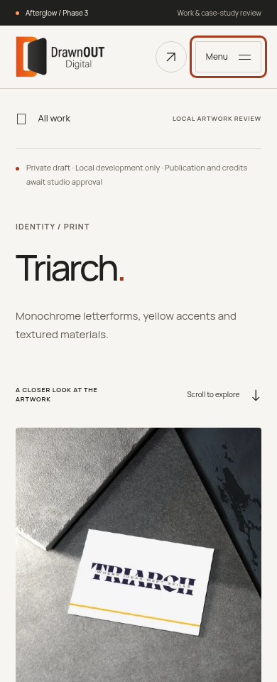 |

### Triarch image sequence — full artwork and detailed print studies

| Desktop — 1440px                                                                                | Tablet — 768px                                                                               | Mobile — 390px                                                                               |
| ----------------------------------------------------------------------------------------------- | -------------------------------------------------------------------------------------------- | -------------------------------------------------------------------------------------------- |
| 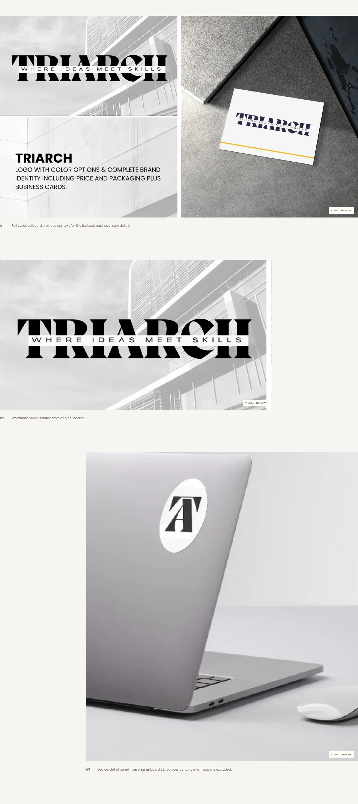 | 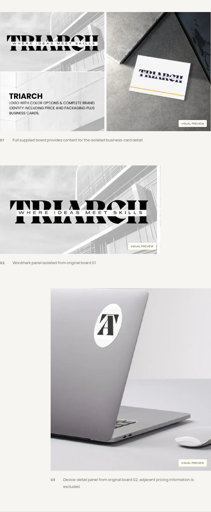 | 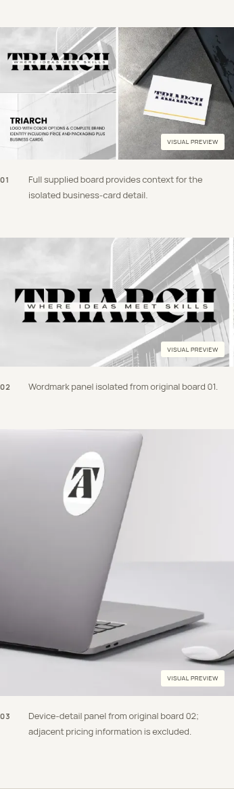 |

## Implementation and validation

- [Phase 3 implementation handoff](../../docs/PHASE_3_HANDOFF.md)
- [Phase 3 validation results](../../docs/PHASE_3_VALIDATION.md)
- [Original artwork and derivative asset audit](../../docs/PHASE_3_ASSET_AUDIT.md)
- [Codex-managed portfolio workflow](../../docs/PORTFOLIO_WORKFLOW.md)

Full-page and opening captures retain the actual header. Gallery-only captures temporarily hide sticky navigation so it does not obscure the artwork. The supplied originals remain unchanged; optimized responsive derivatives provide the media shown here.

Native scrolling, keyboard navigation, focus feedback, and reduced-motion support remain the baseline. Image/text wrappers and project-navigation boundaries prepare later motion work. Full GSAP choreography, cinematic scrolling, expanding-image transitions, and the hand/logo footer animation are deferred; the footer remains static in Phase 3.

**Phase 3 stops for visual approval. No automatic merge, public deployment, or motion-phase implementation is authorized by this gallery.**
