# Phase 4 — Afterglow motion review

This gallery shows the approved Phase 1–3 layouts with the Phase 4 motion layer. Open the full recordings first: screenshots capture composition and expansion states but cannot demonstrate pacing or reverse scrolling.

All artwork shown here is authorized review evidence from the private development collection. The eleven project records remain unapproved drafts; the production build excludes their images and routes. There is no public site deployment.

## Actual scrolling recordings

- [Desktop — 1440 × 900, full MP4](desktop-motion.mp4)
- [Mobile — 390 × 844, full MP4](mobile-motion.mp4)
- [Recorded states, timing markers and performance measurements](motion-evidence.json)

These are real Chromium compositor recordings. The capture script scrolls the native document forward and backward through the homepage, Work index/filter and Bunzo case preview; it does not seek or mock animation timelines. Each full recording starts before the homepage loads, then covers image expansion, selected editorial reveals, Work filtering and reverse movement in the case gallery. GitHub may show a download button for MP4 files; the animated excerpts below play directly in this gallery.

### Desktop excerpt — forward and reverse expansion

[Open the full desktop recording](desktop-motion.mp4).

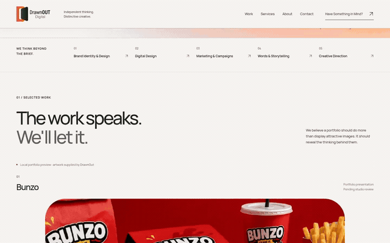

### Mobile excerpt — forward and reverse expansion

[Open the full mobile recording](mobile-motion.mp4).

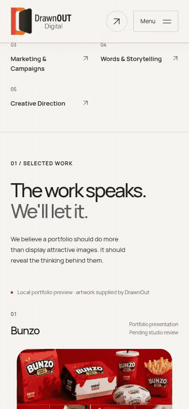

The excerpts are eight-second GIF extracts of the corresponding recordings. Full MP4s retain the other page transitions and editorial scenes. H.264, no audio, fast-start playback; file sizes and observed capture limitations are in [validation](../../docs/PHASE_4_VALIDATION.md).

## Hero atmosphere and typography

The recordings show the staged headline and supporting entrances, restrained exit, and slow orange/lavender atmosphere. These screenshots show the settled hero at each required width.

### Mobile — 390px

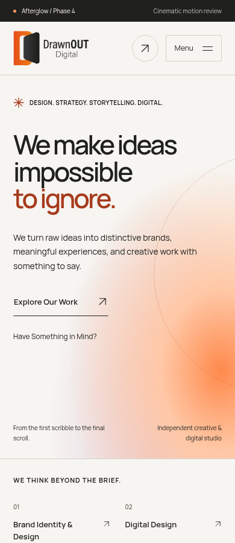

### Tablet — 768px

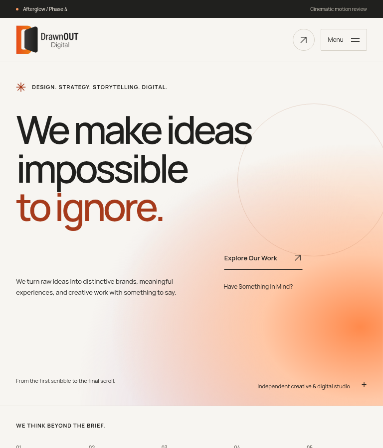

### Desktop — 1440px

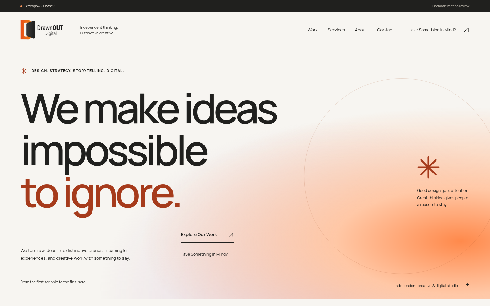

## Expansion states

Each row follows the **same media surface** through real native scroll positions: beginning (about 8%), middle (50%), completed reveal (about 98%) and reverse (back to about 8%). Frames crop the image surface without scrolling it into a different state. The clip progressively opens and the inner artwork settles; card dimensions, captions and document flow stay fixed. Open any image for original resolution. The JSON manifest records actual progress and computed clips for each capture.

### Homepage selected work

The wide Bunzo scene expands within the approved homepage composition.

#### Mobile — 390px

| Beginning                                                               | Middle                                                                    | Completed                                                                     | Reverse                                                                     |
| ----------------------------------------------------------------------- | ------------------------------------------------------------------------- | ----------------------------------------------------------------------------- | --------------------------------------------------------------------------- |
|  | 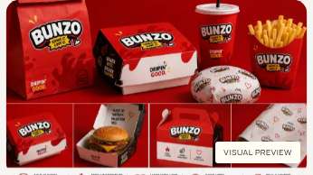 | 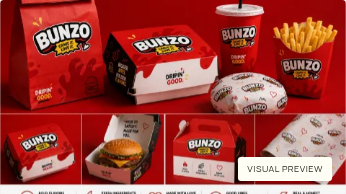 | 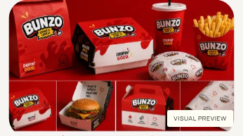 |

#### Tablet — 768px

| Beginning                                                               | Middle                                                                    | Completed                                                                     | Reverse                                                                     |
| ----------------------------------------------------------------------- | ------------------------------------------------------------------------- | ----------------------------------------------------------------------------- | --------------------------------------------------------------------------- |
| 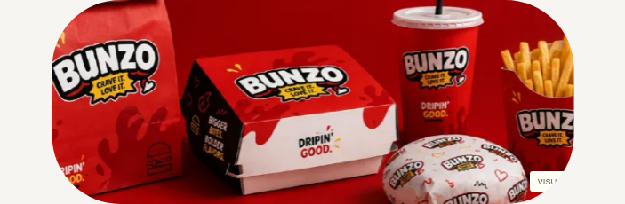 |  |  |  |

#### Desktop — 1440px

| Beginning                                                                 | Middle                                                                      | Completed                                                                       | Reverse                                                                       |
| ------------------------------------------------------------------------- | --------------------------------------------------------------------------- | ------------------------------------------------------------------------------- | ----------------------------------------------------------------------------- |
|  |  |  |  |

### Work index

A scrollable editorial project scene opens within the existing asymmetric index.

#### Mobile — 390px

| Beginning                                                   | Middle                                                        | Completed                                                         | Reverse                                                         |
| ----------------------------------------------------------- | ------------------------------------------------------------- | ----------------------------------------------------------------- | --------------------------------------------------------------- |
| 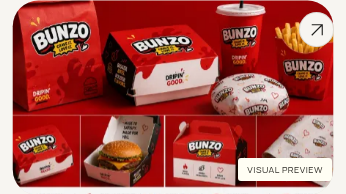 | 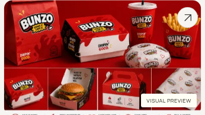 | 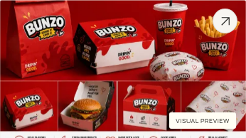 |  |

#### Tablet — 768px

| Beginning                                                   | Middle                                                        | Completed                                                         | Reverse                                                         |
| ----------------------------------------------------------- | ------------------------------------------------------------- | ----------------------------------------------------------------- | --------------------------------------------------------------- |
|  | 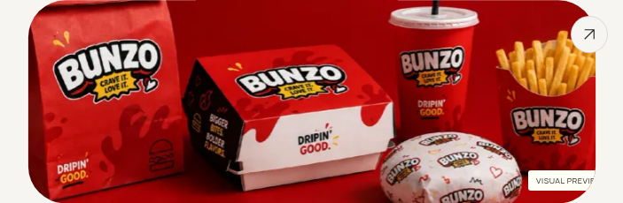 |  |  |

#### Desktop — 1440px

| Beginning                                                     | Middle                                                          | Completed                                                           | Reverse                                                           |
| ------------------------------------------------------------- | --------------------------------------------------------------- | ------------------------------------------------------------------- | ----------------------------------------------------------------- |
| 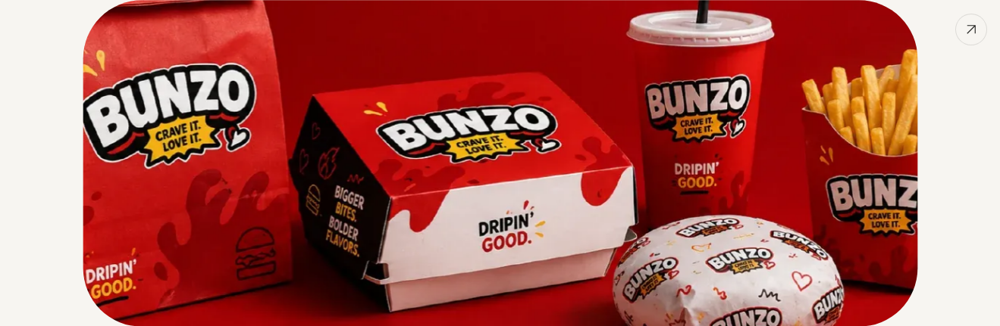 |  |  |  |

### Bunzo case gallery

A gallery composition uses the shared treatment within the existing reusable case template.

#### Mobile — 390px

| Beginning                                                           | Middle                                                                | Completed                                                                 | Reverse                                                                 |
| ------------------------------------------------------------------- | --------------------------------------------------------------------- | ------------------------------------------------------------------------- | ----------------------------------------------------------------------- |
|  |  | 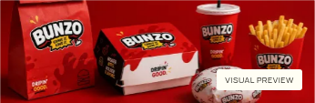 |  |

#### Tablet — 768px

| Beginning                                                           | Middle                                                                | Completed                                                                 | Reverse                                                                 |
| ------------------------------------------------------------------- | --------------------------------------------------------------------- | ------------------------------------------------------------------------- | ----------------------------------------------------------------------- |
|  | 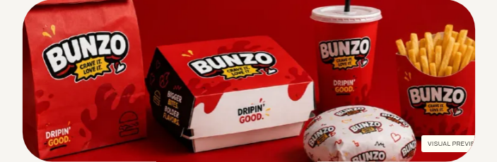 |  |  |

#### Desktop — 1440px

| Beginning                                                             | Middle                                                                  | Completed                                                                   | Reverse                                                                   |
| --------------------------------------------------------------------- | ----------------------------------------------------------------------- | --------------------------------------------------------------------------- | ------------------------------------------------------------------------- |
|  |  |  |  |

## Engineering and approval boundary

- [Motion ownership, timings, easing and lifecycle decisions](../../docs/PHASE_4_HANDOFF.md)
- [Actual validation results, preservation checks and measurement limits](../../docs/PHASE_4_VALIDATION.md)
- [Repository instructions and capture reproduction](../../README.md)
- [Approved Phase 3 layout gallery](../phase-3/README.md)

Reduced motion, data saving, no JavaScript and failed enhancement retain visible static content. Native scrolling, navigation, keyboard focus and project publication rules remain in place. The footer remains static; its signature hand/logo animation belongs to Phase 5. Video-placeholder planning/design is deferred.

**Phase 4 stops for review. No merge, public deployment or Phase 5 work is authorized by this delivery.**
