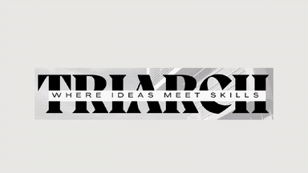
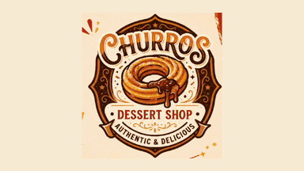
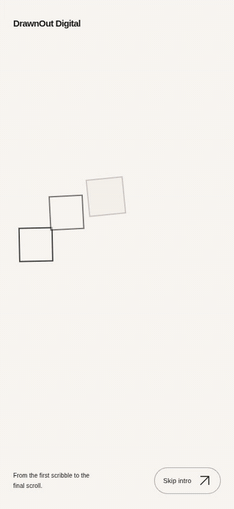
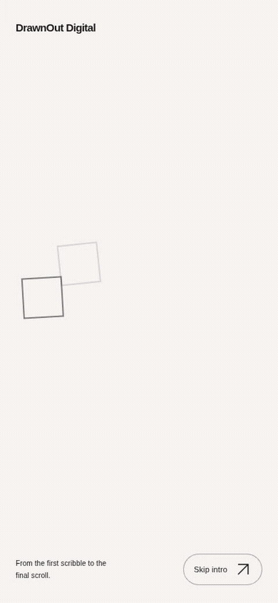
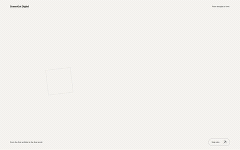
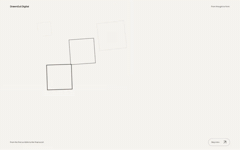

# Portfolio motion — review gallery

Six distinct silent source-artwork compositions, integrated into the real Home and Work cards. All loops are 5.75 seconds at 24fps. These are art-directed 2D masks and image-panel compositions using the approved originals; they do not claim editable vector logo animation or simulated 3D products.

[Validation report](../../docs/next-milestone/PORTFOLIO_MOTION_VALIDATION.md) · [Workflow and limits](../../docs/next-milestone/PORTFOLIO_MOTION_HANDOFF.md) · [Browser playback measurements](website-evidence.json) · [Browser tests](browser-tests.json) · [Export tests](export-tests.txt)

## Six individual compositions

### SOL Community Center

Symbol becomes a system: concentric apertures, signage and stationery.

[Landscape MP4](../../design-assets/portfolio-motion/sol-community-center-landscape.mp4) · [Portrait MP4](../../design-assets/portfolio-motion/sol-community-center-portrait.mp4) · [Application keyframe](sol-community-center-landscape-applications.png)

### Bunzo

Packaging with punch: red shutters and independently moving application panels.

[Landscape MP4](../../design-assets/portfolio-motion/bunzo-landscape.mp4) · [Portrait MP4](../../design-assets/portfolio-motion/bunzo-portrait.mp4) · [Application keyframe](bunzo-landscape-applications.png)

### Triarch

Architectural lines: measured construction guides, monogram and stationery.

[Landscape MP4](../../design-assets/portfolio-motion/triarch-landscape.mp4) · [Portrait MP4](../../design-assets/portfolio-motion/triarch-portrait.mp4) · [Application keyframe](triarch-landscape-applications.png)

### Churros Dessert Shop

Illustrated sweetness: arcs, revolving circular windows and packaging.

[Landscape MP4](../../design-assets/portfolio-motion/churros-landscape.mp4) · [Portrait MP4](../../design-assets/portfolio-motion/churros-portrait.mp4) · [Application keyframe](churros-landscape-applications.png)

### By Tech Group

Identity in modules: progressive grid apertures and assembled applications.

[Landscape MP4](../../design-assets/portfolio-motion/by-tech-group-landscape.mp4) · [Portrait MP4](../../design-assets/portfolio-motion/by-tech-group-portrait.mp4) · [Application keyframe](by-tech-group-landscape-applications.png)

### U Wanna Smoothie

Liquid and flavor: elastic wave masks, illustrated menu and product imagery.

[Landscape MP4](../../design-assets/portfolio-motion/u-wanna-smoothie-landscape.mp4) · [Portrait MP4](../../design-assets/portfolio-motion/u-wanna-smoothie-portrait.mp4) · [Application keyframe](u-wanna-smoothie-landscape-applications.png)

## Real website recordings

These are continuous native browser recordings from the production build. Cards autoplay without hover while native scrolling visits them; each shown loop runs for at least 6.25 seconds. No footage clocks were sought or animation states injected.

### Home — 390px

[Watch full MP4 (44.1s)](home-390-autoplay.mp4)

### Work — 390px

[Watch full MP4 (43.7s)](work-390-autoplay.mp4)

### Home — 1440px

[Watch full MP4 (45.4s)](home-1440-autoplay.mp4)

### Work — 1440px

[Watch full MP4 (44.7s)](work-1440-autoplay.mp4)

## Responsive views

| Width  | Home                                                                                          | Work                                                                                                         |
| ------ | --------------------------------------------------------------------------------------------- | ------------------------------------------------------------------------------------------------------------ |
| 390px  | [Normal view](home-390-bunzo.png) · [Reduced-motion full page](home-390-reduced-motion.png)   | [Normal view](work-390-sol-community-center.png) · [Reduced-motion full page](work-390-reduced-motion.png)   |
| 768px  | [Normal view](home-768-bunzo.png) · [Reduced-motion full page](home-768-reduced-motion.png)   | [Normal view](work-768-sol-community-center.png) · [Reduced-motion full page](work-768-reduced-motion.png)   |
| 1440px | [Normal view](home-1440-bunzo.png) · [Reduced-motion full page](home-1440-reduced-motion.png) | [Normal view](work-1440-sol-community-center.png) · [Reduced-motion full page](work-1440-reduced-motion.png) |

The full capture manifest contains all 48 website screenshots and 36 observed playback visits at 390/768/1440px. All48 export keyframes are also retained. Physical device and hardware GPU review remain necessary. The hand/plaque footer is still its documented 2D prototype; Formspree remains unconfigured.
