# Portfolio rhythm — review gallery

The project order is preserved. The opening deliberately follows **Bunzo static → SOL animated → Triarch static → Churros animated**, keeping SOL prominent without applying an animated-first parity rule. Filters curate the visible projects, including poster-only gaps. All six original motion compositions remain available; this refinement changes where they play and adds a one-time title reveal.

[Downloadable HTML gallery](index.html) · [Capture measurements](website-evidence.json) · [Browser test report](browser-tests.json) · [Implementation and validation](../../docs/next-milestone/PORTFOLIO_RHYTHM_HANDOFF.md) · [Original six compositions](../portfolio-motion/README.md)

The production browser suite passed **35/35 tests**, with no failures, flaky results or skips (195.4 seconds). Fresh capture produced **63 screenshots, 51 project observations and four MP4/GIF recording pairs**, with no page errors or horizontal overflow. All 21 animated observations advanced their decoded playback time; all 51 title reveals completed. The HTML gallery can be downloaded and opened locally; GitHub displays its source.

## Opening rhythm

These screenshots show the four opening selections at desktop and mobile sizes. Home previews are embedded, with matching Work views linked below each preview. Screenshots show appearance; use the recordings to assess movement and title timing.

| Selection                   | Desktop — 1440px                                                                                                                 | Mobile — 390px                                                                                                                |
| --------------------------- | -------------------------------------------------------------------------------------------------------------------------------- | ----------------------------------------------------------------------------------------------------------------------------- |
| **01 · Bunzo — static**     | 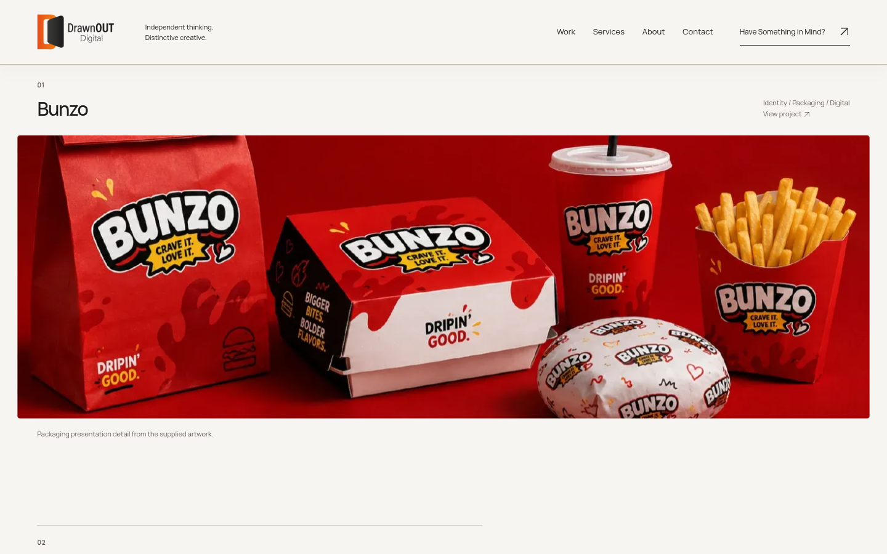 [Work view](work-1440-bunzo.png)                                         | 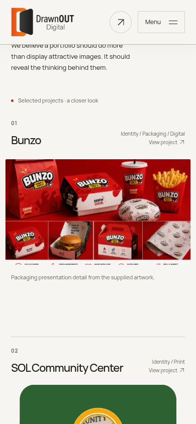 [Work view](work-390-bunzo.png)                                         |
| **02 · SOL — animated**     | 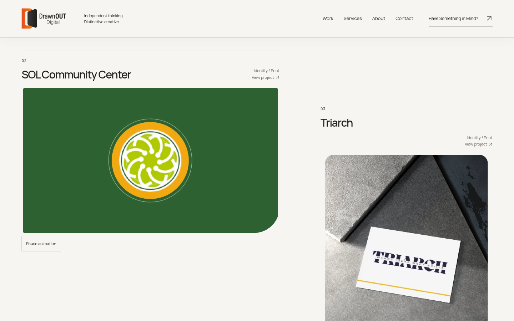 [Work view](work-1440-sol-community-center.png) | 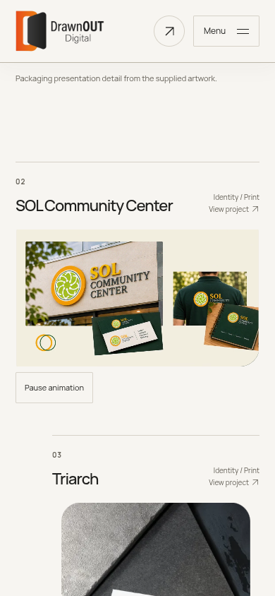 [Work view](work-390-sol-community-center.png) |
| **03 · Triarch — static**   | 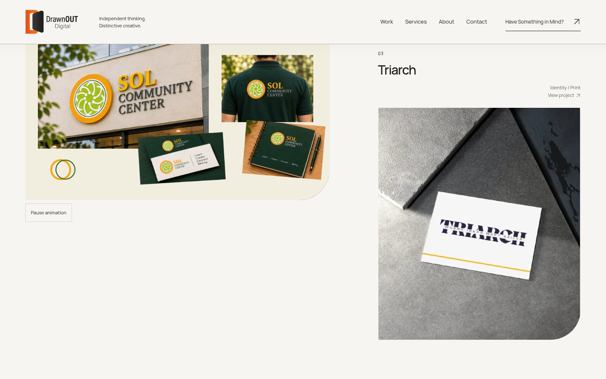 [Work view](work-1440-triarch.png)                                   | 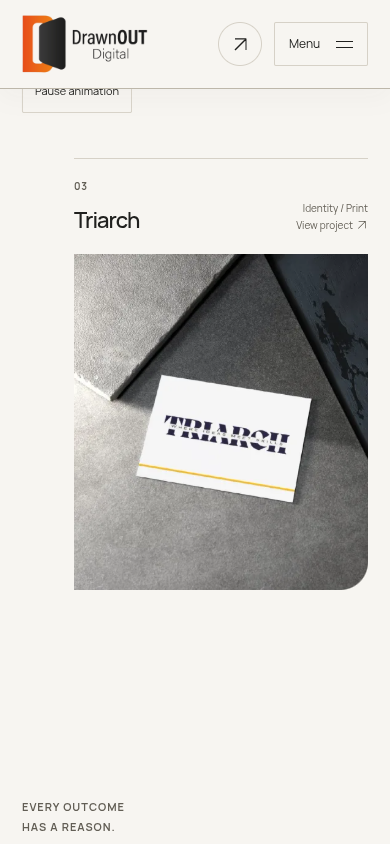 [Work view](work-390-triarch.png)                                   |
| **04 · Churros — animated** | 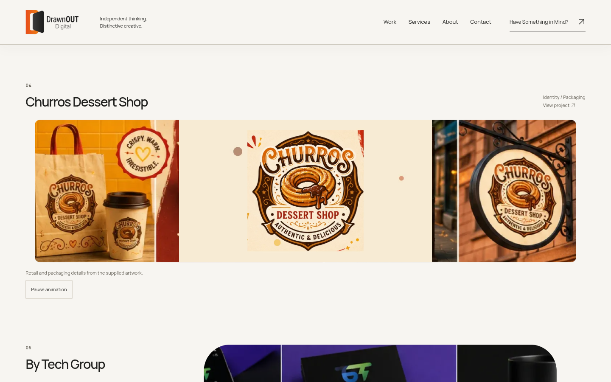 [Work view](work-1440-churros.png)                       | 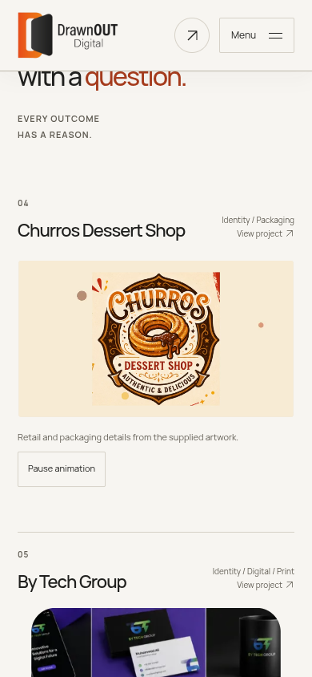 [Work view](work-390-churros.png)                       |

## Browser recordings

The capture script records native scrolling through every project card, letting selected footage play while static projects retain their posters. MP4/GIF output is transcoded from the native browser recording; the project footage is not regenerated. Each recording also visits the captions to show their one-time reveals.

| Route and viewport | Recording                   | Duration | Animated preview                                               |
| ------------------ | --------------------------- | -------- | -------------------------------------------------------------- |
| Home · 390px       | [MP4](home-390-rhythm.mp4)  | 28.48s   | 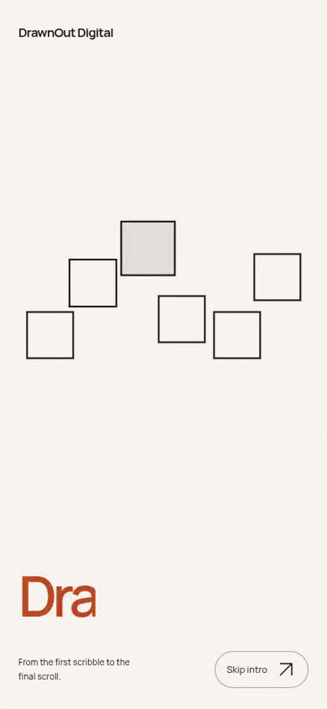   |
| Work · 390px       | [MP4](work-390-rhythm.mp4)  | 41.84s   | 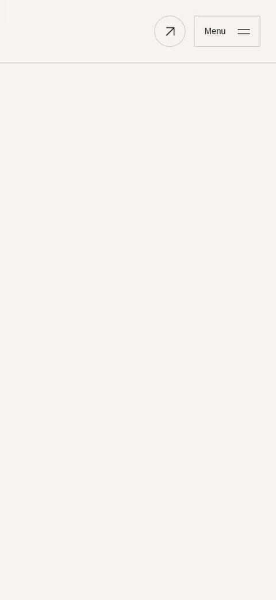   |
| Home · 1440px      | [MP4](home-1440-rhythm.mp4) | 31.08s   | 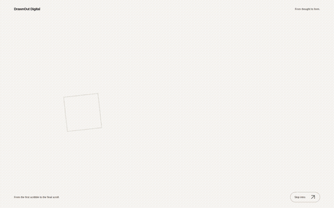 |
| Work · 1440px      | [MP4](work-1440-rhythm.mp4) | 45.52s   | 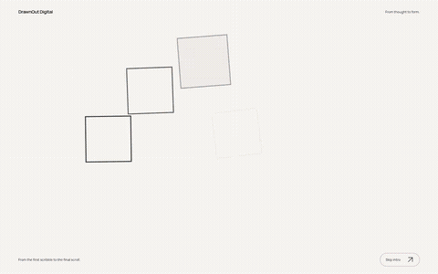 |

## Reduced-motion layouts

These static full-page captures use the browser's real reduced-motion preference, with no portfolio video sources attached.

| Width  | Home                                      | Work                                      |
| ------ | ----------------------------------------- | ----------------------------------------- |
| 390px  | [Full page](home-390-reduced-motion.png)  | [Full page](work-390-reduced-motion.png)  |
| 768px  | [Full page](home-768-reduced-motion.png)  | [Full page](work-768-reduced-motion.png)  |
| 1440px | [Full page](home-1440-reduced-motion.png) | [Full page](work-1440-reduced-motion.png) |

The [downloadable HTML gallery](index.html) links every captured project, including tablet views and the Work index's poster-only gaps. The [JSON manifest](website-evidence.json) records viewport, presentation choice, source state and title completion for inspection. Observed attached-source maxima were one at 390px, two at 768px and one at 1440px, within the existing mobile/desktop budgets. Chromium software-rendered evidence does not establish performance on physical mobile devices or hardware GPUs.
