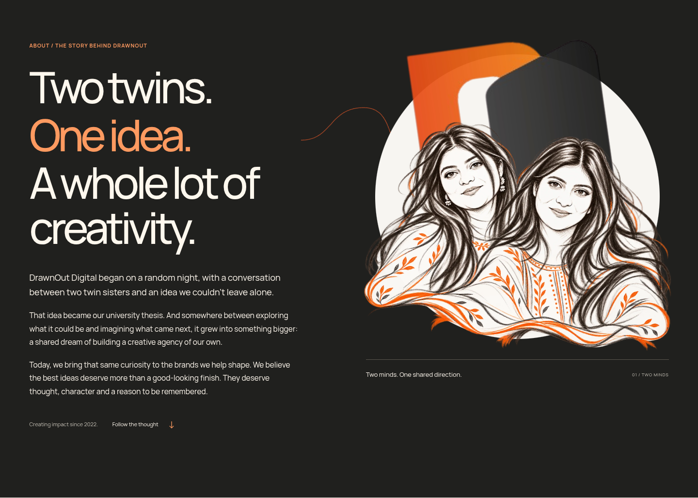

# About refinements and Services hero — review checkpoint

This milestone builds on the owner-reviewed About branch. The About refinement was implemented, tested and preserved before Services hero implementation began. The Services runtime and its final evidence are still being completed at this checkpoint.

## Completed About refinement

[Complete About gallery, initial composition and responsive fallbacks](about-README.md)

| Viewport | Actual arrival                | Direct process scrolling and reversal |
| -------- | ----------------------------- | ------------------------------------- |
| 1440px   | [MP4](about-1440-arrival.mp4) | [MP4](about-1440-process-sync.mp4)    |
| 390px    | [MP4](about-390-arrival.mp4)  | [MP4](about-390-process-sync.mp4)     |

[23-case production browser report](about-browser-tests.json) · [Actual capture facts and image hashes](about-capture-evidence.json) · [Checkpoint and known remaining work](../../docs/services-hero/CHECKPOINT.md) · [Asset provenance](../../docs/services-hero/ASSET_PROVENANCE.md)

The approved derived portrait remains unchanged. The original personal photograph is private. The emblem uses the native supplied artwork, not a navigation thumbnail or a newly drawn vector mark. The existing signature footer remains its documented 2D prototype. No merge, deployment or separate Netlify repository push is included.
