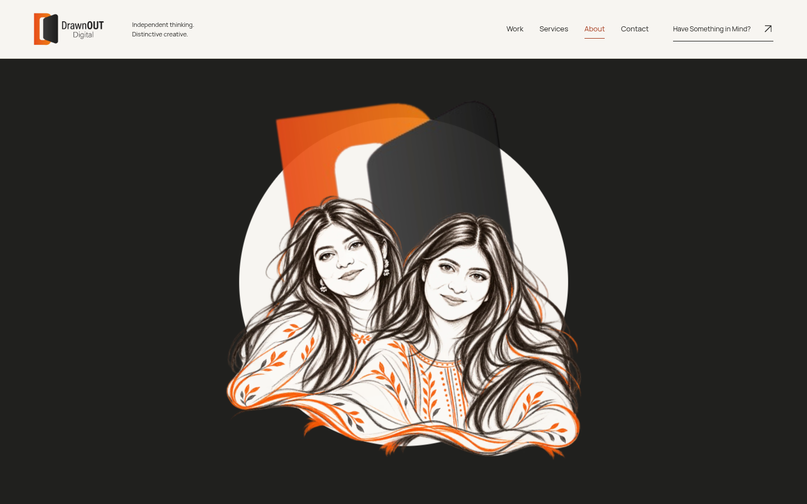
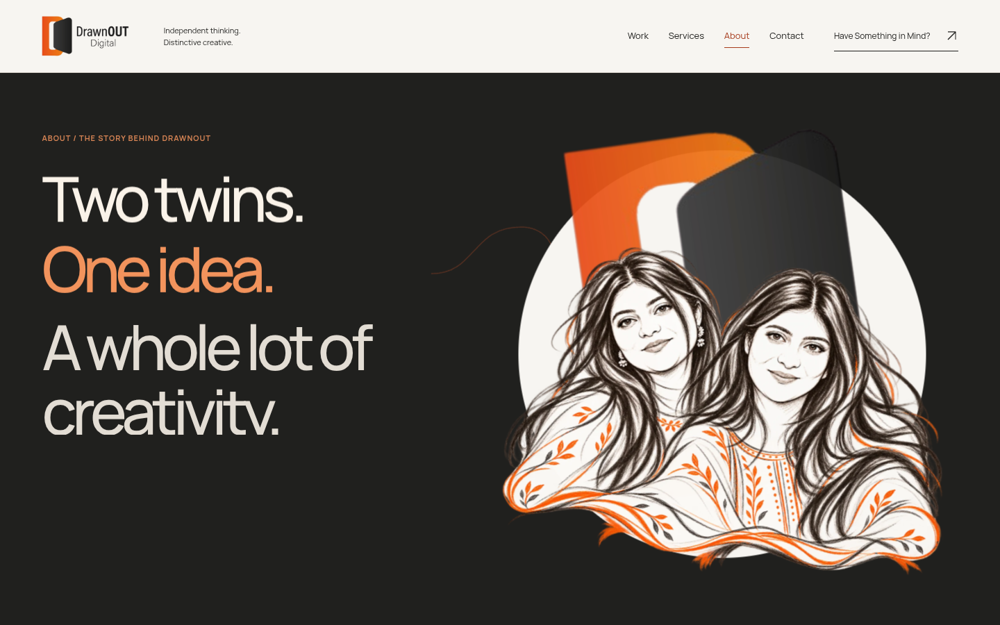
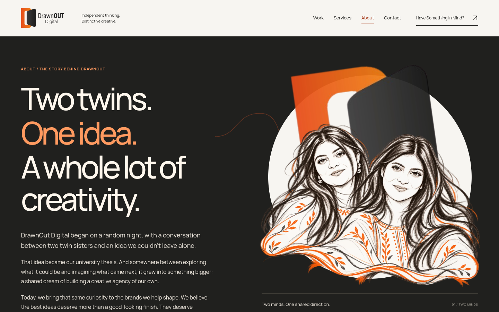
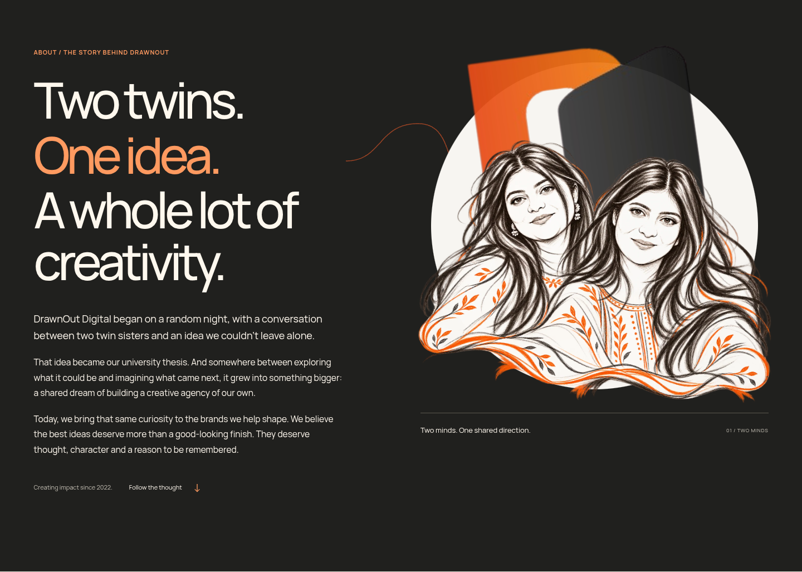
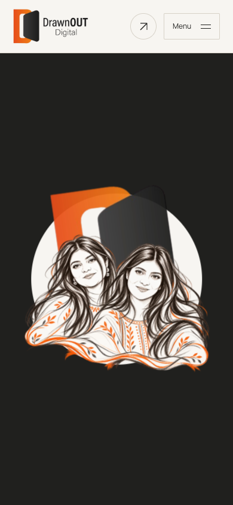
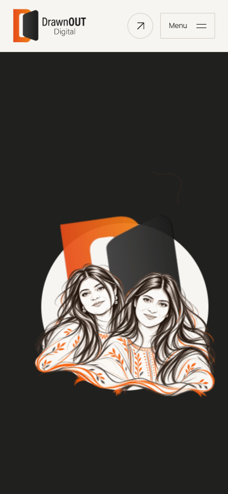
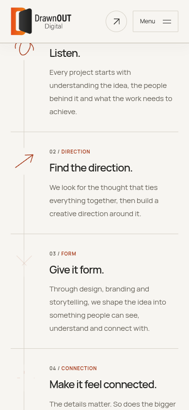

# About correction — actual production evidence

Unedited browser frames and native real-time MP4s for the revised dark About arrival and directly synchronized process. Published clips omit only the first 0.12s of recorder-surface initialization, without changing playback speed or source-clock measurements. Historical About evidence remains unchanged in `artifacts/about`.

[Capture measurements and hashes](about-capture-evidence.json) · [Browser acceptance report](about-browser-tests.json)

## 1440px arrival and process

[Real-time arrival MP4](about-1440-arrival.mp4) · [Fast process forward/reverse MP4](about-1440-process-sync.mp4)

## 390px arrival and process

[Real-time arrival MP4](about-390-arrival.mp4) · [Fast process forward/reverse MP4](about-390-process-sync.mp4)

## Responsive reduced-motion layouts

## No-JavaScript fallback

The approved portrait is unchanged raster artwork. No private photograph is included. These Chromium software-rendering observations do not establish physical-device performance or Safari/Firefox behavior. No merge or deployment is performed by capture.
