# Services cinematic hero — actual production evidence

The first Services hero prototype uses the original supplied emblem and five custom SVG compositions. Existing overview content and detail pages remain below it. These are real browser views and continuous recordings from the local production build; no timeline seeking, CSS replacement or fabricated frames is used. Published clips omit only the first 0.12s of recorder-surface initialization, keeping playback speed and source-clock measurements unchanged.

[Capture facts, timings and screenshot hashes](services-capture-evidence.json) · [Production browser report](services-browser-tests.json) · [About refinement gallery](about-README.md)

## Continuous desktop and mobile loops

Both recordings exceed twenty seconds and show the initial right-side emblem, all five services, the large DrawnOut wordmark and the return into a second cycle. One early native scroll keeps the artwork and caption together in view. The app itself does not auto-scroll.

### 1440px

[Play desktop MP4](services-1440-cycle.mp4)

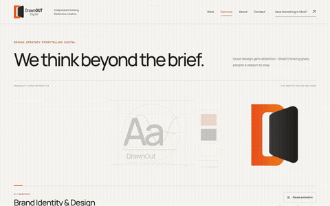

### 390px

[Play mobile MP4](services-390-cycle.mp4)

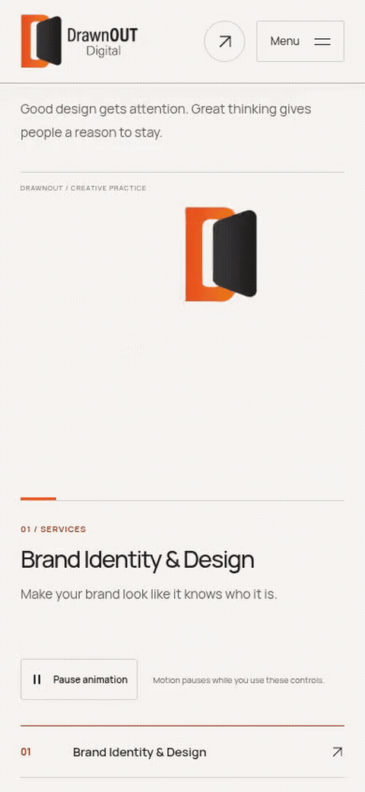

## Five distinct service scenes

| Service                 | 1440px                                                         | 390px                                                        |
| ----------------------- | -------------------------------------------------------------- | ------------------------------------------------------------ |
| Brand Identity & Design | 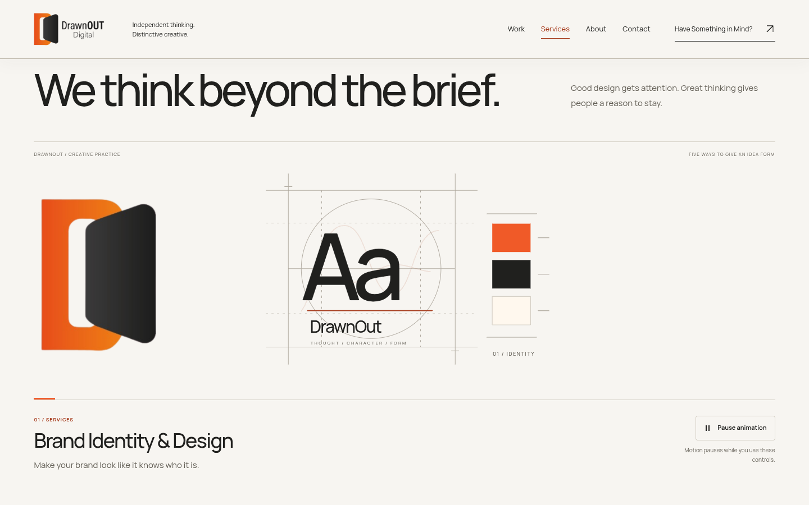           | 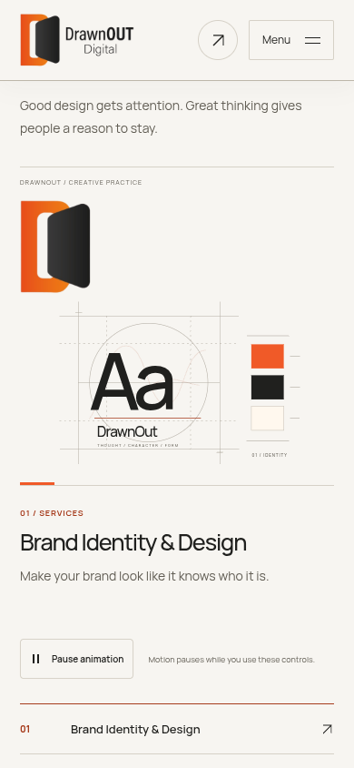           |
| Digital Design          | 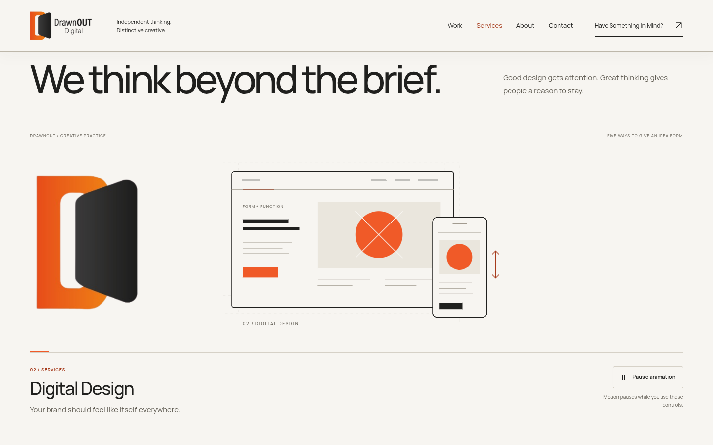            | 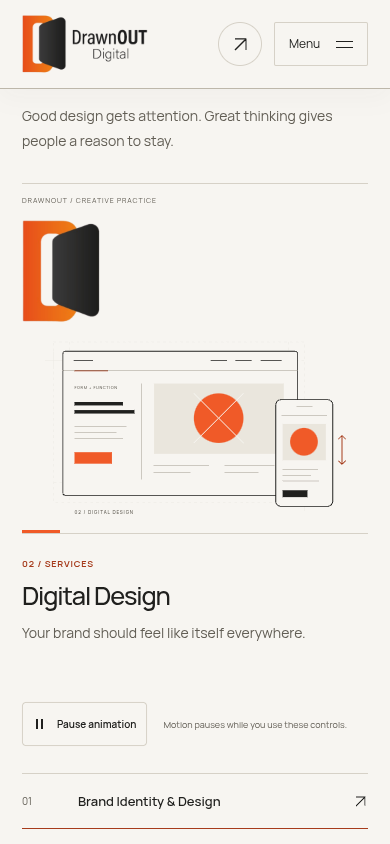            |
| Marketing & Campaigns   | 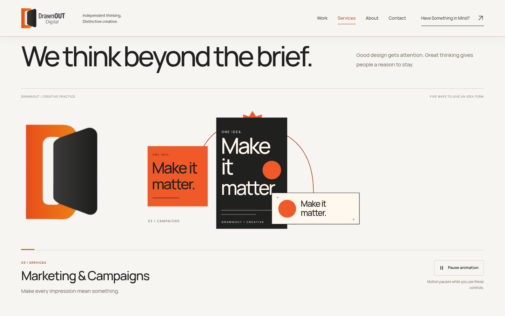           | 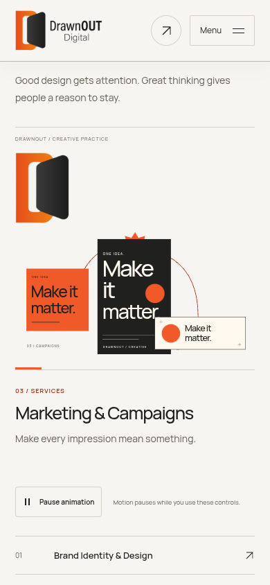           |
| Words & Storytelling    | 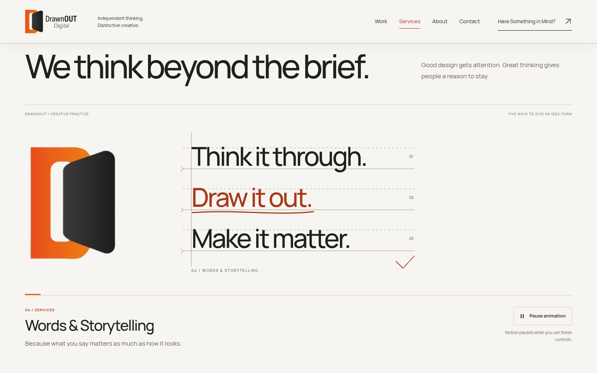       | 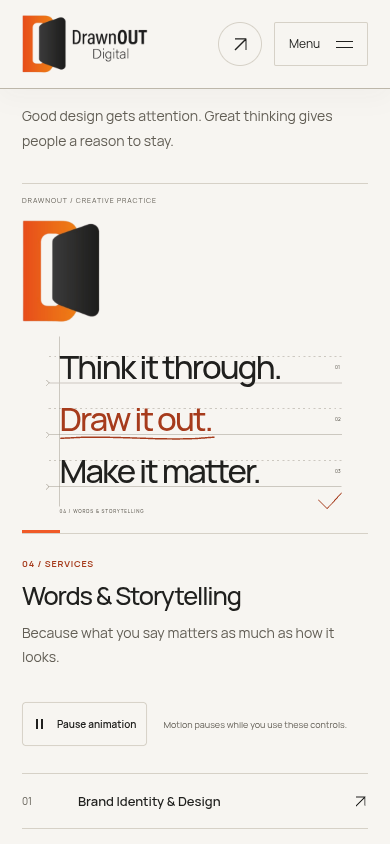       |
| Creative Direction      | 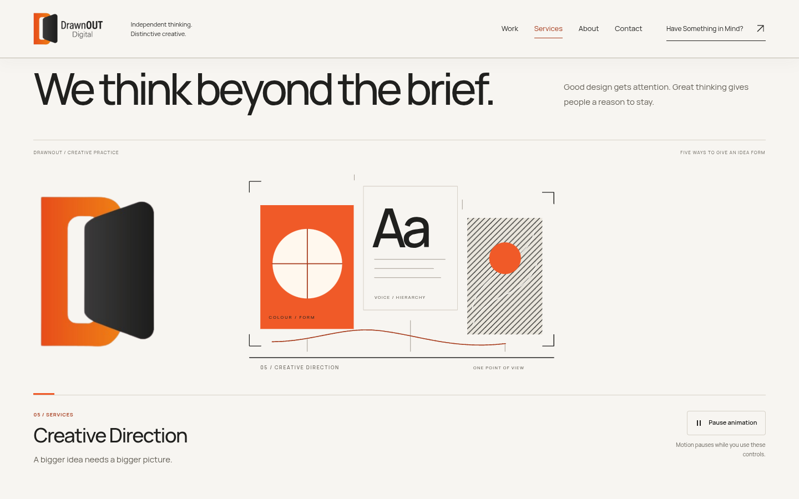 | 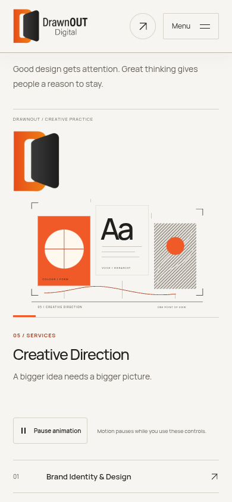 |

## Logo, wordmark and loop boundary

| View                    | 1440px                                                  | 390px                                                 |
| ----------------------- | ------------------------------------------------------- | ----------------------------------------------------- |
| Initial right-side logo | 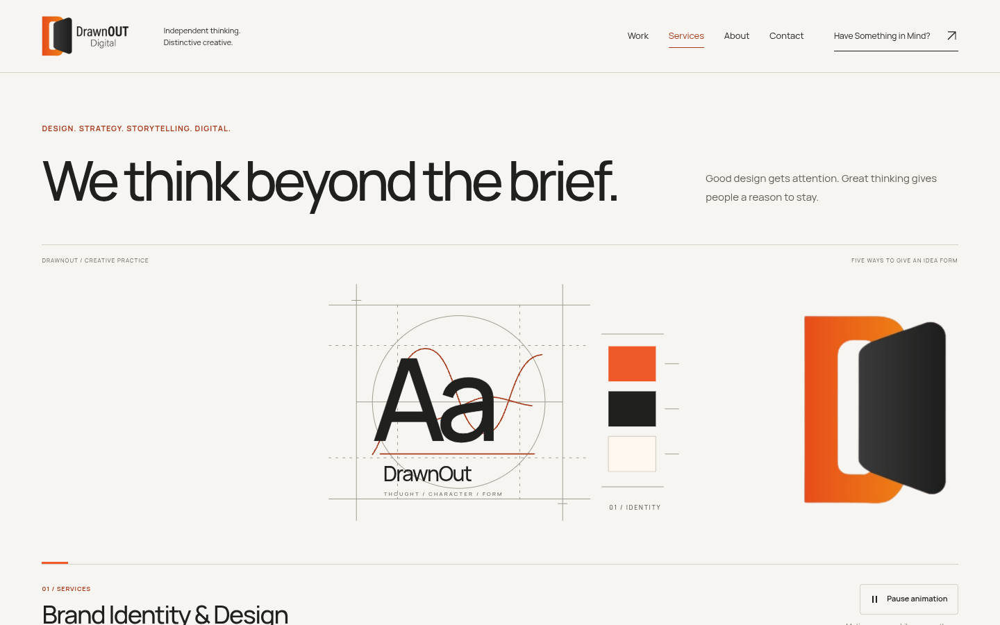               | 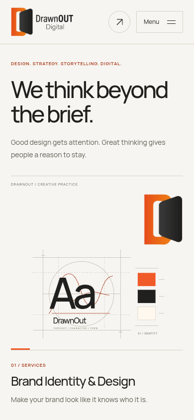               |
| Wordmark and return     | 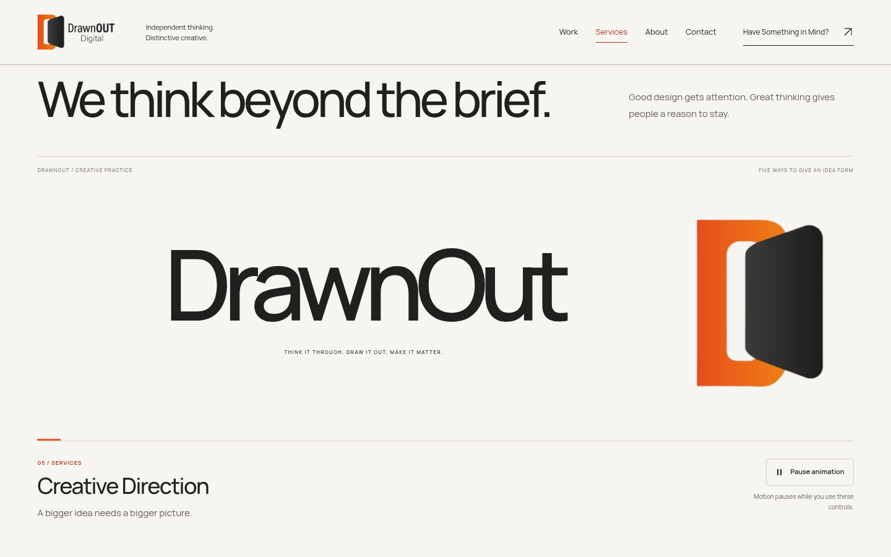         | 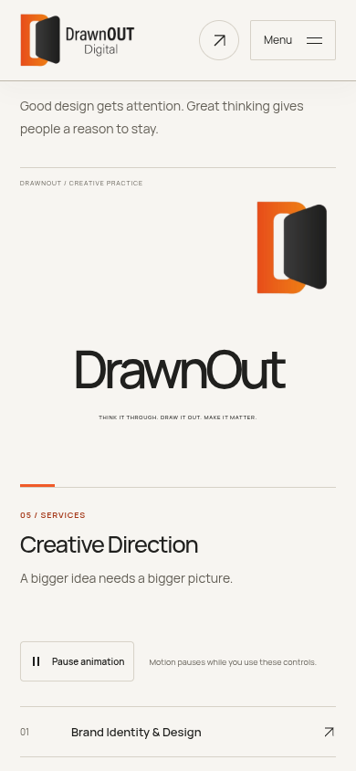         |
| Final right pose        | 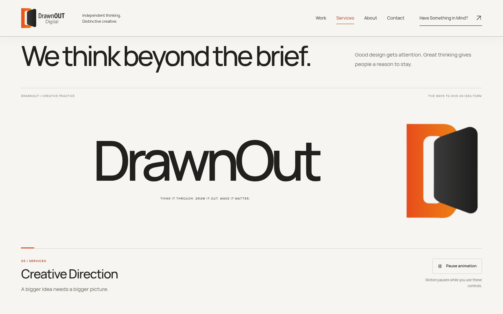             | 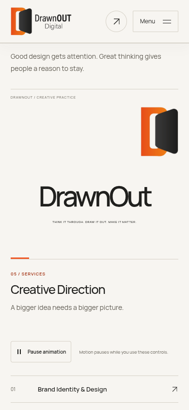             |
| Actual loop restart     | 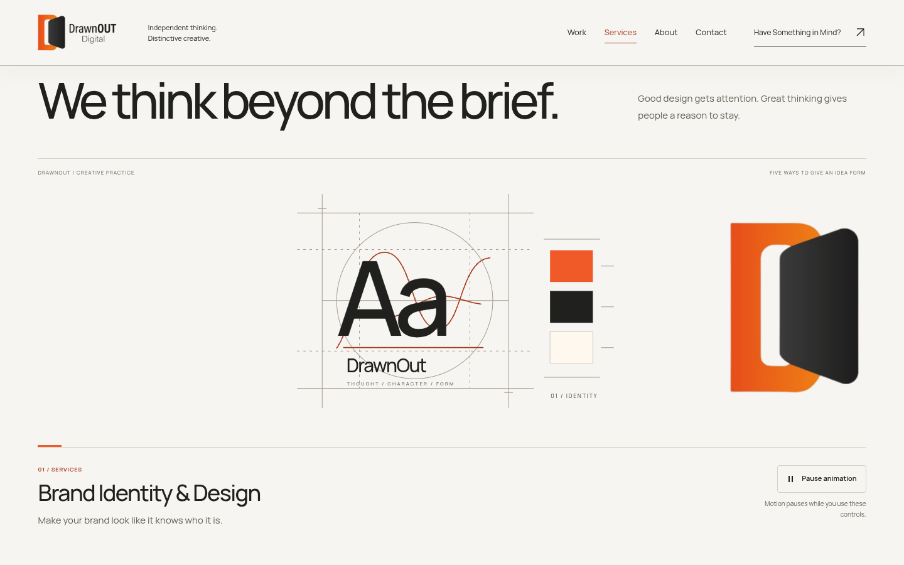 | 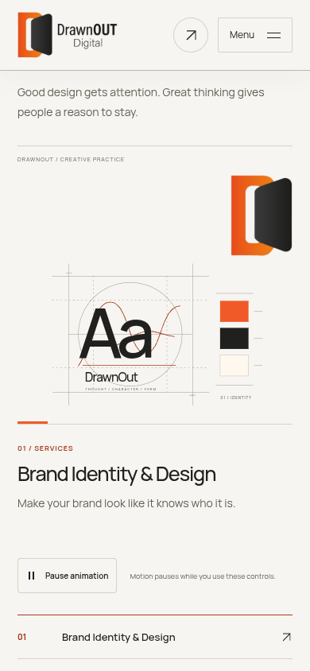 |

## Static fallbacks and preserved continuation

| Width  | Reduced motion                                                                  | No JavaScript                                                               |
| ------ | ------------------------------------------------------------------------------- | --------------------------------------------------------------------------- |
| 390px  | [Hero](services-390-reduced.png) · [Full page](services-390-full-reduced.png)   | [Hero](services-390-no-js.png) · [Full page](services-390-full-no-js.png)   |
| 768px  | [Hero](services-768-reduced.png) · [Full page](services-768-full-reduced.png)   | Not separately captured                                                     |
| 1440px | [Hero](services-1440-reduced.png) · [Full page](services-1440-full-reduced.png) | [Hero](services-1440-no-js.png) · [Full page](services-1440-full-no-js.png) |

The SVG stage is decorative; service names, official copy and direct links remain semantic page content. Native scrolling and keyboard controls remain available. Software-rendered Chromium evidence does not establish field performance on physical devices, Safari or Firefox. The rest of the Services experience is intentionally unchanged pending hero approval. No merge, deployment or Netlify repository push is performed by this capture.
