# Service pages — structure and editorial review

Actual screenshots from the local production build at 390px, 768px and 1440px. The shared Afterglow foundation preserves the supplied draft copy and uses native FAQ controls. Captures use the supported reduced-motion preference for stable readable evidence.

[Validation and editorial dependencies](../../docs/next-milestone/SERVICE_PAGE_VALIDATION.md) · [Implementation handoff](../../docs/next-milestone/SERVICE_PAGE_HANDOFF.md) · [Capture measurements](capture-evidence.json)

## 390px — shared introduction and FAQ

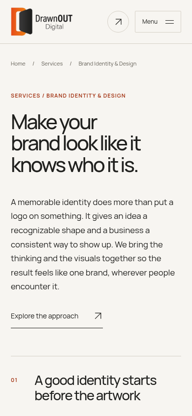

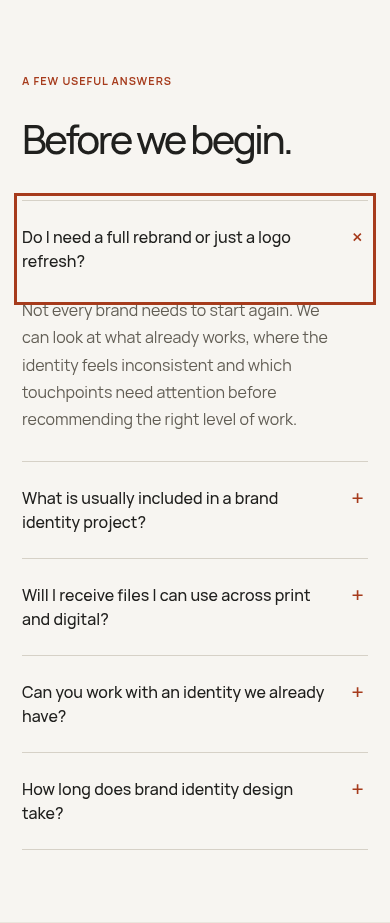

## 768px — shared introduction and FAQ

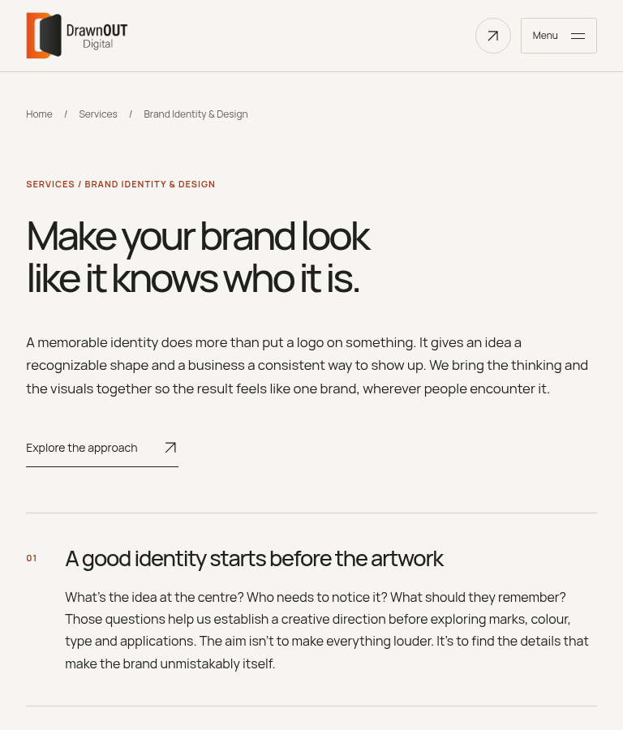

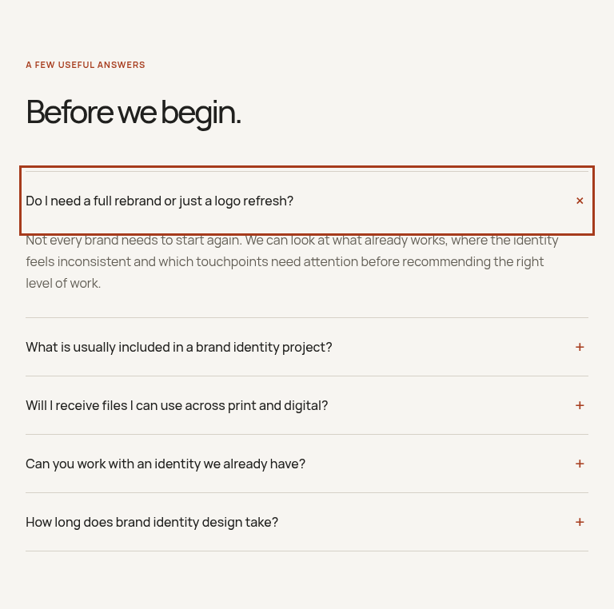

## 1440px — shared introduction and FAQ

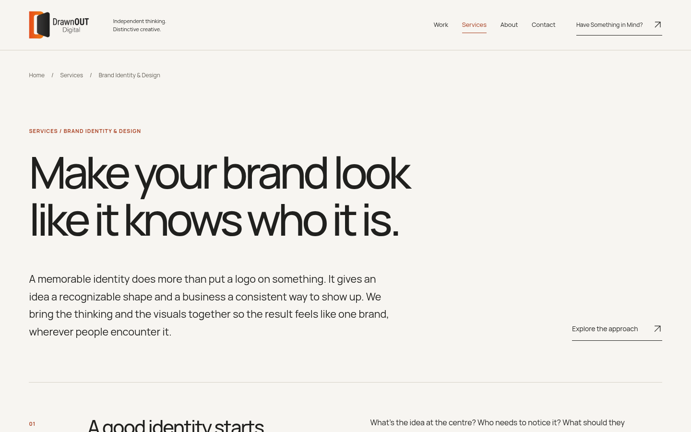

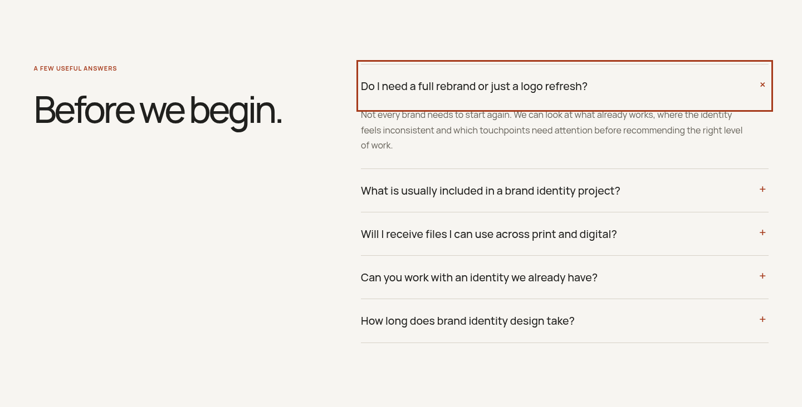

## Brand Identity & Design

### 390px

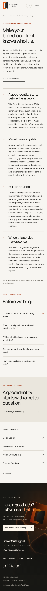

### 768px

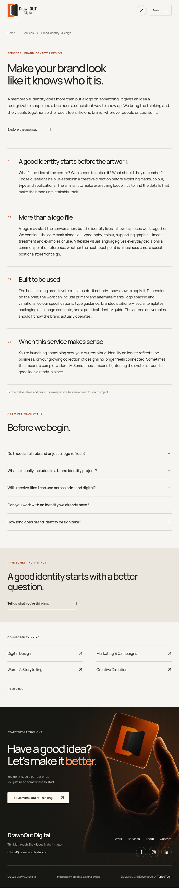

### 1440px

## Digital Design

### 390px

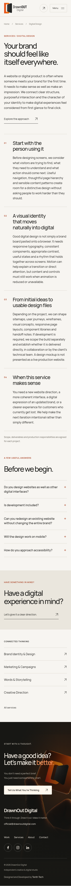

### 768px

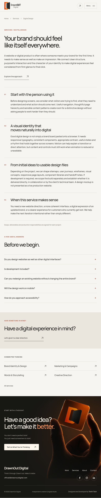

### 1440px

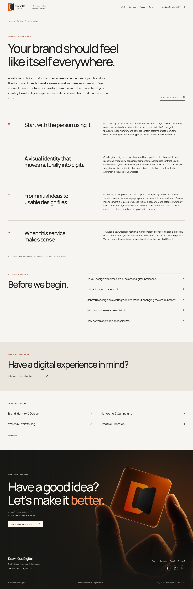

## Marketing & Campaigns

### 390px

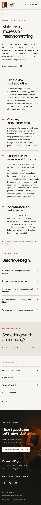

### 768px

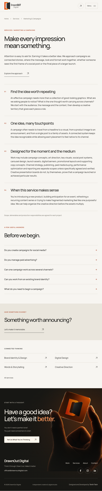

### 1440px

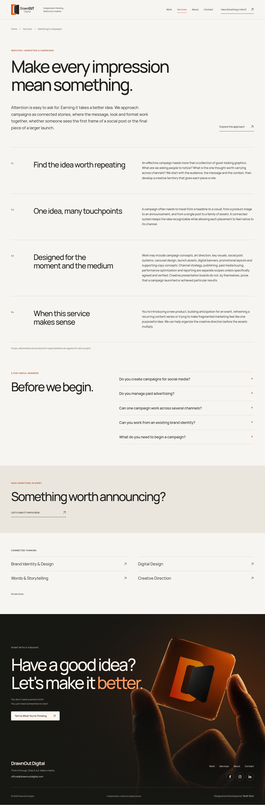

## Words & Storytelling

### 390px

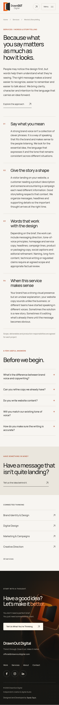

### 768px

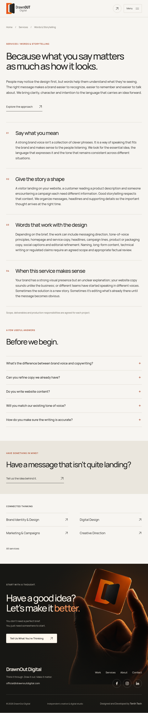

### 1440px

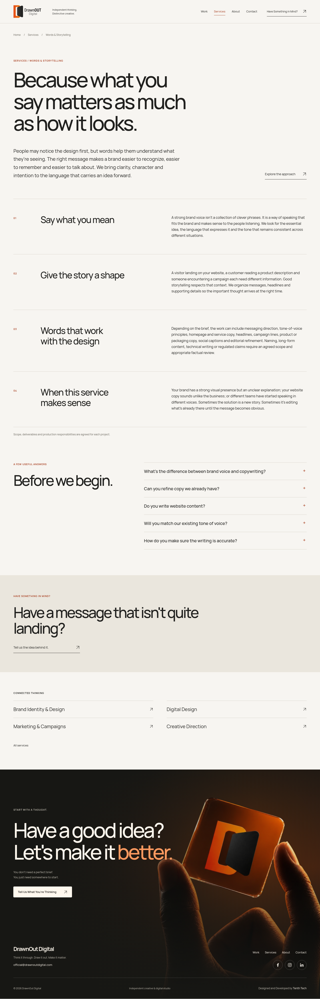

## Creative Direction

### 390px

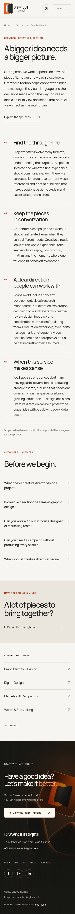

### 768px

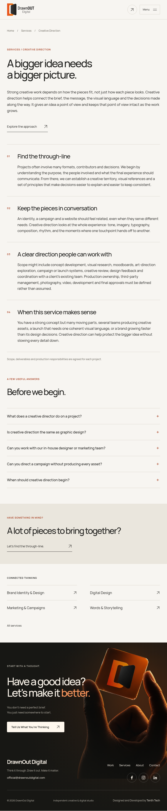

### 1440px

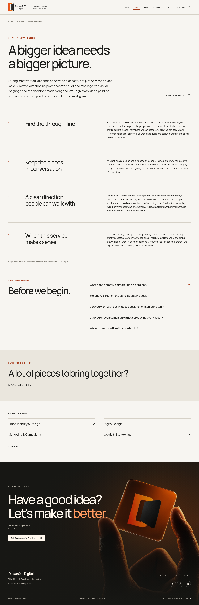

## Review boundary

Copy is an editorial draft. Service scope, delivery responsibilities, handover terms and any related-project attribution still require studio approval before public launch. These pages retain `noindex, nofollow`; no FAQ rich-result claim, pricing, testimonial or campaign result is added. No merge or deployment was performed.
