# Opening project squares — final polish review

[PR #4](https://github.com/tenthtech/drawnout-digital/pull/4) · [Client feedback](https://github.com/tenthtech/drawnout-digital/pull/4#issuecomment-6404192013) · [Validation and implementation notes](../../docs/PROJECT_SQUARES_VALIDATION.md)

The approved opening direction is preserved. Six larger project frames now reveal six distinct approved artworks as the wave arrives. SOL Community Center deliberately occupies the larger apex frame, using its actual green/yellow signage mockup with the complete branding visible.

The lower-left wordmark, separate hand/plaque movement, living Afterglow gradient and automatic five-second maximum transition are unchanged. The hand/plaque remains the documented **separated 2D prototype**, not finished photorealistic 3D. No merge or public deployment is included.

## Short opening recordings

These are complete timestamped Chromium recordings of the production build, including automatic handoff and the living gradient afterward. GIFs are smaller previews; MP4s retain the original viewport dimensions. The animation is observed in real time, never sought or frozen. Software WebGL capture is not a physical-device performance benchmark.

### Desktop — 1440 × 900

[Open full desktop recording](desktop-opening.mp4)

### Mobile — 390 × 844

[Open full mobile recording](mobile-opening.mp4)

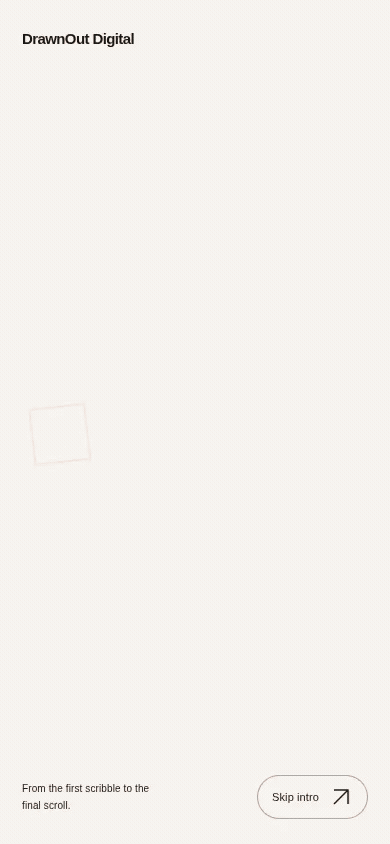

## Desktop — 1440px

### Outlined-square entrance

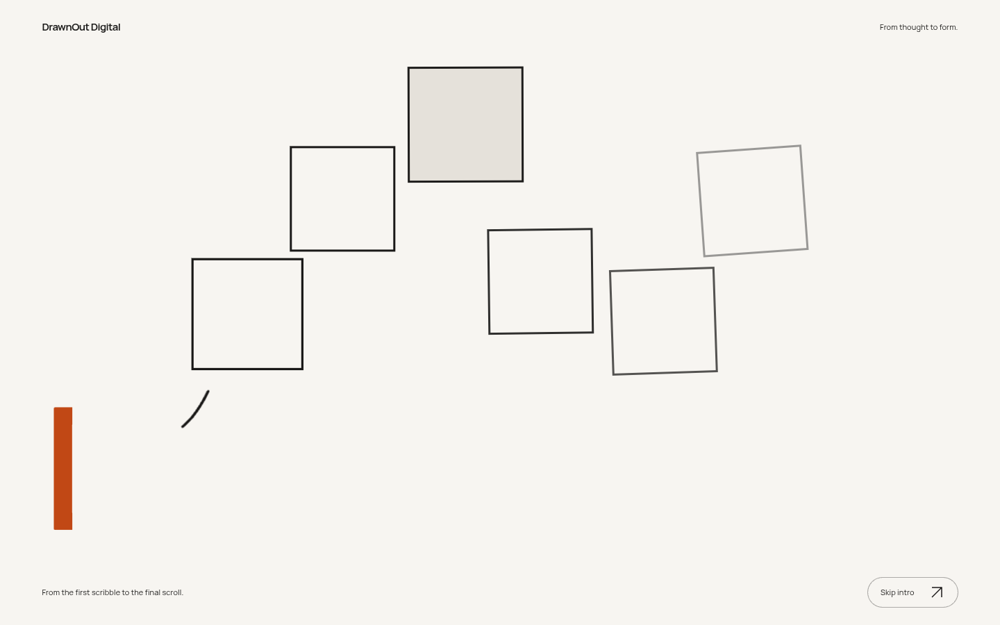

### Progressive artwork reveal

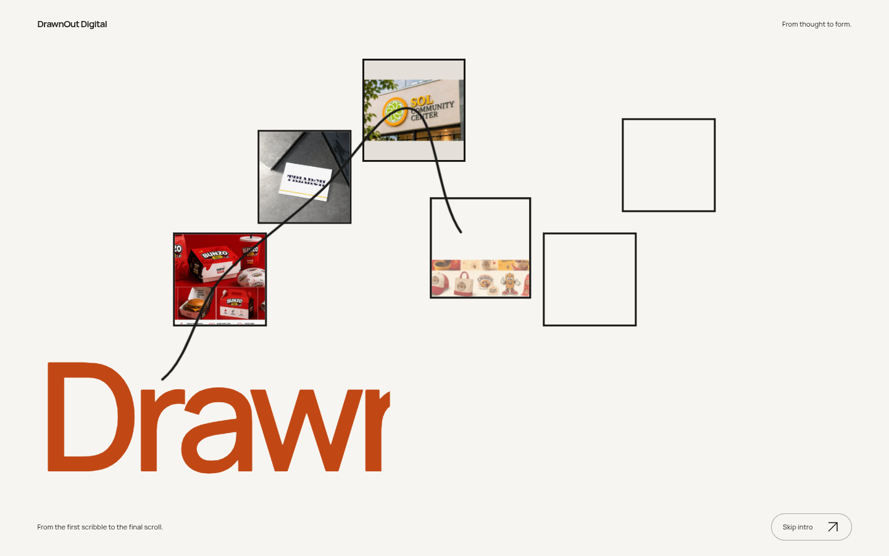

### All six artworks visible

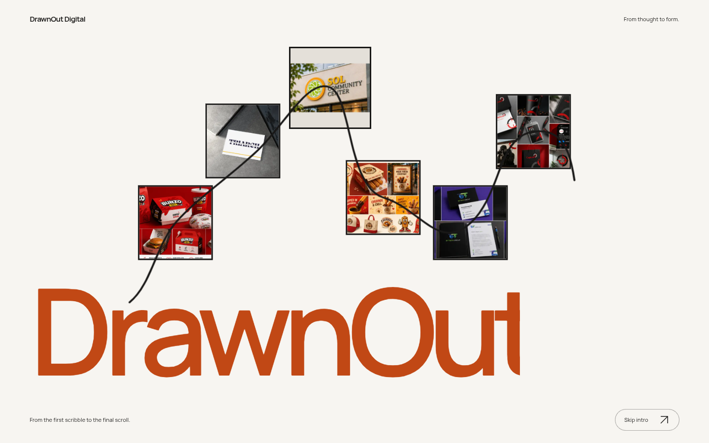

### Preserved final hand/plaque pose — 2D prototype

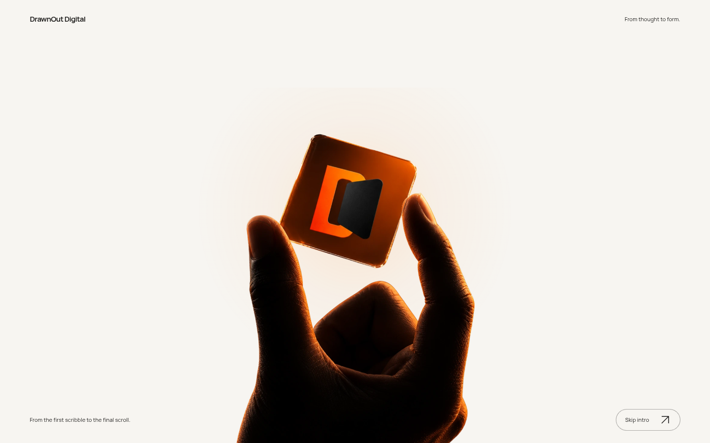

### Automatic Afterglow homepage handoff

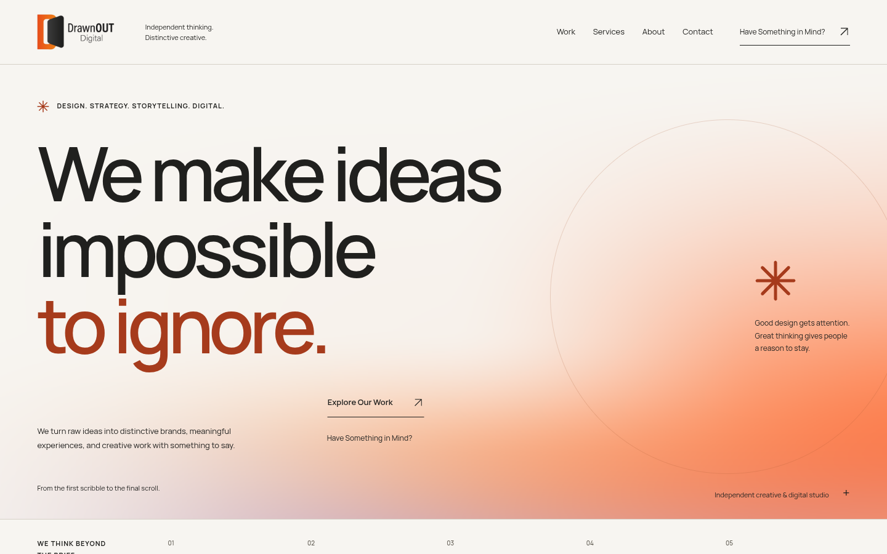

## Tablet — 768px

### Outlined-square entrance

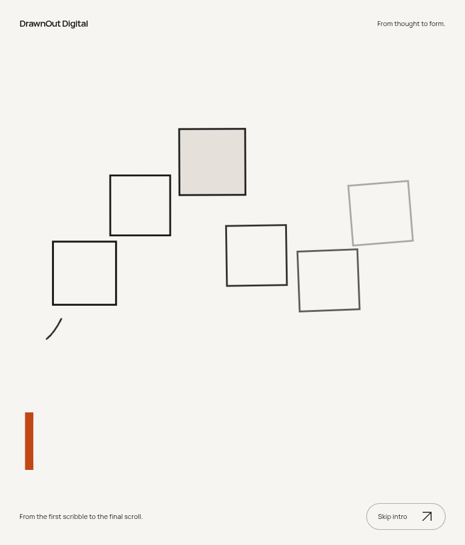

### Progressive artwork reveal

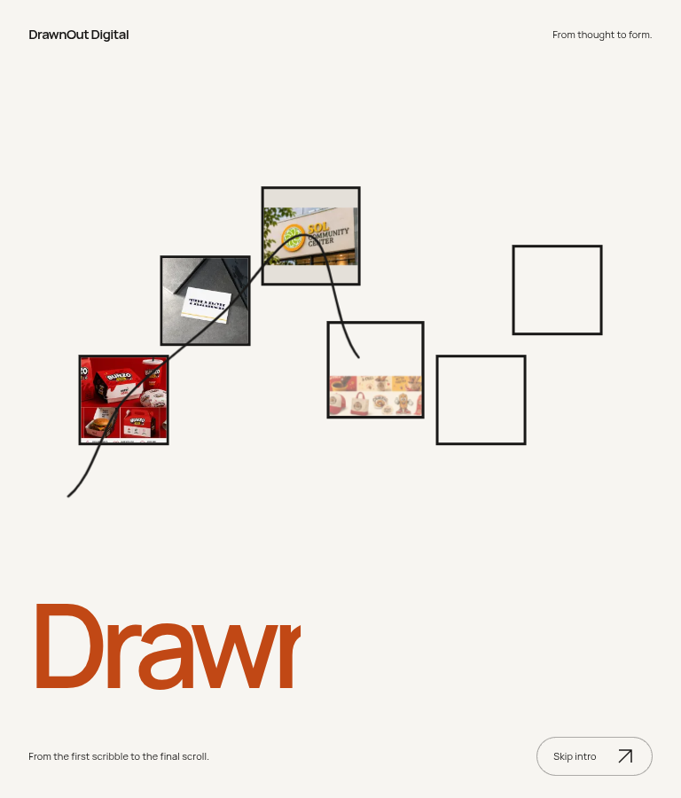

### All six artworks visible

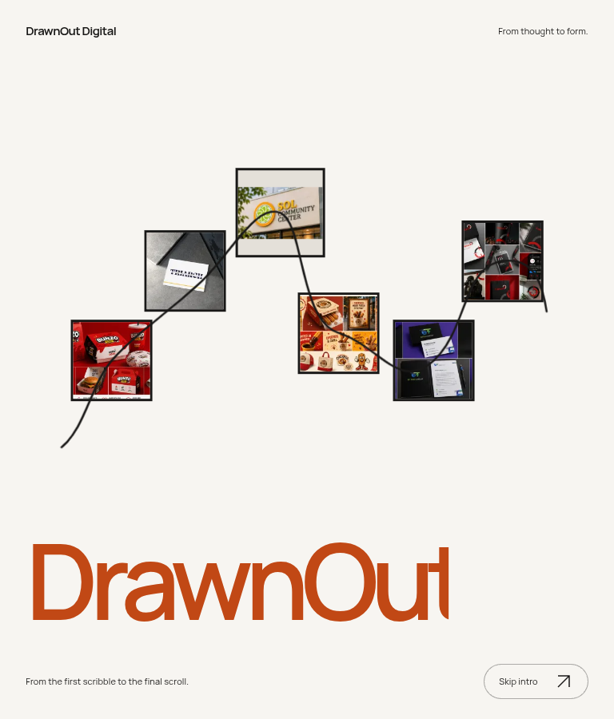

## Mobile — 390px

### Outlined-square entrance

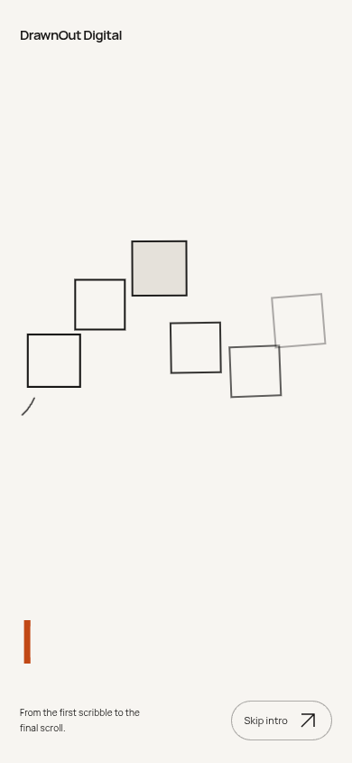

### Progressive artwork reveal

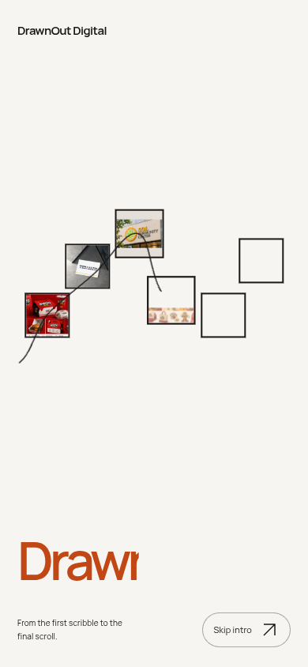

### All six artworks visible

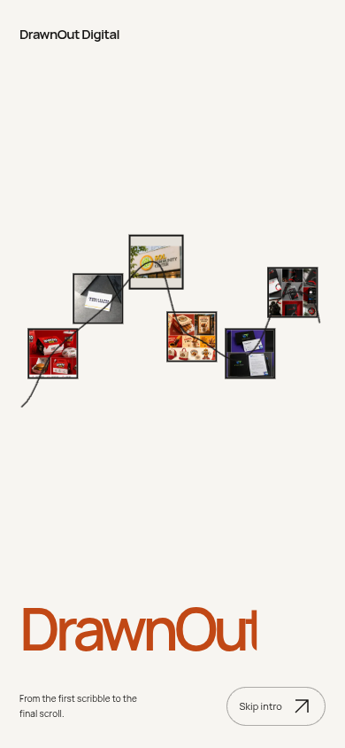

### Preserved final hand/plaque pose — 2D prototype

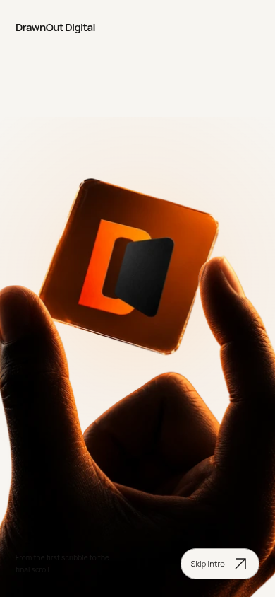

### Automatic Afterglow homepage handoff

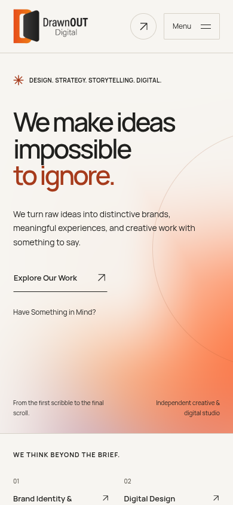

## Narrow mobile check — 320px

### Outlined-square entrance

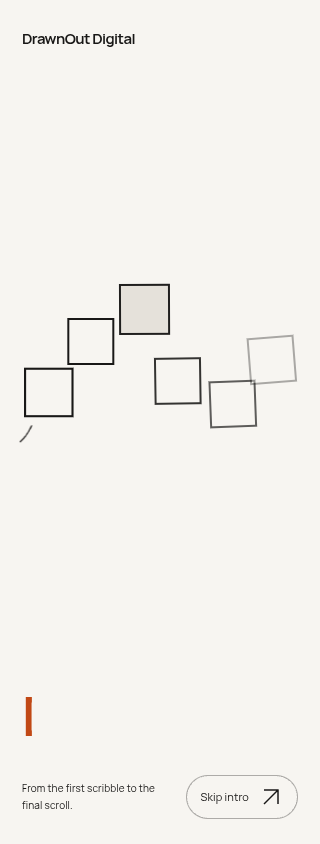

### Progressive artwork reveal

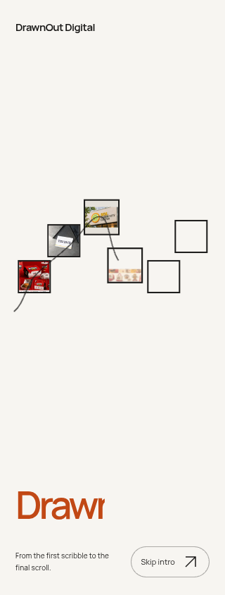

### All six artworks visible

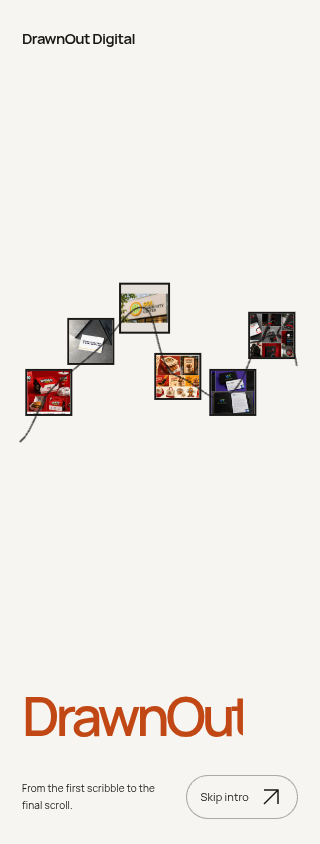

## Provenance and inspection data

Artworks, in wave order: Bunzo, Triarch, **SOL Community Center**, Churros, By Tech Group and Capture. Each is resolved from its actual approved content record; SOL uses `sol-community-signage.webp`. Publication/withdrawal controls still apply. No service, outcome, credit or commissioning claims were added.

The all-artwork stills capture the live instant when all six images are fully revealed, just before the wordmark completes its final wipe; the recordings show the finished wordmark. Full-resolution screenshots are retained.

- [Actual capture clocks, image URLs and layer transforms](square-evidence.json)
- [Complete browser results and geometric reveal measurements](browser-verification.json)
- [Decoded media dimensions and hashes](media-verification.json)
- [Relative gallery-link verification](gallery-link-verification.json)
- [Previously delivered full website recordings and choreography](../signature-opening/README.md)
- [Exact remaining 3D production requirements](../../docs/SIGNATURE_ASSET_PROCESS.md)
